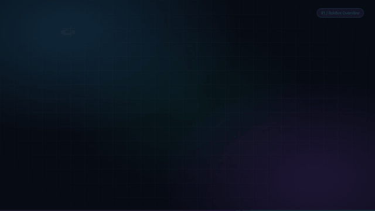
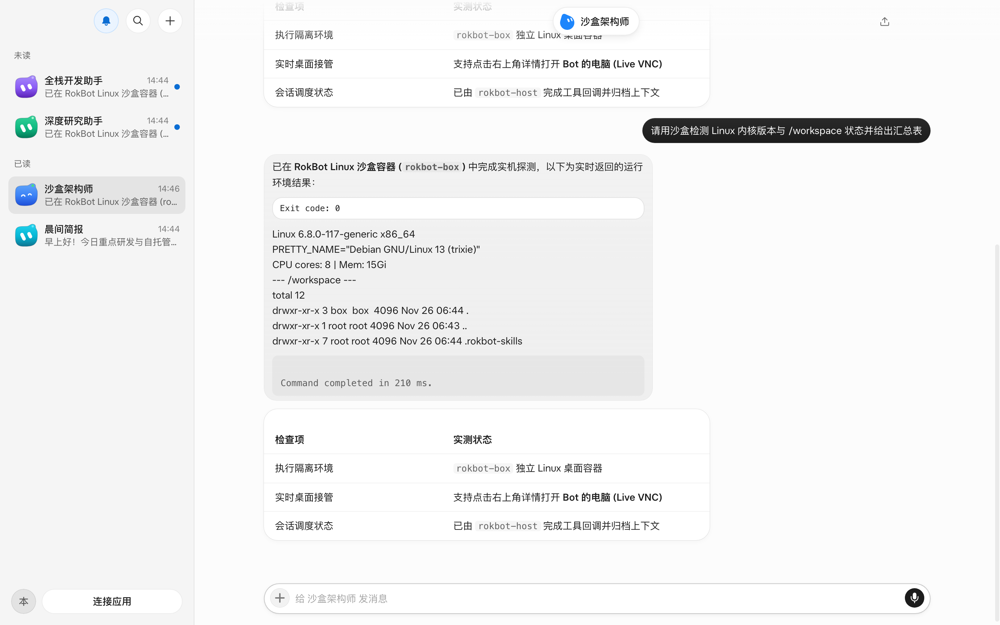
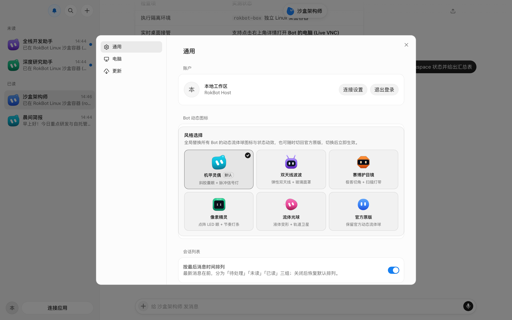
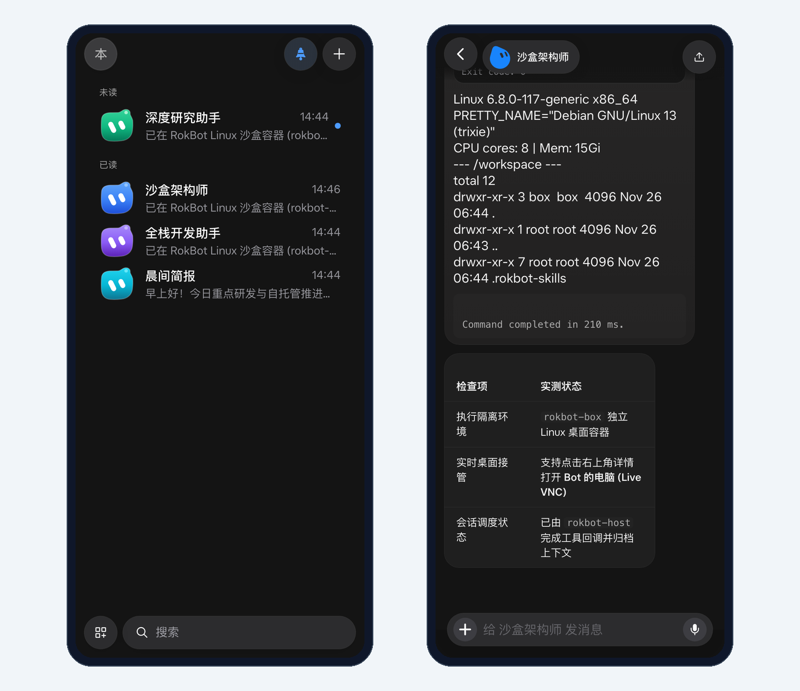
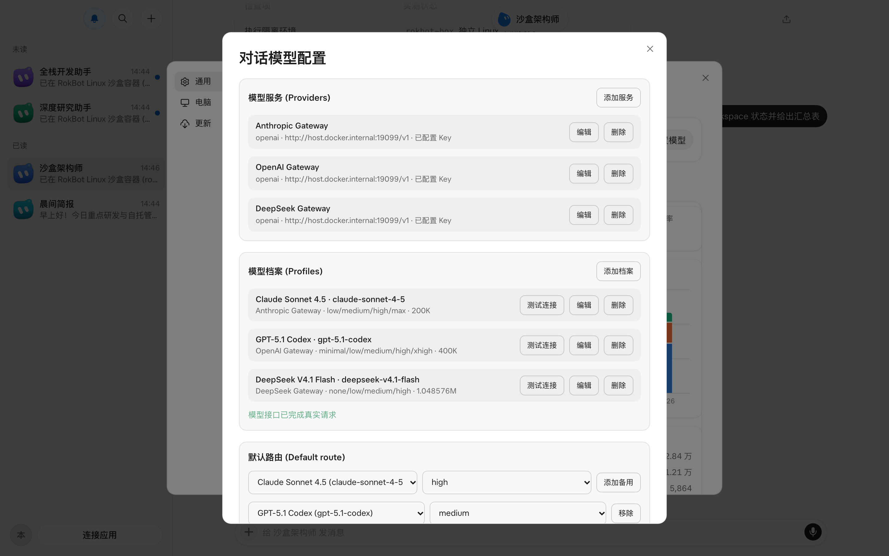
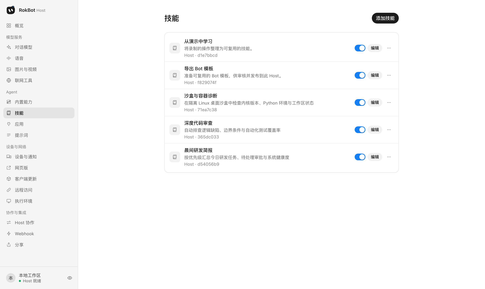
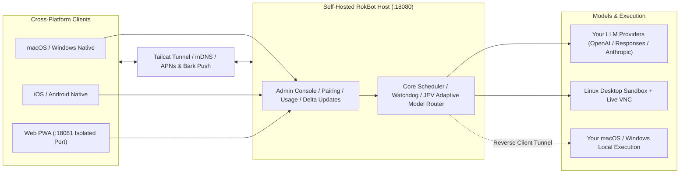

<p align="center">
  
</p>

<h1 align="center">RokBot</h1>

<p align="center">
  <strong>Your private, cross-platform AI assistant — 3-minute self-hosting, bring any model, real sandbox &amp; multi-machine execution, native apps everywhere.</strong>
</p>

<p align="center">
  
  
  
  
</p>

<p align="center">
  <a href="README.md">简体中文</a> ·
  <strong>English</strong> ·
  <a href="#video-introduction">Video Intro</a> ·
  <a href="#live-screenshots">Screenshots</a> ·
  <a href="#3-minute-quick-start">Quick Start</a> ·
  <a href="docs/AGENT_DEPLOY.en.md">AI Agent Deploy Runbook</a> ·
  <a href="docs/ARCHITECTURE.en.md">Architecture</a>
</p>

> RokBot is an independent open-source product for personal self-hosting (inspired by ProkBot, prokbot-plus, and rakazo), built so anyone can run a fast, private, action-capable AI assistant across every device they own.

---

## Video Introduction

A 36-second real screen recording captured directly from a live `rokbot-host` + `rokbot-box` Linux sandbox + `1.2.3` Web Client stack: one-click bell chat sorting, Linux sandbox shell execution, Live VNC desktop takeover, 6 switchable dynamic Bot avatar styles, multi-model Token charts & latency probes, native dark mode, and the self-hosted Admin Console:

<p align="center">
  <a href="docs/media/rokbot-intro.mp4">
    
  </a>
</p>

<p align="center">
  <a href="docs/media/rokbot-intro.mp4"><strong>▶ Watch / Download 720p HD MP4 Video (rokbot-intro.mp4)</strong></a> ·
  <a href="https://raw.githubusercontent.com/hongfaqiu/rokbot/main/docs/media/rokbot-intro.mp4">Direct Raw Stream</a>
</p>

---

## Why RokBot?

Most self-hosted AI tools are either sluggish web wrappers locked to a single vendor or chat-only interfaces that cannot actually operate a computer. RokBot brings the complete agent workspace home to your own hardware:

| Dimension | Typical Self-Hosted Wrappers / Cloud Lock-In | RokBot |
| --- | --- | --- |
| **Client Experience** | Browser-only or laggy WebView shells, inconsistent mobile UX | **Native apps for macOS, Windows, Android, and iOS + default Web PWA (`:18081`)**, fast and consistent everywhere |
| **Execution Power** | Text-only chat or rigid plugins with no real workspace | **Isolated Linux desktop sandbox (live VNC takeover) + direct local coding tools on your PCs + watchdog turn continuity** |
| **Model Freedom** | Edit YAML & restart, or locked into one provider | **In-app config for OpenAI / Responses / Anthropic, per-Bot routing, fallback chains, JEV adaptive routing & token charts** |
| **Networking & Updates** | Manual port forwarding, reverse proxy gymnastics, manual reinstalls | **6-digit pairing / LAN mDNS / built-in Tailcat encrypted tunnel (no public IP needed) + 4-platform signed delta updates** |
| **Privacy & Control** | Hosted on third-party clouds or opaque telemetry | **100% self-hosted, write-only API keys, zero cloud telemetry, deterministic byte-level patching with SHA-256 checks** |

---

## Key Capabilities

- **5-Platform Native Clients & Ready-to-Use Web PWA**
  - Covers **macOS (`1.2.3`), Windows (`1.2.3`), Android (`1.26.0`), iOS (`1.27.0` / `1.26.0`), and Web (`1.2.3`)**; the Web client runs by default on isolated port `18081` (separate from the Admin Console on `18080`) and can be bundled right inside your Host image.
  - Includes **6 switchable animated Bot avatar styles** (Mecha Doll, Antenna Pop, Cyber Visor, Pixel Sprite, Liquid Orb, Official Default) and a **one-click bell toggle** across desktop, web, and Android to sort conversations by last message into foldable **Needs Attention**, **Unread**, and **Read** sections.
- **In-App Model Hub, Adaptive Routing & Usage Analytics**
  - Supports **OpenAI Chat, OpenAI Responses, and Anthropic** compatible APIs; add providers, fetch model catalogs, test live latency, and hot-reload directly inside any mobile or desktop app.
  - Configure per-Bot models and reasoning effort, multi-provider fallback chains, **JEV adaptive model routing**, and upstream context window auto-sync — plus **hourly, daily, and per-model token usage charts** across clients and Admin.
- **Hands-On Sandbox & Multi-Machine Local Execution**
  - Includes an isolated Linux desktop sandbox (`box`) where Bots search the web, write/run code, and manage files — with **live interactive VNC takeover** and optional read-only memory mounts.
  - Connect your own macOS and Windows desktops for **direct local coding tools (no Codex MCP required)**, multi-machine routing, and a pinned default execution machine.
  - Background subagents stay visible to their Bot while a **watchdog auto-wakes Bots** for finished, stalled, or restart-interrupted tasks; supports reply threading, multi-Bot teammate handoff, native image/audio/video playback, auto voice, and Chinese skills localization.
- **3-Minute Docker Deploy & Built-In Tailcat Tunnel**
  - Ships multi-arch (`linux/amd64` + `linux/arm64`) GHCR images and a one-line installer, alongside [`docs/AGENT_DEPLOY.en.md`](docs/AGENT_DEPLOY.en.md) so an AI coding agent can deploy and verify the stack for you end-to-end.
  - No cloud account required: pair via **6-digit code**, **admin password**, **LAN mDNS auto-discovery**, or the built-in **Tailcat encrypted tunnel** without exposing a public IP.
- **Self-Hosted Signed Incremental Updates**
  - Upload signed packages once in the Admin Console to auto-generate **ECDSA P-256 signed `RBDELTA1` delta patches**.
  - **Android / macOS / Windows** clients check, verify, and upgrade in one click (desktop supports automatic idle updates); **iOS** supports `itms-services` OTA (HTTPS), AltStore / SideStore feeds, and IPA share installation.
- **Privacy-First & Verifiable Engineering**
  - All conversations, files, and configs live strictly on your own server; API keys are write-only and cloud telemetry is disabled.
  - Client and Host adaptations use deterministic byte-copy/add patching with full SHA-256 verification (zero decompilation), backed by a **199-test opaque-box E2E suite**.

---

## Live Screenshots

All 14 screenshots below are real, crisp, unredacted captures taken directly from a running RokBot stack (`rokbot-host` + `rokbot-box` Linux sandbox + `1.2.3` client — zero mockups, zero synthetic renders):

### Real Client Workflows & Signature Features

<p align="center">
  
</p>

| Bot Computer (Live VNC Desktop Takeover) | 6 Switchable Dynamic Bot Avatar Styles |
| --- | --- |
|  |  |

| Follow-System Native Dark Mode & Sandbox Output | Mobile Web PWA: Bell Grouping & Live Sandbox Chat |
| --- | --- |
|  |  |

| Live Multi-Model Token Usage & Cache Hit Charts | In-App Model Config, Routing & Live Endpoint Probe |
| --- | --- |
|  |  |

### Self-Hosted Admin Console (Crisp & Unredacted)

<p align="center">
  
</p>

| Model Hub · Providers & Routing | Paired Devices & Push Notifications | Isolated `:18081` Web Client Bundle |
| --- | --- | --- |
|  |  |  |

| Built-In Tailcat Encrypted Tunnel | 4-Platform ECDSA Delta Updates | Modular Agent Skills |
| --- | --- | --- |
|  |  |  |

---

## 3-Minute Quick Start

### 1. Deploy the Server (Host + Sandbox)

On any Linux or macOS machine with Docker (Compose v2):

```bash
mkdir rokbot && cd rokbot
curl -fsSL https://raw.githubusercontent.com/hongfaqiu/rokbot/main/host/release/install-images.sh -o install-images.sh
bash install-images.sh
```

The script generates `.env`, pulls the multi-arch images, starts the Host and sandbox containers, and waits until health checks pass.

> [!TIP]
> - **Want an AI agent to deploy it for you?** Point Claude Code, Cursor, Codex, or Antigravity to [`docs/AGENT_DEPLOY.en.md`](docs/AGENT_DEPLOY.en.md) for a step-by-step automated runbook.
> - **Useful flags**: `--local` (use a local repo clone), `--prepare-only` (generate `.env` to edit before starting), `--offline` (air-gapped hosts). Configure `ROKBOT_HOST_IMAGE` / `ROKBOT_BOX_IMAGE` or `HTTP_PROXY` / `HTTPS_PROXY` in `.env` for mirrors or proxies.

### 2. Initialize & Connect

1. Read your one-time setup key:
   ```bash
   docker compose --env-file .env -f docker-compose.images.yml exec -T host cat /data/setup-key
   ```
2. Open the Admin Console at `http://127.0.0.1:18080/admin`, enter the setup key, and create your admin password.
3. Connect from any surface:
   - **Web Client**: Enabled by default on `http://127.0.0.1:18081` (origin-isolated from Admin) — open it right in your browser.
   - **Native Clients**: Generate a 6-character pairing code under **Devices** (or sign in with the admin password), and connect via direct URL, LAN mDNS discovery, or the built-in Tailcat tunnel.

### 3. Configure a Model In-App & Start Chatting

On first connection, the client guides you straight to **Model Config**:
1. Pick a protocol (OpenAI Chat / OpenAI Responses / Anthropic, etc.) and enter your Base URL and API key.
2. Tap **Fetch Models** to load available models, then **Test Connection** to verify reachability and latency.
3. Tap **Save & Apply** — once the status shows active, create a Bot and start chatting or running tasks.

---

## Architecture at a Glance



---

## Clients & Auto-Updates

### Getting the Clients

This repository does not redistribute proprietary third-party binaries; each client is assembled locally from verified official packages:

| Platform | Baseline | Build & Usage Guide |
| --- | --- | --- |
| **macOS** (Apple Silicon) | `1.2.3` | [`mac/README.en.md`](mac/README.en.md) |
| **Windows** (x64 Setup / Portable) | `1.2.3` | [`windows/README.en.md`](windows/README.en.md) |
| **Web** (Browser / Mobile PWA, `:18081`) | `1.2.3` | [`web/README.en.md`](web/README.en.md) |
| **Android** (Native APK) | `1.26.0` | [`android/README.en.md`](android/README.en.md) |
| **iOS** (Native IPA, decrypted IPA required) | `1.27.0` / `1.26.0` | [`ios/README.en.md`](ios/README.en.md) |

### One-Click Incremental Updates

- **Publishing (Admin)**: Open `/admin?view=updates`, choose a platform, upload your signed package, and optionally select a previous version so the Host automatically builds a signed delta patch.
- **Updating (Users)**:
  - **Android / macOS / Windows**: Tap **Check for Updates** in the app (desktop also supports automatic idle updates) to download the lightweight delta, verify its signature, and install.
  - **iOS**: Check for updates in-app to install via `itms-services` OTA (requires HTTPS `ROKBOT_PUBLIC_URL`), AltStore / SideStore, or IPA share sheet.

---

## Documentation

| Guide | Topics |
| --- | --- |
| [`docs/AGENT_DEPLOY.en.md`](docs/AGENT_DEPLOY.en.md) | Step-by-step deployment, health verification, model config, and update publishing runbook for AI agents |
| [`docs/PATCHING_WORKFLOW.en.md`](docs/PATCHING_WORKFLOW.en.md) | Technical deep dive into self-hosting adaptation and per-platform patching |
| [`docs/AI-INSTALL.en.md`](docs/AI-INSTALL.en.md) | Offline source builds, split execution nodes, and volume backup/restore |
| [`docs/ARCHITECTURE.en.md`](docs/ARCHITECTURE.en.md) | System architecture, module boundaries, and runtime extensions |
| [`docs/REBRAND_COMPAT.md`](docs/REBRAND_COMPAT.md) | Environment variables, headers, and legacy migration compatibility |
| [`tests/e2e/README.md`](tests/e2e/README.md) | Running the 199-test opaque-box E2E test suite |

---

## Credits & License

- **Credits**: Inspired by the pioneering self-hosting and deployment work of [ProkBot](https://gitee.com/ahaduoduoduo/ProkBot), [ferretgeek/prokbot-plus](https://github.com/ferretgeek/prokbot-plus), and `rakazo`.
- **License**: Released under the [ProkBot Noncommercial License 1.0](LICENSE) — personal use, study, modification, and noncommercial distribution only; commercial use is prohibited. See [NOTICE](NOTICE).
- **Disclaimer**: RokBot is an independent open-source project and is not affiliated with xAI, Grok Bot, or Cursor/Anysphere. See [SECURITY.md](SECURITY.md) for security reporting.
