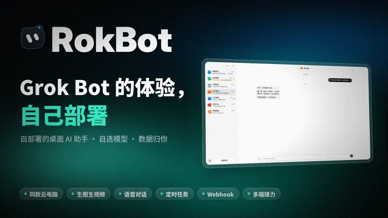
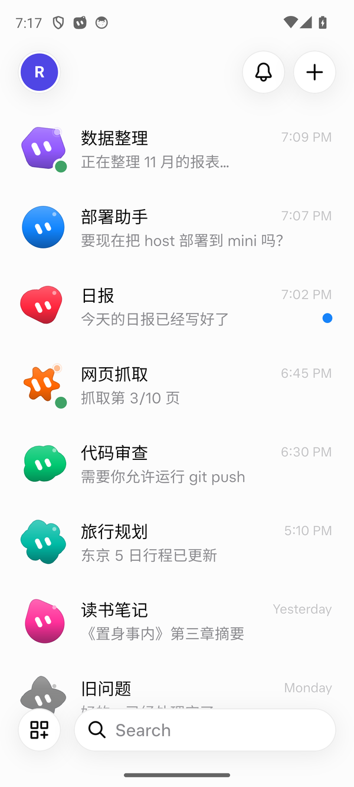
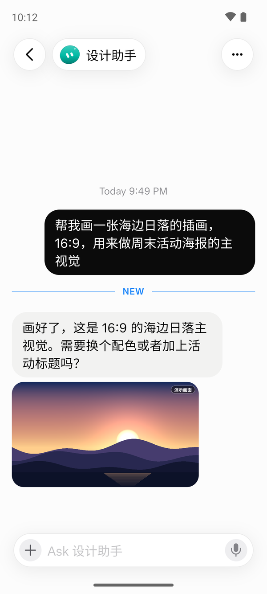
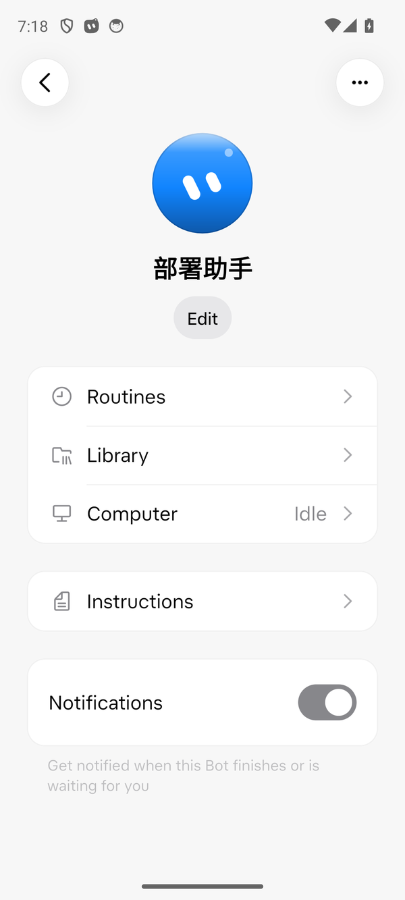
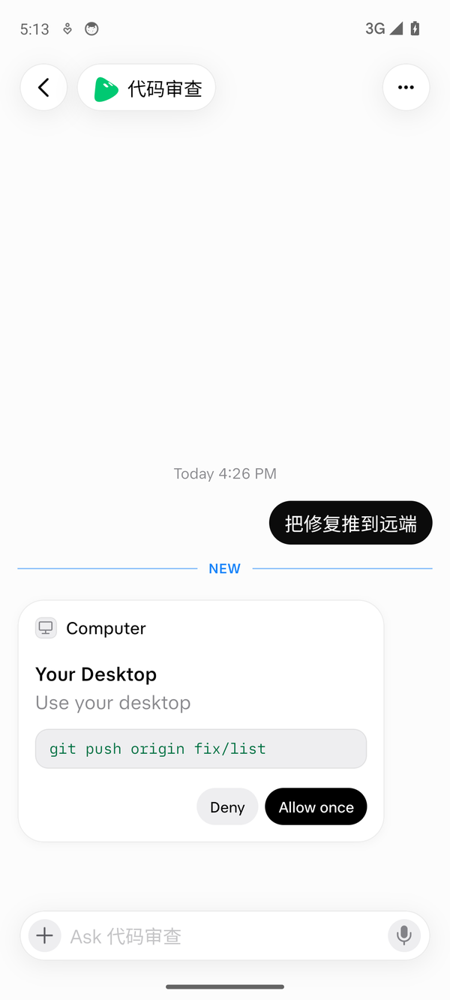

<p align="center">
  
</p>

<h1 align="center">RokBot</h1>

<p align="center">
  A private AI assistant running on your own server: bring your own models, keep your data local, and hand off seamlessly across native desktop, mobile and web clients.
</p>

<p align="center">
  <a href="LICENSE"></a>
  <a href="docs/clients.en.md"></a>
  <a href="#quick-start"></a>
</p>

<p align="center">
  <a href="docs/media/rokbot-promo.mp4">
    
  </a>
  <br />
  <sub><a href="docs/media/rokbot-promo.mp4">Watch the full promo video (80 seconds, with narration; in Chinese)</a></sub>
</p>

<!-- 用户可在 GitHub 网页编辑器中把 mp4 拖入此处，生成 user-attachments 链接后即可内嵌播放 -->

<div align="center">

<table>
  <tr>
    <td align="center"><br /><sub>Bot list</sub></td>
    <td align="center"><br /><sub>Chat and image generation</sub></td>
    <td align="center"><br /><sub>The Bot's computer and routines</sub></td>
    <td align="center"><br /><sub>Approval card</sub></td>
  </tr>
</table>

<sub>More Android, desktop and admin console screenshots in <a href="docs/screenshots.en.md">Screenshots</a></sub>

</div>

<p align="center">
  <a href="README.md">简体中文</a> ·
  <strong>English</strong> ·
  <a href="#how-rokbot-differs-from-upstream">Upstream Comparison</a> ·
  <a href="#why-rokbot">Why RokBot</a> ·
  <a href="#whats-new">What's New</a> ·
  <a href="#quick-start">Quick Start</a> ·
  <a href="#documentation">Documentation</a>
</p>

## How RokBot Differs from Upstream

RokBot is a self-hosted remake based on official Grok Bot, derived from upstream open-source projects [ProkBot](https://gitee.com/ahaduoduoduo/ProkBot) and [ferretgeek/prokbot-plus](https://github.com/ferretgeek/prokbot-plus) (see [NOTICE](NOTICE)).

| Area | Official Grok Bot | ProkBot | prokbot-plus | RokBot |
| --- | --- | --- | --- | --- |
| Hosting & data | Official cloud, cloud account required | Self-hosted Docker, data stays local | Self-hosted Docker with ARM64 and backup/recovery | Self-hosted Docker + GHCR prebuilt images one-script deploy, plus offline & source builds |
| Models & routing | Official models only | Bring your own model (OpenAI Chat focus) | OpenAI Chat / Responses / Anthropic, per-Bot routes & fallbacks | Adds 6 per-scenario model routes + Android per-Bot details picker, up to 8 fallbacks per route |
| Android client | Official native app (cloud-bound) | Legacy WebView wrapper | Legacy WebView wrapper | Native React Native + Hermes patcher (16 KB aligned, 6 native modal screens, system share) |
| Desktop & web | Official desktop (no self-hosted web) | macOS + iOS | Adds Windows (1.1.0/0.71.2) and web client | Desktop & web upgraded to 1.3.0 baseline, adds Linux x64/arm64 desktop, decoupled web client |
| Recent UX enhancements | Official cloud behavior | Core chat & cloud desktop | Web client, app catalog, webhooks, usage stats | Contextual input suggestions, batch image download (desktop/web/Android gallery), Android native group creation |
| Privacy & delivery | Official cloud account & telemetry | Local pairing, telemetry disabled | Local pairing, telemetry disabled | Telemetry off everywhere, write-only API keys, built-in Tailcat zero-account tunnel & delta client updates |

## Why RokBot

- **Fully self-hosted, your data stays on your machine:** the agent server (Host) and the Linux execution desktop (`box`) run in Docker on your own hardware. Conversations, files, settings and API keys live on local data volumes; API keys are write-only, and telemetry and crash reporting are disabled across the Host and all clients.
- **Bring your own models with granular routing:** supports OpenAI Chat Completions, OpenAI Responses and Anthropic Messages APIs. Configure a default route, per-Bot routes, and 6 dedicated scenario routes with up to 8 automatic fallbacks per route — never switching mid-response once output starts.
- **Full cross-platform client coverage:** native desktop apps for macOS, Windows and Linux, a native patched Android APK (replacing the legacy WebView shell), an iOS IPA, and a fully decoupled web client. Every client connects to your single Host for seamless handoff.
- **Built-in execution desktop plus safe control of your own PC:** ships with a Linux desktop container with live VNC takeover (or a remote Linux execution node), and can also work on your own Mac (shell + GUI) or Windows (local commands) over outbound client connections without opening ports.
- **No cloud account and zero-config remote access:** sign in with a single-use 6-digit pairing code or admin password. Connect over LAN IP (with Android LAN scan) or remotely via the built-in Tailcat encrypted network (no Tailscale account needed), Tailscale, or an HTTPS reverse proxy.
- **Complete automation, media and safety guardrails:** local cron scheduler, HMAC-SHA256 webhooks, image/video generation and voice calls, per-model token usage charts, and model-based auto-review with native approval cards.

See [docs/features.en.md](docs/features.en.md) for the full feature breakdown and [docs/architecture-overview.en.md](docs/architecture-overview.en.md) for the architecture overview.

## What's New

Highlights from the latest release (see [2026-11-27 release notes](docs/releases/2026-11-27.md), in Chinese):

- **Desktop and web upgraded to 1.3.0:** macOS, Windows and web default to the official 1.3.0 baseline while keeping all RokBot self-hosted capabilities, with `1.2.3` / `0.71.2` fallback builds still supported.
- **New Linux desktop client:** supports Linux x64 (`amd64`) and arm64 (`aarch64`), building `.deb`, `.tar.gz` and portable directories cross-platform on Linux or macOS, with built-in Tailcat and delta updates.
- **Per-scenario model routing:** assign separate model profiles and reasoning effort in the admin console or Android Model Settings for 6 scenarios — Input suggestions, Context summarization, Memory extraction, Auto-review, Subagents and Automations (unset scenarios inherit the default route).
- **Contextual input suggestions:** web and Android display tappable prompt suggestions above the composer powered by the Input suggestions scenario model, falling back to built-in Chinese/English presets when unconfigured or on failure.
- **Multi-select batch image download:** save selected images to a folder or ZIP on Desktop, download as ZIP on Web, or batch-save straight to the gallery (`Pictures/RokBot`) in the Android native viewer.
- **Android per-Bot model picker and native group chat creation:** assign a dedicated model right from an individual Bot's details page, and tap `+` in the chat list to open a native bottom sheet for creating a new Bot or a multi-Bot group chat.

## Quick Start

On a Linux or macOS server with Docker (including Compose v2), get running in 3 steps:

1. **Sign in to GHCR, clone the repo and start the stack** (access required for the private repo and prebuilt images):

   ```bash
   echo "$GHCR_TOKEN" | docker login ghcr.io -u <GitHub username> --password-stdin
   gh repo clone hongfaqiu/rokbot rokbot-src
   mkdir rokbot && cd rokbot
   bash ../rokbot-src/host/release/install-images.sh --local
   ```

2. **Initialize the admin console and configure a model:**

   ```bash
   docker compose --env-file .env -f docker-compose.images.yml exec -T host cat /data/setup-key
   ```

   Open `http://127.0.0.1:18080/admin`, enter the setup key and set an admin password, then add a model service, create a model profile and set the default route under Chat model.

3. **Get and pair a client:** this repository does not distribute prebuilt client installers. Build a client yourself or obtain it from your Host following [Getting the Clients](docs/clients.en.md), then pair using a 6-digit code from the admin console.

For full options, offline installs, source builds and AI-assisted deployment, see: [Deployment Guide](docs/deployment.en.md) · [AI Agent Deploy Runbook](docs/AGENT_DEPLOY.en.md) · [Operations & Backup](docs/AI-INSTALL.en.md).

## Documentation

| Document | Contents |
| --- | --- |
| [docs/features.en.md](docs/features.en.md) | Complete feature guide (Bot computer, routing, media, voice, automation, networking & privacy) |
| [docs/screenshots.en.md](docs/screenshots.en.md) | Full screenshot gallery (Android, desktop and admin console) |
| [docs/deployment.en.md](docs/deployment.en.md) | Detailed deployment steps, script flags, initialization and model setup |
| [docs/clients.en.md](docs/clients.en.md) | Supported platforms matrix, per-platform build commands and Host delta updates |
| [docs/architecture-overview.en.md](docs/architecture-overview.en.md) | Architecture overview and component diagram |
| [docs/faq.en.md](docs/faq.en.md) | Frequently asked questions and distribution/compliance notes |
| [docs/releases/2026-11-27.md](docs/releases/2026-11-27.md) | 2026-11-27 release notes (Chinese) |
| [docs/AGENT_DEPLOY.en.md](docs/AGENT_DEPLOY.en.md) | Runbook for AI coding agents: preflight checks, deployments, releases and troubleshooting |
| [docs/AI-INSTALL.en.md](docs/AI-INSTALL.en.md) | Deploying with `host/deploy.py`: machine sizing, split deployment, operations and volume backup/recovery |
| [docs/ARCHITECTURE.en.md](docs/ARCHITECTURE.en.md) | Full technical design, feature comparison, component internals and directory layout |
| [docs/PATCHING_WORKFLOW.en.md](docs/PATCHING_WORKFLOW.en.md) | Per-platform patch baselines and maintenance workflow |
| [docs/REBRAND_COMPAT.md](docs/REBRAND_COMPAT.md) | Rename registry: environment variables, interface identifiers and migration bridges |
| [tests/e2e/README.md](tests/e2e/README.md) | How to run the black-box end-to-end test suite |
| [SECURITY.md](SECURITY.md) | Vulnerability reporting and deployment security advice |

## License & Credits

RokBot is licensed under the [ProkBot Noncommercial License 1.0](LICENSE) (personal use, self-hosting, study, modification and noncommercial redistribution permitted; all commercial use prohibited; see [NOTICE](NOTICE) for derivation and third-party notices, and [docs/faq.en.md](docs/faq.en.md#distribution--compliance) for compliance notes). RokBot builds on [ProkBot](https://gitee.com/ahaduoduoduo/ProkBot) and [ferretgeek/prokbot-plus](https://github.com/ferretgeek/prokbot-plus), and drew on `rakazo`'s work on self-hosted deployment — our thanks to all of them. Friends: [LINUX DO](https://linux.do).

RokBot is an independent open-source project and is not affiliated with or endorsed by xAI, official Grok Bot, or Cursor / Anysphere; Grok, Grok Bot and related names and marks belong to their respective owners. Please report security issues privately via [SECURITY.md](SECURITY.md).
