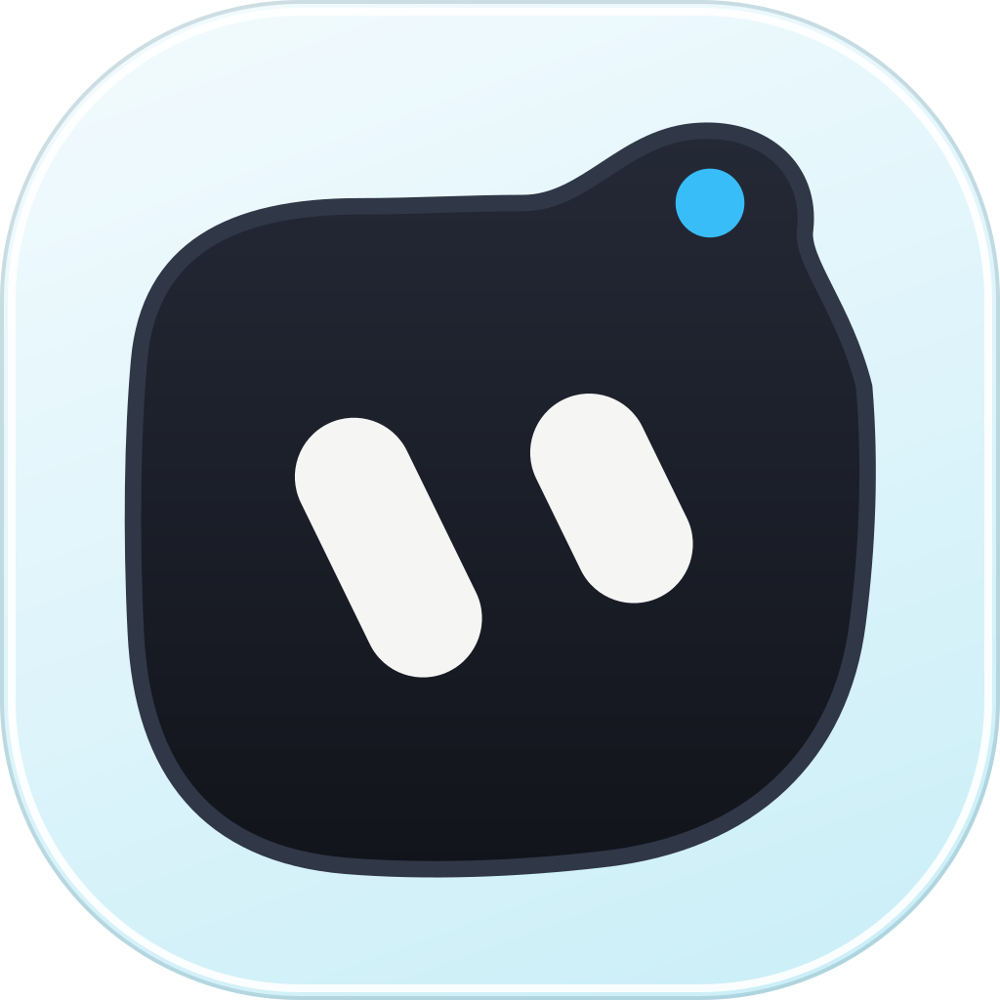
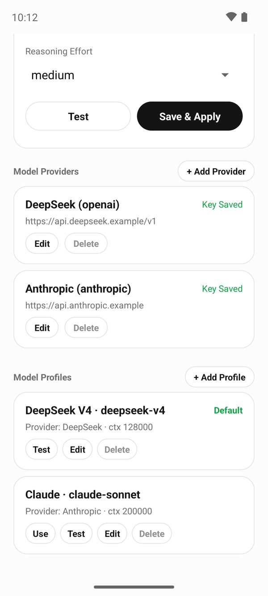
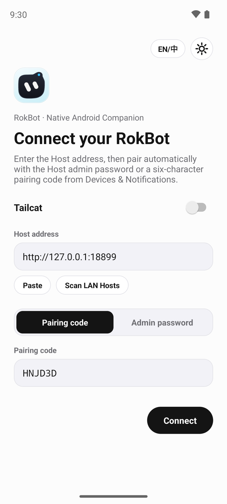
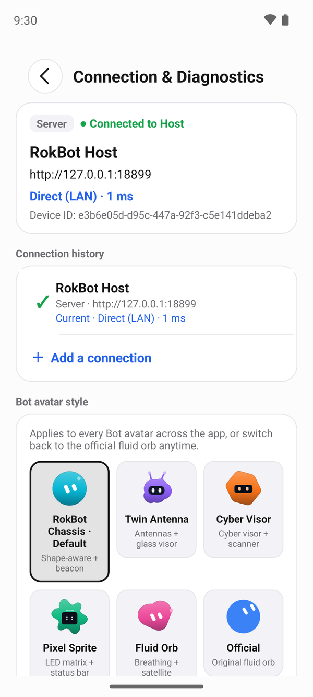
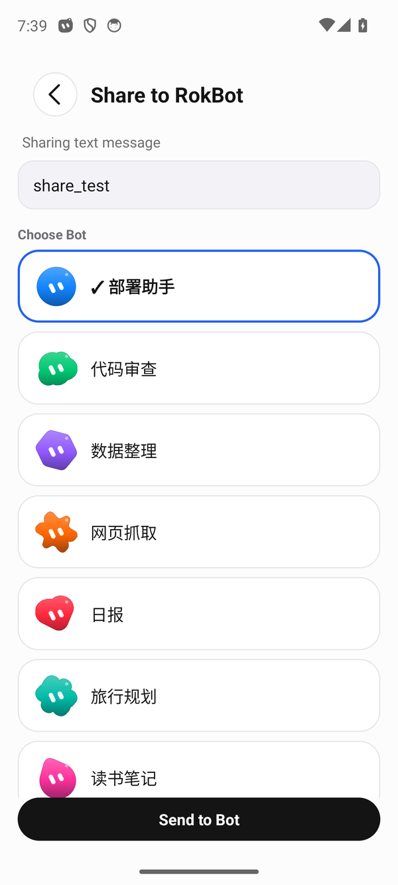
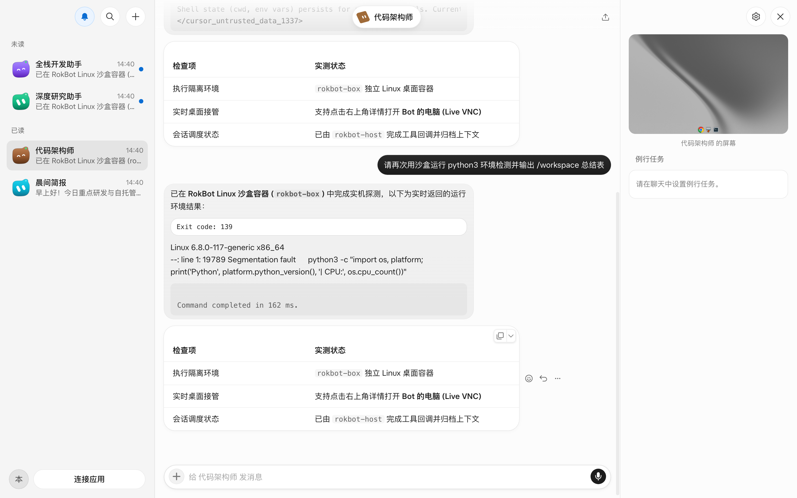
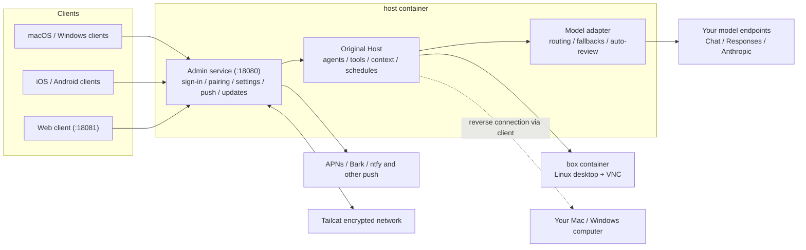

<p align="center">
  
</p>

<h1 align="center">RokBot</h1>

<p align="center">
  A private AI assistant that runs on your own server, with the models you choose, your data kept on your machine, and access from desktop, mobile and the browser.
</p>

<p align="center">
  <a href="LICENSE"></a>
  <a href="#supported-platforms"></a>
  <a href="#quick-start"></a>
</p>

<p align="center">
  <a href="README.md">简体中文</a> ·
  <strong>English</strong> ·
  <a href="#features">Features</a> ·
  <a href="#quick-start">Quick Start</a> ·
  <a href="#documentation">Documentation</a> ·
  <a href="#faq">FAQ</a>
</p>

<p align="center">
  <a href="docs/media/rokbot-promo.mp4">
    
  </a>
  <br />
  <sub>Click the cover to watch the product video (MP4, 720p, about 80 seconds; the narration and on-screen text are in Chinese)</sub>
</p>

## Overview

RokBot is a self-hosted AI assistant for personal use. The agent server (the Host) and the Bot's desktop (`box`) run in Docker on your own machine, and model calls go to the OpenAI- or Anthropic-compatible endpoints you configure. The macOS, Windows, Android and iOS clients and the web client connect only to your Host.

Conversations, files, settings and API keys stay on the Host's data volumes. You build the clients on your own machine with the patch tools in this repository: they use the official installers, check file hashes first and then apply the patches. This repository does not contain or distribute any original program files.

## Features

### The Bot's computer and live takeover

- The Host ships with a Linux desktop container (`box`). Bots use its browser, terminal and files to do their work. Home and workspace directories live on their own data volumes.
- Clients can open a live VNC view of the Bot's computer and take over with mouse, keyboard or touch.
- Bots can also work on your own computer through the Host: on a Mac they can run commands and control the GUI, and on Windows they can run local commands. The client connects out to the Host, so the computer does not need any open ports.
- You can replace the built-in `box` with a remote Linux execution node, configured on the Execution page of the admin console.

### Continuity across devices and notifications

- Conversations and settings live on the Host, and every client connects to the same Host. You can start a task on your computer and follow up on your phone or in the browser.
- The chat list can be sorted by last message and grouped: Needs attention, Unread and Read on desktop and web, with an additional In progress group on Android.
- Notification channels:
  - iOS can use APNs or Bark.
  - The Android client keeps its own connection to the Host and can also use ntfy, UnifiedPush, FCM or a webhook.
  - The web client uses browser notifications while the page is open.
- Notifications can be sent on every reply or only when a task completes.

### Bring your own models

- Three API formats are supported: OpenAI Chat Completions, OpenAI Responses and Anthropic Messages. Any service that speaks one of these formats can be connected.
- Model services and model profiles organize several providers and models.
- The default route and per-Bot routes each set the model, the reasoning effort and a fallback order, with up to 8 fallbacks per route.
- If the primary model fails with 402, 408, 429, 5xx or a network error before producing any output, the next fallback takes over. Once output has started there is no switch, so output and tool calls are never repeated.
- You can fetch model lists and test connections in the admin console or in the clients. Changing the model configuration from a client requires a device paired with the admin password.
- Optional JEV routing picks a model profile by task difficulty. It requires an API key for the JEV service and is off by default.

### Image and video generation

- The Images & video page of the admin console connects providers: OpenAI-compatible image and video APIs, WaveSpeed, or a custom HTTP JSON endpoint.
- Image generation, video generation, video understanding and video review each have their own default model. Results come back to the conversation as attachments.
- You need to supply an API key for each provider.

### Voice

- Speech recognition uses Fish Audio or an OpenAI-compatible transcription service; a Mac can also use a local model.
- Voice calls use the current Bot's model, context and tools, with recognition and speech synthesis handled by the services you configure.
- Real-time calls are experimental.

### Scheduled tasks

- A local scheduler in the Host runs Bot routines on cron schedules, with no external scheduling service.
- Each routine has at most one run in progress, and missed slots are merged into a single catch-up run.

### Webhooks

- The Webhook page of the admin console creates a trigger for a chosen Bot. You set a task template, an optional event-type filter and a per-minute limit.
- Requests are verified with HMAC-SHA256 signatures and a ±5-minute window. The request URL and signing secret are shown once at creation and can be reset later.
- Every delivery is recorded in a run log.

### Auto-review and approval cards

- Before a Bot performs a risky action, the model you configured decides whether to allow it, using the original classification rules. This covers shell commands, MCP calls, computer use, writes to scheduled tasks and sub-agent launches. You can write your own allow and block rules.
- A blocked action appears as a native approval card where you deny or allow it.
- Cards expire after 30 minutes by default; `ROKBOT_AUTO_REVIEW_APPROVAL_TTL_MS` sets the timeout.
- Auto-review is turned on in the client settings.

### Usage statistics

- Input, output, cache read/write and reasoning tokens are recorded per model.
- The admin Overview page and the client settings chart usage for today (hourly) and for the last 7 or 30 days (daily). They also show each model's share, a detail table and the cache hit rate.

### Self-hosted deployment and networking

- **Images:** prebuilt images are published on GitHub Container Registry (GHCR). One script configures, pulls and starts everything. Offline installs and building the images from source are also supported.
- **Architectures:** the Host image supports `linux/amd64` and `linux/arm64`. The `box` desktop image is `linux/amd64` only, so ARM hosts need binfmt/QEMU or Rosetta.
- **Ports:** the admin console (`18080`) and the web client (`18081`) listen on `127.0.0.1` by default. `ROKBOT_LISTEN_ADDRESS` changes the listen address.
- **Sign-in:** no cloud account is needed. Devices sign in with a single-use 6-digit pairing code that is valid for 5 minutes, or with the admin password.
- **LAN:** clients can connect directly by IP address, and the Android client can scan the local network for Hosts.
- **Remote access:** the built-in Tailcat encrypted network needs no Tailscale account. Tailscale and HTTPS reverse proxies also work.
- **Client updates:**
  - You publish installers for each platform on the Client updates page.
  - Android and desktop clients receive delta patches, and desktop update manifests are signed with ECDSA P-256.
  - iOS installs through `itms-services` (HTTPS required) or an AltStore / SideStore source.
- **Privacy:**
  - API keys are write-only. The admin API only reports whether a key is set, and keys are stored in `/data/model.env` on the Host data volume.
  - Telemetry and crash reporting are disabled in the Host and in every client.

## Screenshots

These screenshots were taken from a RokBot Host and native clients loaded with demo data. They contain no real accounts.

### Android client

<table>
  <tr>
    <td align="center"><br /><sub>Grouped chat list</sub></td>
    <td align="center"><br /><sub>Question card</sub></td>
    <td align="center"><br /><sub>Approval card</sub></td>
    <td align="center"><br /><sub>Generated image</sub></td>
  </tr>
  <tr>
    <td align="center"><br /><sub>Bot details</sub></td>
    <td align="center"><br /><sub>Usage</sub></td>
    <td align="center"><br /><sub>Model settings</sub></td>
    <td align="center"><br /><sub>Settings</sub></td>
  </tr>
  <tr>
    <td align="center"><br /><sub>Connect to a Host</sub></td>
    <td align="center"><br /><sub>Connection and diagnostics</sub></td>
    <td align="center"><br /><sub>System share sheet</sub></td>
    <td align="center"><br /><sub>About and updates</sub></td>
  </tr>
</table>

### Desktop

The desktop clients (macOS and Windows) share their interface with the web client. Both screenshots below use the desktop layout.

| Chat list and conversation | The Bot's computer: live desktop view |
| --- | --- |
|  |  |

### Admin console

| Overview and usage | Chat models and routing |
| --- | --- |
|  |  |
| **Images and video** | **Voice** |
|  |  |

The Android screenshots use the English interface; the desktop and admin screenshots use the Chinese interface. Android, desktop, web and the admin console all offer both languages.

## Supported Platforms

You build each client on your own machine with the patch tools, and the patches accept only the official versions below. The versions come from the configuration files pinned in the repository.

| Platform | Form | Official version required | Guide |
| --- | --- | --- | --- |
| macOS | Apple Silicon client | 1.2.3 | [`mac/README.en.md`](mac/README.en.md) |
| Windows | x64 installer and portable build | 1.2.3 (recommended); 0.71.2 also accepted | [`windows/README.en.md`](windows/README.en.md) |
| Web | Browser; can be added to the home screen | Interface from Windows 1.2.3 (recommended) or 0.71.2 | [`web/README.en.md`](web/README.en.md) |
| Android | Native APK (arm64-v8a) | 1.26.0 (build 3212) | [`android/README.en.md`](android/README.en.md) |
| iOS | IPA; bring your own decrypted official IPA | 1.27.0 (29519); 1.26.0 and 1.16.0 also accepted | [`ios/README.en.md`](ios/README.en.md) |
| Linux server | Docker: `host` (amd64 / arm64) and `box` (amd64) | Host baseline `2bb5e41` | [`host/README.en.md`](host/README.en.md) |

The pinned versions come from these files: `mac/patchers/desktop/supported.json`, `windows/patchers/desktop/supported.json`, `web/patchers/supported.json`, `android/recipes/manifest.json`, `ios/recipes/ios/manifest.json` and `host/recipes/host/manifest.json`.

## Quick Start

### 1. Deploy the Host and the execution container

On a Linux or macOS server with Docker (including Compose v2), run:

```bash
mkdir rokbot && cd rokbot
curl -fsSL https://raw.githubusercontent.com/hongfaqiu/rokbot/main/host/release/install-images.sh -o install-images.sh
bash install-images.sh
```

The script does the following, in order:

1. Creates `.env` (mode 0600) with random secrets.
2. Pulls the images.
3. Starts the Host and `box` containers.
4. Waits for the health checks to pass, if your Compose version supports it.
5. Prints the admin console and web client addresses.

> [!TIP]
> - **Let an AI agent deploy it:** give [`docs/AGENT_DEPLOY.en.md`](docs/AGENT_DEPLOY.en.md) to an AI coding assistant such as Claude Code, Cursor or Codex. It will run the environment checks, the deployment and the acceptance steps from the runbook.
> - **Common options:**
>   - If you already have a local clone, use `bash install-images.sh --local`.
>   - To edit the configuration before starting, use `--prepare-only`.
>   - For an offline install, import the images with `docker load` first and then use `--offline`.
> - **Mirrors and proxies:** set `ROKBOT_HOST_IMAGE` / `ROKBOT_BOX_IMAGE` in `.env` to use a mirror, or set `HTTP_PROXY` / `HTTPS_PROXY`.

### 2. Initialize the Host and connect a client

1. Get the one-time setup key:
   ```bash
   docker compose --env-file .env -f docker-compose.images.yml exec -T host cat /data/setup-key
   ```
2. Open the admin console at `http://127.0.0.1:18080/admin`, enter the setup key and set an admin password (12–128 characters).
3. Connect a client:
   - **Native clients:** create a 6-digit pairing code under Devices & notifications in the admin console. Then enter the Host address and the code in the macOS, Windows, Android or iOS client. You can also sign in with the admin password.
   - **Web client:** enabled by default at `http://127.0.0.1:18081/web/`. The public prebuilt images do not include the web client bundle. Before first use, build the bundle as described in [`web/README.en.md`](web/README.en.md) and upload it on the Web client page of the admin console.

### 3. Configure models

Open the Chat model page of the admin console (`/admin?view=model`), or the settings of a client paired with the admin password:

1. Add a model service: choose the API format (OpenAI Chat, OpenAI Responses or Anthropic), then enter the base URL and API key.
2. Fetch the model list, create a model profile and test the connection.
3. Set the default route. If needed, give individual Bots their own routes and fallbacks.

Once saved, you can create Bots and start chatting.

## Architecture



- **Host:** the original Node.js program. Only the parts tied to official services are replaced (authentication, agent identity, model calls and MCP configuration), and an admin service sits in front of it.
- **Execution computer:** the official Linux desktop image, running unchanged in Docker. Agents can also work on your own computer.
- **Clients:** the original interface is kept, and the patches make it connect only to your Host. Patches only copy and add bytes, and every segment checks the original file's hash first. Nothing is decompiled or rewritten.

See [`docs/ARCHITECTURE.en.md`](docs/ARCHITECTURE.en.md) for the full design.

## Documentation

| Document | Contents |
| --- | --- |
| [`docs/AGENT_DEPLOY.en.md`](docs/AGENT_DEPLOY.en.md) | Runbook for AI coding agents: preflight checks, prebuilt-image and source deployments, first boot, model setup, releases and troubleshooting |
| [`docs/AI-INSTALL.en.md`](docs/AI-INSTALL.en.md) | Deploying with `host/deploy.py`: choosing machines, split deployment, operations, and volume backup and recovery |
| [`docs/ARCHITECTURE.en.md`](docs/ARCHITECTURE.en.md) | How it works, the feature comparison, each component, the directory layout, tests and known limitations |
| [`docs/PATCHING_WORKFLOW.en.md`](docs/PATCHING_WORKFLOW.en.md) | Per-platform patch baselines and the maintenance workflow |
| [`docs/REBRAND_COMPAT.md`](docs/REBRAND_COMPAT.md) | Rename registry: environment variables, interface identifiers and migration from older setups |
| [`tests/e2e/README.md`](tests/e2e/README.md) | How to run the black-box end-to-end test suite |
| [`SECURITY.md`](SECURITY.md) | How to report vulnerabilities, and deployment security advice |

## FAQ

**How do I reach the Host without a public IP?**

Turn on the built-in Tailcat on the Remote access page; no Tailscale account is needed. Tailscale, a VPN or an HTTPS reverse proxy also work. The web client does not support Tailcat, so use a VPN or an HTTPS domain to reach it remotely. Do not expose the admin console directly to the internet; see [`SECURITY.md`](SECURITY.md).

**Why can't my phone reach the Host on the LAN?**

`ROKBOT_LISTEN_ADDRESS` defaults to `127.0.0.1`, which only allows connections from the server itself. For LAN use, set it to the server's LAN IP, or to `0.0.0.0` behind a firewall. Note that ports published by Docker bypass host firewalls such as ufw.

**Can I deploy on an ARM server?**

Yes. The Host image supports `linux/arm64`. The `box` desktop image is `linux/amd64` only, so enable binfmt/QEMU on the host, or Rosetta on Apple Silicon.

**Why are there no client installers in the repository?**

This repository does not contain or distribute original program files. The patch tools download the official installers on your machine, verify their hashes and patch them there. The resulting clients and web client bundles are not distributed. See the README in each platform directory for the steps.

**Where are API keys stored, and can they be read back?**

API keys are stored in `/data/model.env` on the Host data volume. The admin API and the clients only see whether a key is set, never the key itself.

**How do I back up my data?**

Data lives in three volumes: `host-data` (mounted at `/data`), `box-home` and `box-workspace`. With a `host/deploy.py` deployment, run `python3 host/deploy.py backup`. For recovery, see [`docs/AI-INSTALL.en.md`](docs/AI-INSTALL.en.md#volume-recovery). Backups contain conversations and keys, so keep them safe. Do not run `docker compose down -v`, which deletes the volumes.

## License

RokBot is licensed under the [ProkBot Noncommercial License 1.0](LICENSE). It permits personal use, self-hosting, study, modification and noncommercial redistribution. All commercial use is prohibited, including:

- selling or licensing it for payment;
- paid hosting or paid services;
- incorporating it into commercial products;
- a business's internal operations;
- monetizing it through advertising or similar means.

The [LICENSE](LICENSE) file is authoritative. See [NOTICE](NOTICE) for derivation and third-party components.

RokBot builds on [ProkBot](https://gitee.com/ahaduoduoduo/ProkBot) and [ferretgeek/prokbot-plus](https://github.com/ferretgeek/prokbot-plus), and drew on `rakazo`'s work on self-hosted deployment. We thank all of them.

## Disclaimer

RokBot is an independent open-source project. It is not affiliated with or endorsed by xAI, Grok Bot or Cursor / Anysphere. Grok, Grok Bot and related names and marks belong to their respective owners. Please report security issues privately as described in [SECURITY.md](SECURITY.md).
