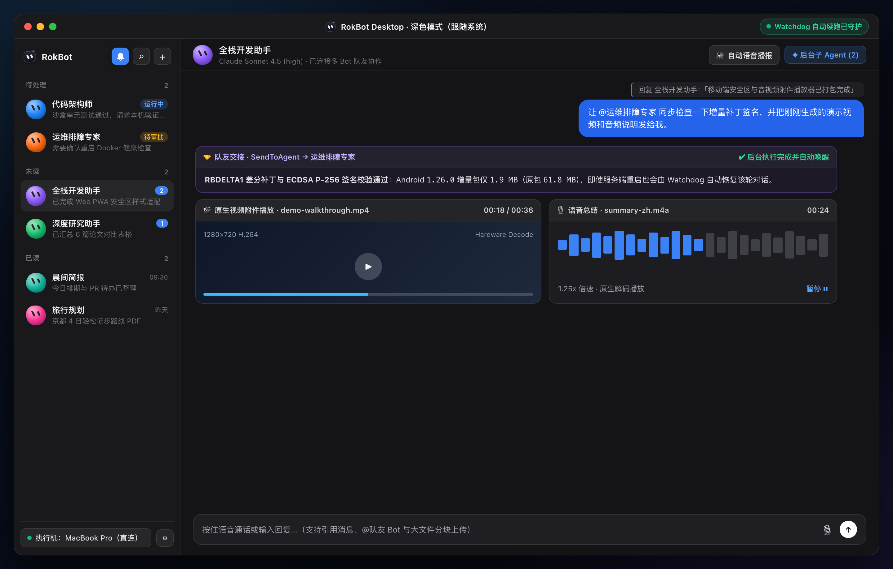
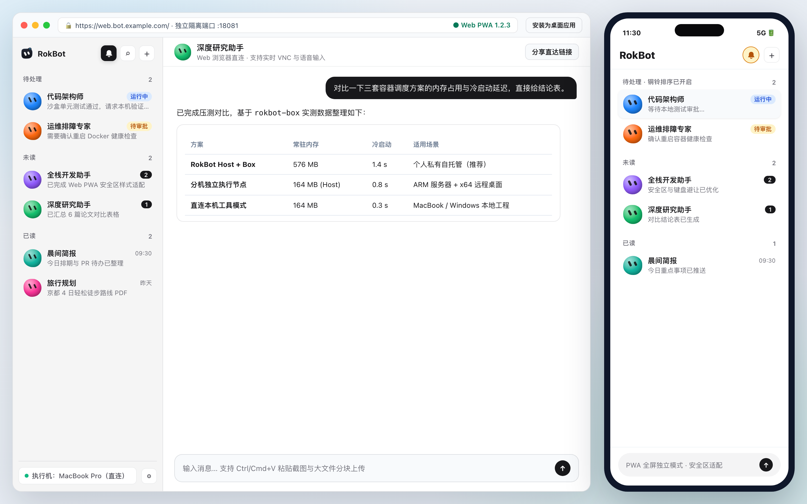
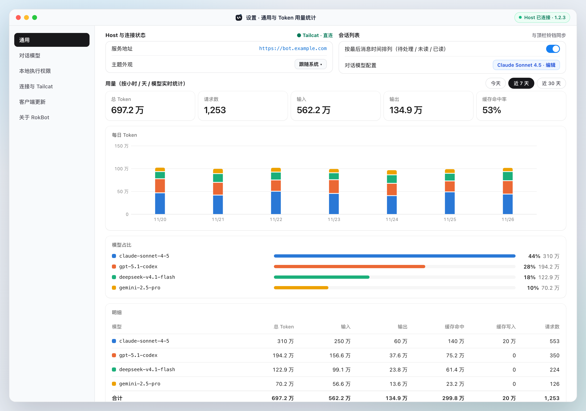
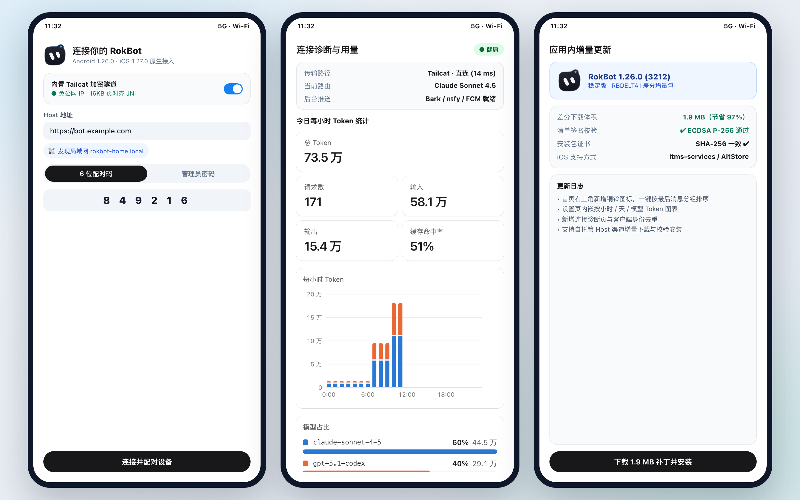
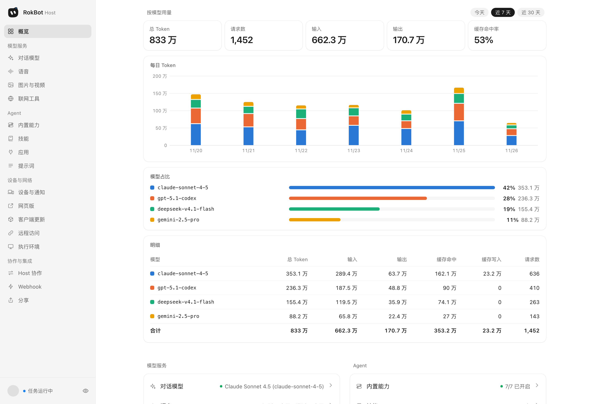
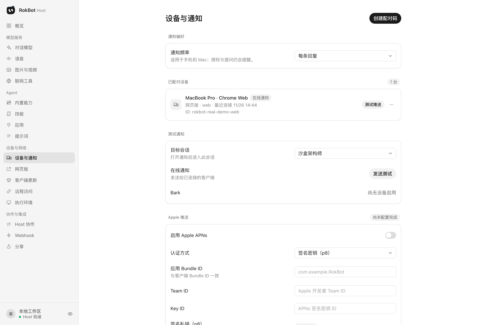
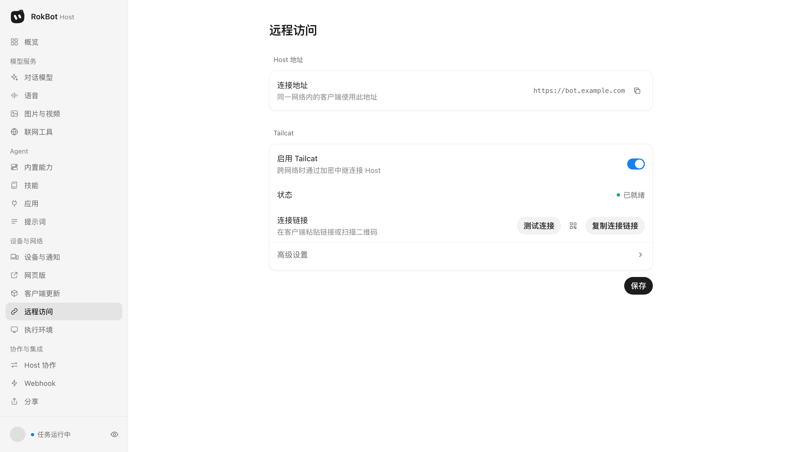
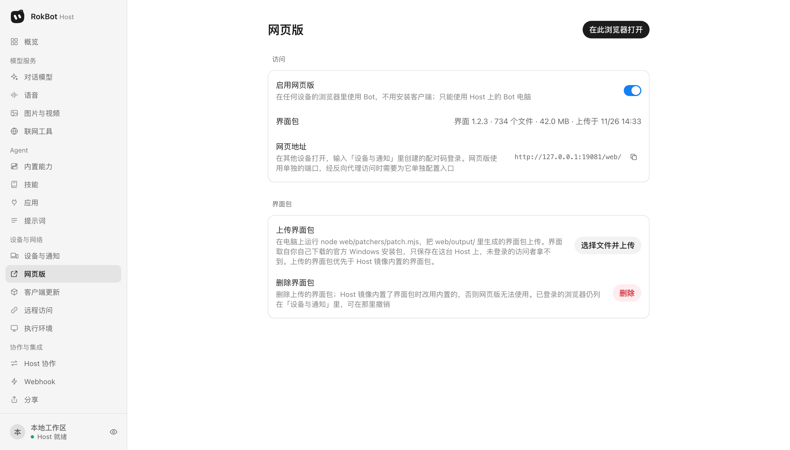
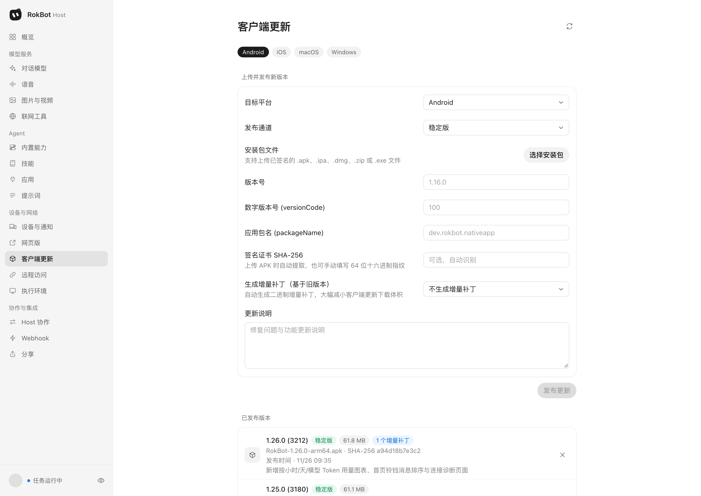
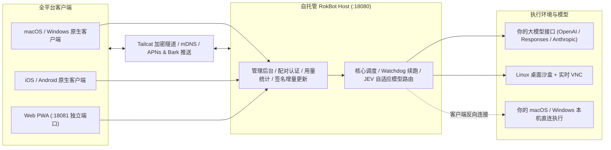

<p align="center">
  
</p>

<h1 align="center">RokBot</h1>

<p align="center">
  <strong>属于你自己的全平台私有 AI 助手 —— 3 分钟一键自托管、自由接入任意大模型、真沙盒 + 多机执行、全端原生流畅体验。</strong>
</p>

<p align="center">
  
  
  
  
</p>

<p align="center">
  <strong>简体中文</strong> ·
  <a href="README.en.md">English</a> ·
  <a href="#视频介绍">视频介绍</a> ·
  <a href="#真实界面预览">界面预览</a> ·
  <a href="#3-分钟快速上手">快速上手</a> ·
  <a href="docs/AGENT_DEPLOY.md">AI Agent 部署引导</a> ·
  <a href="docs/ARCHITECTURE.md">架构文档</a>
</p>

> RokBot 是一款面向个人与自托管场景的独立开源产品（架构与自托管思路受到 ProkBot、prokbot-plus 与 rakazo 启发），致力于让每个人都能在自己的服务器上轻松拥有完整、隐私、真正能干活的全端私有 AI 助手。

---

## 视频介绍

36 秒实机交互演示：铃铛一键按消息排序、Linux 沙盒与实时 VNC 接管、App 内模型延迟实测与多维 Token 图表、移动端 Tailcat 与 1.9 MB 增量更新，以及 3 分钟一键部署：

<p align="center">
  <a href="docs/media/rokbot-intro.mp4">
    
  </a>
</p>

<p align="center">
  <a href="docs/media/rokbot-intro.mp4"><strong>▶ 查看 / 下载高清 720p MP4 视频介绍（rokbot-intro.mp4）</strong></a> ·
  <a href="https://raw.githubusercontent.com/hongfaqiu/rokbot/main/docs/media/rokbot-intro.mp4">Raw 直链播放</a>
</p>

---

## 为什么选择 RokBot？

大多数开源 AI 助手要么只是「套壳网页 + 单一厂商绑定」，要么只能纯文字聊天；RokBot 把完整的云端 Agent 体验原汁原味搬回你的服务器与个人设备：

| 维度 | 常见自托管套壳 / 云端绑定方案 | RokBot |
| --- | --- | --- |
| **客户端体验** | 仅网页端或 Electron/WebView 套壳，移动端体验割裂 | **macOS、Windows、Android、iOS 四端原生客户端 + 默认开启的 Web PWA（`:18081`）**，手感流畅一致 |
| **执行能力** | 纯对话或受限插件，无法真正在电脑环境干活 | **独立 Linux 桌面沙盒（支持实时 VNC 接管）+ 直连本机编程工具 + 后台任务断点续跑与 Watchdog 自动唤醒** |
| **模型与路由** | 修改 YAML/重启生效，或绑定单一模型厂商 | **App 内直配 OpenAI / Responses / Anthropic，单 Bot 独立路由、备用链、JEV 自适应路由、小时/日/模型级 Token 图表** |
| **联机与升级** | 手动配置内网穿透与公网端口，客户端每次手动重装 | **6 位配对码 / 局域网 mDNS / 内置 Tailcat 加密隧道（免公网 IP）+ 管理后台四端一键签名增量更新** |
| **隐私与可控性** | 数据托管第三方云端，或遥测无法关闭 | **100% 私有部署，API Key 只写不读、云端遥测默认关闭，确定性字节级补丁与 SHA-256 校验** |

---

## 核心亮点

- **全端原生客户端与开箱即用 Web PWA**
  - 覆盖 **macOS（`1.2.3`）、Windows（`1.2.3`）、Android（`1.26.0`）、iOS（`1.27.0` / `1.26.0`）与 Web（`1.2.3`）** 五大平台；Web 端默认随 Host 在独立端口 `18081` 启动（与 `18080` 管理后台同源隔离），也可直接预打包进 Host 镜像。
  - 保留流畅的动态多色 Bot 标识；桌面端、Web 端与 Android 首页支持**铃铛一键切换「按最后消息排序」**，自动将对话聚拢为 **待处理 / 未读 / 已读** 三个可折叠分组，多 Bot 并发不遗漏。
- **App 内模型中心、自适应路由与用量洞察**
  - 原生支持 **OpenAI Chat、OpenAI Responses 与 Anthropic** 等兼容协议；连接后直接在手机或电脑 App 内添加服务商、拉取模型列表、实测连通与延迟并一键热切换。
  - 支持按不同 Bot 独立指定模型与推理强度、配置多节点备用顺序、**JEV 自适应模型路由**及上游上下文窗口自动同步；客户端与后台提供**按小时、按天、按模型**的 Token 用量可视化图表。
- **真沙盒桌面与多机协同执行**
  - 内置独立 Linux 桌面执行容器（`box`），支持在对话中联网检索、编写与运行代码、读写文件，并可打开**实时交互式 VNC 画面**直接接管鼠标键盘，还支持按需只读挂载记忆目录。
  - 支持接入你自己的多台 macOS / Windows 电脑协同执行（**直连本地编程工具，无需 Codex MCP**），并可固定默认执行机器。
  - 后台子 Agent 对所属 Bot 全程可见，配合 **Watchdog 自动唤醒**，即使后台任务完成、卡顿或遭遇重启中断也能自动续跑；原生支持引用回复、多 Bot 队友协同、图片/音视频原生播放、自动语音与中文技能本地化。
- **3 分钟 Docker 一键部署与内置 Tailcat 隧道**
  - 提供 `linux/amd64` + `linux/arm64` 多架构预构建 GHCR 镜像与一键安装脚本，也提供 [`docs/AGENT_DEPLOY.md`](docs/AGENT_DEPLOY.md) 让 AI Coding Agent 全自动代劳部署。
  - 无需注册云端账号：支持 **6 位配对码**、**管理员密码**、**局域网 mDNS 自动发现**以及内置 **Tailcat 加密隧道**，没有公网 IP 也能随时随地安全直连。
- **自建更新源，四端一键签名增量更新**
  - 管理员在后台上传各端签名包，Host 自动生成带 **ECDSA P-256 签名**的轻量增量补丁（`RBDELTA1`）。
  - Android / macOS / Windows 在客户端内一键检查、校验并升级（桌面端支持空闲自动更新）；iOS 支持 `itms-services` OTA（需 HTTPS）、AltStore / SideStore 源与 IPA 分享安装。
- **隐私优先与可验证工程质量**
  - 所有对话、文件与配置均保存在你自己的服务器；API Key 只写不读，云端遥测默认关闭。
  - 客户端与 Host 改造采用确定性「复制 + 新增」字节补丁（不反编译源码），全流程核对官方 SHA-256 摘要，并配备 **199 项黑盒端到端自动化测试（E2E）** 守卫发布质量。

---

## 真实界面预览

以下截图均基于 RokBot 自研界面与隐私安全演示数据高清直出（零打码遮挡），涵盖五端客户端与自托管后台真实使用场景：

### 全平台客户端体验与特色功能

<p align="center">
  
</p>

| 跟随系统深色模式 · 多 Bot 协同与原生音视频 | 独立端口 `:18081` Web PWA（桌面 + 手机铜铃排序） |
| --- | --- |
|  |  |

| 设置通用与实时 Token 用量图表 | App 内模型配置、目录同步与延迟实测 |
| --- | --- |
|  |  |

<p align="center">
  
</p>

### 自托管管理后台全景（高清无打码）

| 概览 · 并发 Bot 与今日每小时用量 | 近 7 天多模型 Token 与缓存命中率 | 对话模型 Hub · 多服务商与路由 | 设备配对与 APNs / Bark 推送 |
| --- | --- | --- | --- |
|  |  |  |  |

| 内置 Tailcat 加密隧道远程访问 | 默认启用 `:18081` 网页版管理 | 四端 ECDSA 签名增量更新发布 | Agent 中文技能与模块化管理 |
| --- | --- | --- | --- |
|  |  |  |  |

---

## 3 分钟快速上手

### 第 1 步：一键部署服务端（Host + Sandbox）

准备一台安装好 Docker（含 Compose v2）的 Linux 或 macOS 服务器，执行：

```bash
mkdir rokbot && cd rokbot
curl -fsSL https://raw.githubusercontent.com/hongfaqiu/rokbot/main/host/release/install-images.sh -o install-images.sh
bash install-images.sh
```

脚本会自动生成 `.env` 配置、拉取多架构镜像、启动 Host 与沙盒容器，并等待健康检查就绪。

> [!TIP]
> - **让 AI 帮你部署？** 直接把 [`docs/AGENT_DEPLOY.md`](docs/AGENT_DEPLOY.md) 发给 Claude Code / Cursor / Codex / Antigravity 等 AI 助手，按引导全自动完成环境检查、部署与验收。
> - **常用参数**：已有本地克隆仓库用 `bash install-images.sh --local`；想先改配置再启动用 `--prepare-only`；离线内网环境用 `--offline`；需要镜像加速或代理可在 `.env` 中设置 `ROKBOT_HOST_IMAGE` / `ROKBOT_BOX_IMAGE` 或 `HTTP_PROXY` / `HTTPS_PROXY`。

### 第 2 步：初始化并连接客户端

1. 获取一次性初始化密钥：
   ```bash
   docker compose --env-file .env -f docker-compose.images.yml exec -T host cat /data/setup-key
   ```
2. 浏览器打开管理后台 `http://127.0.0.1:18080/admin`，输入初始化密钥并设置你的管理员密码。
3. 直接开始使用：
   - **Web 网页端**：已默认随 Host 在隔离端口 `http://127.0.0.1:18081` 启用，浏览器打开即可使用。
   - **原生客户端**：在管理后台「设备与通知」生成 6 位配对码（或直接使用管理员密码），打开 macOS / Windows / Android / iOS 客户端输入服务器地址（或通过局域网 mDNS / Tailcat 隧道连接）即可完成配对。

### 第 3 步：在 App 里配置模型并开始对话

首次连接时，客户端会自动引导进入**模型配置**页：
1. 选择协议（OpenAI Chat / OpenAI Responses / Anthropic 等），填写 Base URL 与 API Key；
2. 点击**获取模型**拉取可用模型列表，点击**测试连接**确认延迟与连通性；
3. 点击**保存并应用**，等待状态变为「已生效」，即可创建 Bot 开始对话与执行任务。

---

## 架构一览



---

## 全平台客户端与增量更新

### 获取各端客户端

本仓库不直接分发第三方闭源安装包，各端客户端均可在本地通过官方校验包一键生成，详见对应平台说明：

| 平台 | 当前基线 | 使用与构建说明 |
| --- | --- | --- |
| **macOS**（Apple Silicon） | `1.2.3` | [`mac/README.md`](mac/README.md) |
| **Windows**（x64 安装版 / 便携版） | `1.2.3` | [`windows/README.md`](windows/README.md) |
| **Web**（浏览器 / 手机 PWA，`:18081`） | `1.2.3` | [`web/README.md`](web/README.md) |
| **Android**（原生 APK） | `1.26.0` | [`android/README.md`](android/README.md) |
| **iOS**（原生 IPA，需自备砸壳包） | `1.27.0` / `1.26.0` | [`ios/README.md`](ios/README.md) |

### 四端一键增量更新

- **管理员发版**：打开管理后台「客户端更新」（`/admin?view=updates`），选择平台并上传你签名好的新版安装包，勾选基于旧版自动生成增量补丁后点击发布即可。
- **用户升级**：
  - **Android / macOS / Windows**：在客户端点击「检查更新」（桌面端支持空闲自动更新），自动下载轻量增量补丁、校验签名并完成升级；
  - **iOS**：在客户端内检查更新，支持 `itms-services` OTA（需配置 HTTPS `ROKBOT_PUBLIC_URL`）、AltStore / SideStore 源或下载 IPA 分享安装。

---

## 文档导航

| 文档 | 内容 |
| --- | --- |
| [`docs/AGENT_DEPLOY.md`](docs/AGENT_DEPLOY.md) | 面向 AI Coding Agent 的自动化部署、校验、模型配置与发版执行手册 |
| [`docs/PATCHING_WORKFLOW.md`](docs/PATCHING_WORKFLOW.md) | 全端自托管适配与补丁改造技术流程（适合开发者与维护者） |
| [`docs/AI-INSTALL.md`](docs/AI-INSTALL.md) | 离线源码构建镜像、分机部署执行节点与数据卷备份恢复 |
| [`docs/ARCHITECTURE.md`](docs/ARCHITECTURE.md) | 系统架构、模块边界与扩展能力说明 |
| [`docs/REBRAND_COMPAT.md`](docs/REBRAND_COMPAT.md) | 环境变量、接口标识与旧环境迁移兼容说明 |
| [`tests/e2e/README.md`](tests/e2e/README.md) | 199 项黑盒端到端自动化测试套件运行说明 |

---

## 致谢与许可

- **致谢**：感谢开源项目 [ProkBot](https://gitee.com/ahaduoduoduo/ProkBot)、[ferretgeek/prokbot-plus](https://github.com/ferretgeek/prokbot-plus) 与 `rakazo` 在容器化自托管与一键部署体验上的先行探索与启发。
- **许可协议**：沿用 [ProkBot Noncommercial License 1.0](LICENSE) —— 允许个人使用、学习、修改与非商业分发，禁止任何形式的商业用途。详见 [NOTICE](NOTICE)。
- **声明**：RokBot 为独立开源项目，与 xAI、Grok Bot 及 Cursor / Anysphere 无任何关联。安全反馈请参阅 [SECURITY.md](SECURITY.md)。
