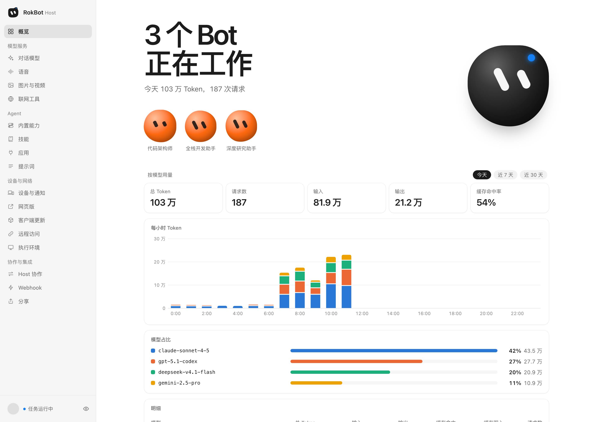

<p align="center">
  
</p>

<h1 align="center">RokBot</h1>

<p align="center">
  <strong>属于你自己的全平台私有 AI 助手 —— 一键自托管、自由接入任意模型、全端原生体验。</strong>
</p>

<p align="center">
  <strong>简体中文</strong> ·
  <a href="README.en.md">English</a> ·
  <a href="docs/AGENT_DEPLOY.md">AI Agent 部署引导</a> ·
  <a href="docs/PATCHING_WORKFLOW.md">技术与改造原理</a> ·
  <a href="docs/ARCHITECTURE.md">架构文档</a>
</p>

> RokBot 是一款面向个人与自托管场景的独立开源产品（架构与自托管思路受到 ProkBot、prokbot-plus 与 rakazo 启发），致力于让每个人都能在自己的服务器上轻松拥有完整、流畅、全端一致的私有 AI 助手。

---

## 核心特性

- **3 分钟一键部署**：提供预构建 Docker 镜像与一键安装脚本，无需克隆源码、无需手动编译，小白也能快速跑起来。
- **全端原生客户端**：覆盖 **macOS、Windows、Android、iOS、Web** 五大平台，全部采用原生客户端路线（告别卡顿套壳），交互流畅一致。
- **App 内直接配置模型**：支持 OpenAI、Anthropic 及各类兼容接口；连接后即可在手机或电脑 App 内直接添加服务商、拉取模型列表、实测连通与延迟、一键热切换，并支持按不同 Bot 独立指定模型。
- **真正能干活的执行环境**：内置独立沙盒，可直接在对话中联网检索、编写与运行代码、读写文件；也支持接入你自己的多台电脑协同执行，并可固定默认执行机器。
- **自建更新源，四端一键增量更新**：管理员在后台上传签名好的各端安装包，Host 自动生成轻量增量补丁并签名，用户在 App 内一键检查、校验并更新。
- **数据完全归你所有**：所有对话、文件与配置均保存在你自己的服务器；API Key 只写不读，默认屏蔽云端遥测。

---

## 界面预览

以下为 Android 端与自托管管理后台的真实运行截图（账号、地址与密钥信息已做隐私打码）：

| Android 桌面图标 | 配对连接 | App 内模型配置 | 真实对话与沙盒执行 |
| --- | --- | --- | --- |
|  |  |  |  |

| 管理后台概览 | 对话模型与 Bot 路由 | 四端增量更新发布 |
| --- | --- | --- |
|  |  |  |

---

## 快速上手

### 第 1 步：一键部署服务端（Host）

准备一台安装好 Docker（含 Compose v2）的 Linux 或 macOS 服务器，执行：

```bash
mkdir rokbot && cd rokbot
curl -fsSL https://raw.githubusercontent.com/hongfaqiu/rokbot/main/host/release/install-images.sh -o install-images.sh
bash install-images.sh
```

脚本会自动生成配置文件、拉取镜像、启动服务并等待健康检查就绪。

> [!TIP]
> - **让 AI 帮你部署？** 把 [`docs/AGENT_DEPLOY.md`](docs/AGENT_DEPLOY.md) 直接发给 Claude Code / Cursor / Codex / Antigravity 等 AI 助手，按引导自动完成环境检查、部署与验收。
> - **常用参数**：已有本地克隆仓库用 `bash install-images.sh --local`；想先改配置再启动用 `--prepare-only`；离线内网环境用 `--offline`；需要镜像加速或代理可在 `.env` 中设置 `ROKBOT_HOST_IMAGE` / `ROKBOT_BOX_IMAGE` 或 `HTTP_PROXY` / `HTTPS_PROXY`。

### 第 2 步：初始化并连接客户端

1. 获取一次性初始化密钥：
   ```bash
   docker compose --env-file .env -f docker-compose.images.yml exec -T host cat /data/setup-key
   ```
2. 浏览器打开 `http://127.0.0.1:18080/admin`，输入初始化密钥并设置你的管理员密码。
3. 在管理后台「设备与通知」生成 6 位配对码（或直接使用管理员密码），打开任意端 RokBot 客户端输入服务器地址即可完成配对。

### 第 3 步：在 App 里配置模型并开始对话

首次连接时，客户端会自动引导进入**模型配置**页：
1. 选择协议（OpenAI / Anthropic 等），填写 Base URL 与 API Key；
2. 点击**获取模型**拉取可用模型列表，点击**测试连接**确认延迟与连通性；
3. 点击**保存并应用**，等待状态变为「已生效」，即可立即创建 Bot 开始对话。

---

## 客户端下载与增量更新

### 获取各端客户端

本仓库不直接分发第三方闭源安装包，各端客户端均可在本地一键生成，详见对应平台说明：

| 平台 | 当前基线 | 使用与构建说明 |
| --- | --- | --- |
| **macOS**（Apple Silicon） | `1.2.3` | [`mac/README.md`](mac/README.md) |
| **Windows**（x64 安装版 / 便携版） | `1.2.3` | [`windows/README.md`](windows/README.md) |
| **Web**（浏览器网页版） | `1.2.3` | [`web/README.md`](web/README.md) |
| **Android**（原生 APK） | `1.16.0` | [`android/README.md`](android/README.md) |
| **iOS**（原生 IPA，需自备砸壳包） | `1.16.0` | [`ios/README.md`](ios/README.md) |

### 四端一键增量更新

- **管理员发版**：打开管理后台「客户端更新」（`/admin?view=updates`），选择平台并上传你签名好的新版安装包，勾选基于旧版自动生成增量补丁后点击发布即可。
- **用户升级**：
  - **Android / macOS / Windows**：在客户端点击「检查更新」（桌面端支持空闲自动更新），自动下载轻量增量补丁、校验签名并完成升级；
  - **iOS**：在客户端内检查更新，支持 `itms-services` OTA（需配置 HTTPS 域名）、AltStore / SideStore 源或下载 IPA 分享安装。

---

## 文档导航

| 文档 | 内容 |
| --- | --- |
| [`docs/AGENT_DEPLOY.md`](docs/AGENT_DEPLOY.md) | 面向 AI Coding Agent 的自动化部署、校验、模型配置与发版执行手册 |
| [`docs/PATCHING_WORKFLOW.md`](docs/PATCHING_WORKFLOW.md) | 全端自托管适配与补丁改造技术流程（适合开发者与维护者） |
| [`docs/AI-INSTALL.md`](docs/AI-INSTALL.md) | 离线源码构建镜像、分机部署执行节点与数据卷备份恢复 |
| [`docs/ARCHITECTURE.md`](docs/ARCHITECTURE.md) | 系统架构、模块边界与扩展能力说明 |
| [`docs/REBRAND_COMPAT.md`](docs/REBRAND_COMPAT.md) | 环境变量、接口标识与旧环境迁移兼容说明 |
| [`tests/e2e/README.md`](tests/e2e/README.md) | 199 项黑盒端到端自动化测试套件运行说明 |

---

## 致谢与许可

- **致谢**：感谢开源项目 [ProkBot](https://gitee.com/ahaduoduoduo/ProkBot)、[ferretgeek/prokbot-plus](https://github.com/ferretgeek/prokbot-plus) 与 `rakazo` 在容器化自托管与一键部署体验上的先行探索与启发。
- **许可协议**：沿用 [ProkBot Noncommercial License 1.0](LICENSE)——允许个人使用、学习、修改与非商业分发，禁止任何形式的商业用途。详见 [NOTICE](NOTICE)。
- **声明**：RokBot 为独立开源项目，与 xAI、Grok Bot 及 Cursor / Anysphere 无任何关联。安全反馈请参阅 [SECURITY.md](SECURITY.md)。
