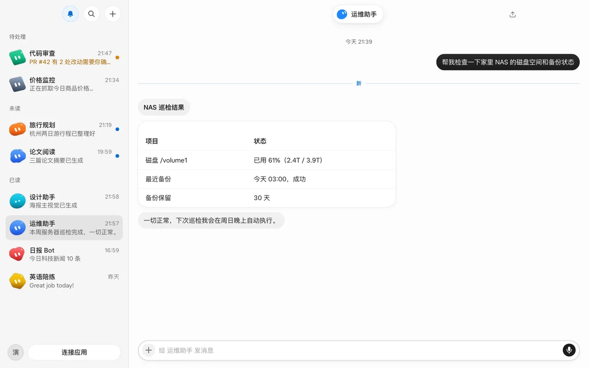
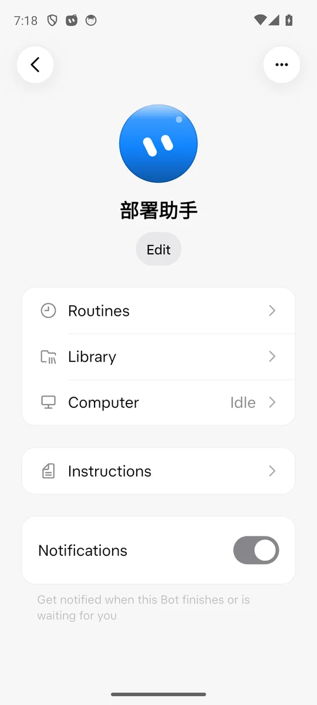
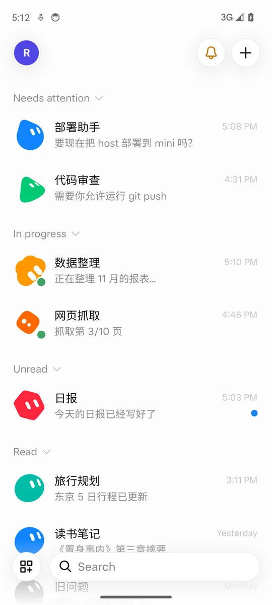
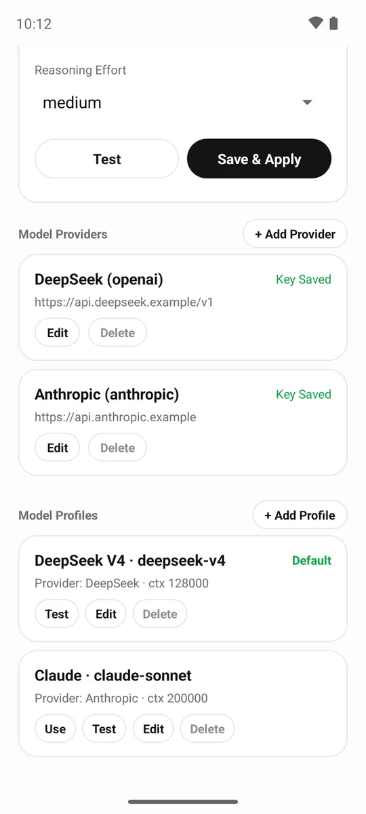
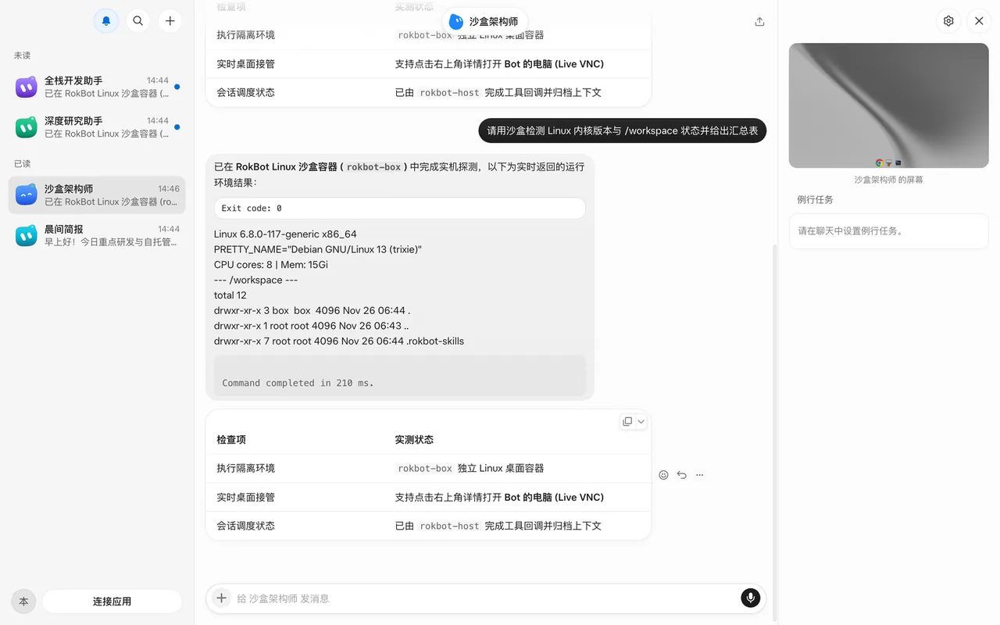

<p align="center">
  
</p>

<h1 align="center">RokBot</h1>

<p align="center">
  部署在你自己服务器上的私有 AI 助手：数据留在本地，模型自己选，网页、桌面和手机随时接力。
</p>

<p align="center">
  <a href="LICENSE"></a>
  <a href="docs/clients.md"></a>
  <a href="#快速开始"></a>
</p>

<p align="center">
  <a href="docs/media/rokbot-promo.mp4">
    
  </a>
  <br />
  <sub><a href="docs/media/rokbot-promo.mp4">观看完整宣传片（80 秒，带配音）</a></sub>
</p>

<!-- 用户可在 GitHub 网页编辑器中把 mp4 拖入此处，生成 user-attachments 链接后即可内嵌播放 -->

<p align="center">
  <strong>简体中文</strong> ·
  <a href="README.en.md">English</a> ·
  <a href="#功能介绍">功能介绍</a> ·
  <a href="#新方向与路线图">路线图</a> ·
  <a href="#快速开始">快速开始</a> ·
  <a href="#获取客户端">获取客户端</a> ·
  <a href="#与上游的区别">与上游的区别</a> ·
  <a href="#完整文档">完整文档</a>
</p>

## 功能介绍

###  自部署与数据


- **数据在自己的机器上**：Host 和执行桌面以 Docker 跑在你的服务器上，对话、文件、配置和 API Key 都存在本地数据卷，全端关闭遥测。
- **模型自己选**：兼容 OpenAI Chat Completions、OpenAI Responses 和 Anthropic Messages，接哪家服务、用哪个模型由你决定。
- **场景模型路由**：输入建议、上下文压缩、记忆提取、自动审核、子 Agent、定时任务 6 个场景可以各用一个模型和思考强度，单个 Bot 也能单独指定。
- **主模型挂了自动切备用**：每条路由最多 8 个备用模型，主模型出错时自动切换，已经开始输出的回复不会中途换模型。
- **从 Grok Bot 迁移**：一键读取本机 Grok Bot 数据，或复制迁移 prompt 让 Grok Bot 导出记忆、技能和例程，预览后导入，可重复执行不产生重复，详见[迁移指南](docs/migrate-from-grokbot.md)。
- **无需云端账号**：用 6 位一次性配对码接入，外网访问可用内置的 Tailcat 组网、Tailscale 或 HTTPS 反向代理。

<br clear="right" />

###  多端



- **六端覆盖**：网页、Mac、Windows、Linux（x64 / arm64）、安卓和 iOS 连同一台 Host，电脑上布置的任务可以在手机上接着看。
- **桌面端自动更新**：桌面端 1.3.1 通过自建 Host 的「客户端更新」自动检查新版本，并支持只下载差异部分的增量更新。
- **安卓直接覆盖升级**：安卓正式版统一用 RokBot 正式签名，新版本可以直接覆盖安装，不用卸载重装。
- **原生安卓客户端**：原生界面加系统分享、原生图片查看器和多选批量保存到相册。

<br clear="right" />

###  对话体验


- **输入建议 v2**：输入框上方的建议条可以整体开关，也可以只关掉 AI 生成。
- **自定义常用语**：常用语保存在 Host 上，桌面端、网页和安卓之间自动同步。
- **点一下就发送**：点建议直接发出，不用再手动点发送。
- **聚焦时才出现**：建议条只在输入框获得焦点时显示，平时不打扰。
- **根据上下文智能生成**：有对话记录时由模型按当前上下文生成建议，空白会话只显示你的常用语。
- **上传不限大小**：电脑和 Bot 工作区之间的文件改为分块流式传输，默认不限制单个文件大小。
- **语音**：语音输入和语音通话，识别与合成接你自己配置的服务。
- **生图**：图片和视频生成可以单独指定模型，结果作为附件发回对话，支持多选批量下载。

<br clear="right" />

###  Bot 自管理



- **记忆**：Bot 可以在自建 Host 上更新和回忆长期记忆。
- **例程**：Bot 能自己修改例行任务并查看执行记录。
- **任务跟踪**：跟踪任务的进度和结果会正常显示在对话里。
- **改资料**：Bot 可以更新自己的个人资料。
- **写技能**：Bot 可以为自己编写和更新技能。
- **新建 bot**：Bot 能直接创建新的 Agent。
- **调整思考强度**：Bot 可以调整自己的思考强度。
- **聊天里弹表单**：需要你补充信息时，Bot 会在对话里弹出表单让你填写。

<br clear="right" />

###  群聊



- **多 bot 群聊**：把多个 Bot 拉进同一个群协作，一个群最多 6 个 Bot。
- **安卓建群和桌面端一致**：安卓建群改为单页流程，用顶部「To:」栏选成员，群名规则与桌面端相同。
- **边选边建**：选成员时可以当场新建 Bot 并加入群里。
- **失败自动撤销**：建群出错时会撤销已完成的步骤，不留下残缺的群。

<br clear="right" />

###  自有设计



- **RokBot 自己的选择器和控件**：模型路由等页面的系统原生下拉框换成了 RokBot 风格的下拉菜单，安卓上以底部选择面板呈现。
- **深浅色都适配**：菜单、底部面板和设置页跟随系统深浅色和中英文界面。
- **动态头像**：Bot 默认使用 RokBot 动态头像，覆盖 26 种形状，可以在应用内切换头像样式。
- **统一的图标**：桌面端、应用内和「关于」页统一使用 RokBot 图标。

<br clear="right" />

###  远程电脑与本机执行



- **Bot 的电脑**：内置 Linux 桌面容器，Bot 在里面操作时你可以通过 VNC 实时查看和接管。
- **远程执行节点**：内置桌面也可以换成一台远程 Linux 机器，在管理页「执行环境」配置。
- **操作你的电脑**：Bot 可以在 Mac 上执行命令和操作图形界面，在 Windows 上执行本机命令。
- **不用开端口**：由客户端主动连接 Host，你的电脑不需要对外开放端口；敏感操作先经自动审核和审批卡片。

<br clear="right" />

完整功能说明见 [docs/features.md](docs/features.md)，更多截图见 [界面截图](docs/screenshots.md)，最近的更新见 [2026-11-27 更新说明](docs/releases/2026-11-27.md)。

## 新方向与路线图

 下列功能正在开发或计划中，**目前还不能使用**：

| 功能 | 说明 | 状态 |
| --- | --- | --- |
| 本地画布 | Bot 生成可交互页面，由自建 Host 托管 | 开发中 |
| 输入补全 | 打字时用灰字提示后半句，按 Tab 接受 | 开发中 |
| 建议加载动效 | 生成输入建议时显示加载动效 | 开发中 |
| 输入建议设置入口 | 输入建议设置移到设置一级菜单 | 即将推出 |
| iOS 功能同步 | iOS 客户端同步上述全部新功能 | 即将推出 |
| 自动发版 | GitHub Release 自动发版并附带增量补丁包 | 即将推出 |
| 官网改版 | 官网改为黑白风格 | 即将推出 |

## 快速开始

 准备一台装有 Docker（含 Compose v2）的 Linux 或 macOS 服务器：

```bash
echo "$GHCR_TOKEN" | docker login ghcr.io -u <GitHub 用户名> --password-stdin
gh repo clone hongfaqiu/rokbot rokbot-src
mkdir rokbot && cd rokbot
bash ../rokbot-src/host/release/install-images.sh --local
docker compose --env-file .env -f docker-compose.images.yml exec -T host cat /data/setup-key
```

打开 `http://127.0.0.1:18080/admin`，用初始化密钥设置管理员密码，再到「对话模型」添加模型服务并设为默认路由。

也可以用命令行工具 `rokbot` 一键完成部署、管理员密码设置、环境检查、更新回滚和本地打包：`bash scripts/install-cli.sh` 后运行 `rokbot init`，见 [命令行工具](docs/cli.md)。

参数说明、离线安装、源码构建和 AI 助手自动部署见 [部署指南](docs/deployment.md) · [AI 助手部署手册](docs/AGENT_DEPLOY.md) · [高级运维与备份](docs/AI-INSTALL.md)。

## 获取客户端

 本仓库不直接分发安装包。按 [客户端构建与获取指南](docs/clients.md) 用官方安装包自行打补丁，或从已部署的 Host「客户端更新」获取，然后在管理页生成 6 位配对码接入。

## 与上游的区别

 RokBot 衍生自上游开源项目 [ProkBot](https://gitee.com/ahaduoduoduo/ProkBot) 与 [ferretgeek/prokbot-plus](https://github.com/ferretgeek/prokbot-plus)（详见 [NOTICE](NOTICE)）。

| 维度 | 官方版 | ProkBot | prokbot-plus | RokBot |
| --- | --- | --- | --- | --- |
| 部署与数据 | 官方云端 | 自托管 Docker | 自托管，支持 ARM64 与备份恢复 | 自托管 + 预构建镜像一键部署 |
| 模型路由 | 仅官方模型 | 自选模型 | 单 Bot 路由与备用 | 6 个场景路由，每路最多 8 个备用 |
| 客户端 | 官方各端 | macOS、iOS | 新增 Windows 与网页版 | 六端，新增 Linux 与原生安卓 |
| 对话与 Bot | 官方云端功能 | 基础对话与云电脑 | 应用目录、Webhook、用量统计 | 输入建议 v2、Bot 自管理、原生建群 |
| 隐私 | 官方账号与遥测 | 关闭遥测 | 关闭遥测 | 全端关闭遥测，API Key 只写不读 |

## 完整文档


| 文档 | 内容 |
| --- | --- |
| [docs/features.md](docs/features.md) | 全部功能说明 |
| [docs/screenshots.md](docs/screenshots.md) | 安卓、桌面端与管理页截图 |
| [docs/deployment.md](docs/deployment.md) | 部署步骤、脚本参数、初始化与模型配置 |
| [docs/clients.md](docs/clients.md) | 支持版本、各端构建命令与 Host 分发 |
| [docs/architecture-overview.md](docs/architecture-overview.md) | 架构概览 |
| [docs/faq.md](docs/faq.md) | 常见问题与分发合规说明 |
| [docs/releases/2026-11-27.md](docs/releases/2026-11-27.md) | 2026-11-27 更新说明 |
| [docs/AGENT_DEPLOY.md](docs/AGENT_DEPLOY.md) | 写给 AI 编程助手的部署手册 |
| [docs/AI-INSTALL.md](docs/AI-INSTALL.md) | `host/deploy.py` 部署、日常运维与备份恢复 |
| [docs/ARCHITECTURE.md](docs/ARCHITECTURE.md) | 完整技术架构与目录结构 |
| [docs/PATCHING_WORKFLOW.md](docs/PATCHING_WORKFLOW.md) | 补丁基线与维护流程 |
| [docs/REBRAND_COMPAT.md](docs/REBRAND_COMPAT.md) | 重命名对照与旧环境迁移（英文） |
| [tests/e2e/README.md](tests/e2e/README.md) | 端到端测试运行方法 |
| [SECURITY.md](SECURITY.md) | 漏洞报告与部署安全建议 |

## 许可

 RokBot 使用 [RokBot Noncommercial License 1.0](LICENSE)（中文译文见同一文件后半部分，以英文版为准）：允许个人使用、自托管、学习、修改与非商业分发，禁止任何商业用途。源自 ProkBot 的部分同时受 [ProkBot Noncommercial License 1.0](LICENSES/ProkBot-Noncommercial-1.0.txt) 约束；衍生关系与第三方声明见 [NOTICE](NOTICE)，合规说明见 [docs/faq.md](docs/faq.md#分发与合规说明)。

## 致谢

本项目基于 [ProkBot](https://gitee.com/ahaduoduoduo/ProkBot) 和 [ferretgeek/prokbot-plus](https://github.com/ferretgeek/prokbot-plus) 开发，并受到 `rakazo` 在自托管部署方面工作的启发，在此致谢。友情链接：[LINUX DO](https://linux.do)。

## 免责声明

RokBot 是独立的开源项目，与 xAI、官方 Grok Bot 及 Cursor / Anysphere 没有任何关联，也未获得其认可；Grok、Grok Bot 及相关名称和标志归各自的权利人所有。安全问题请按 [SECURITY.md](SECURITY.md) 私下报告。
