<p align="center">
  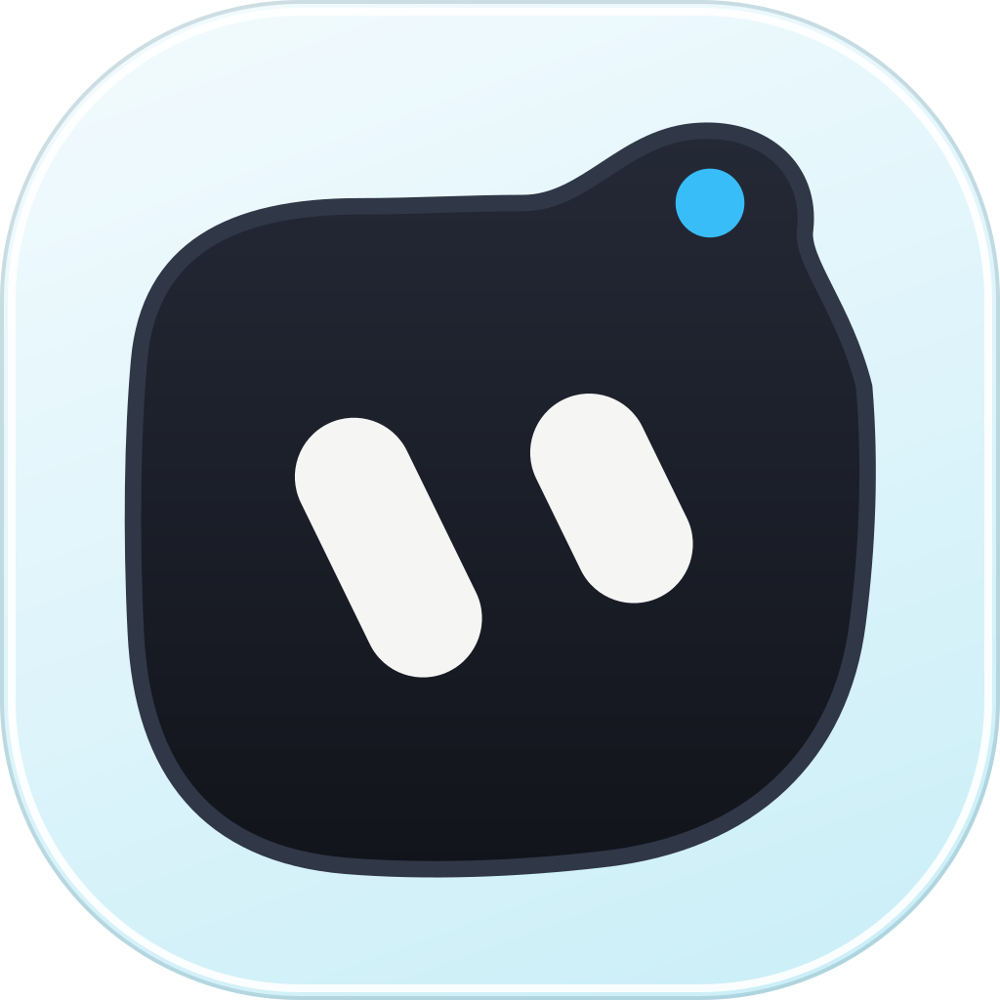
</p>

<h1 align="center">RokBot</h1>

<p align="center">
  部署在你自己服务器上的私有 AI 助手：自选模型，数据留在本地，桌面、移动端和浏览器都能用。
</p>

<p align="center">
  <a href="LICENSE"></a>
  <a href="#支持平台"></a>
  <a href="#快速开始"></a>
</p>

<p align="center">
  <strong>简体中文</strong> ·
  <a href="README.en.md">English</a> ·
  <a href="#核心功能">核心功能</a> ·
  <a href="#快速开始">快速开始</a> ·
  <a href="#文档">文档</a> ·
  <a href="#常见问题">常见问题</a>
</p>

<p align="center">
  <a href="docs/media/rokbot-promo.mp4">
    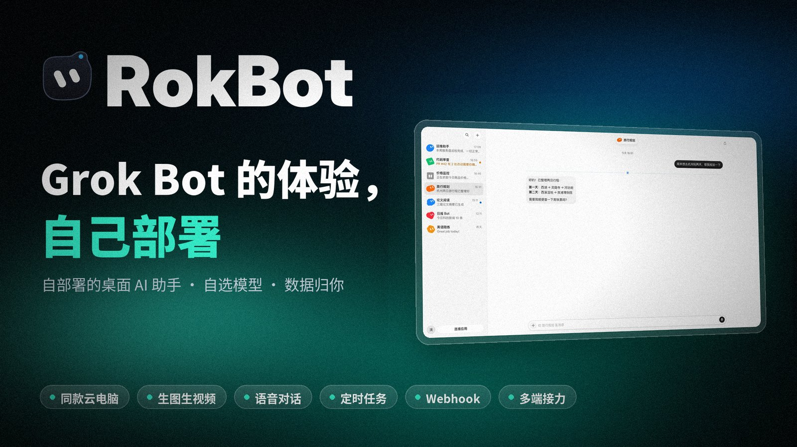
  </a>
  <br />
  <sub>点击封面观看产品介绍视频（MP4，720p，约 80 秒）</sub>
</p>

## 简介

RokBot 是一个面向个人的自托管 AI 助手。Agent 服务端（Host）和 Bot 的执行桌面（`box`）都用 Docker 部署在你自己的机器上，模型调用走你配置的 OpenAI 或 Anthropic 兼容接口。macOS、Windows、Android、iOS 客户端和网页版只连接你自己的 Host。

对话、文件、配置和 API Key 都保存在 Host 的数据卷里。客户端由仓库里的补丁工具在你本机生成：工具使用官方安装包，先校验文件哈希再打补丁。本仓库不包含、也不分发任何原版程序文件。

## 核心功能

### Bot 的电脑与实时接管

- Host 自带一台 Linux 桌面执行容器（`box`）。Bot 在里面用浏览器、终端和文件完成任务，主目录和工作区保存在单独的数据卷里。
- 客户端可以打开 Bot 电脑的实时 VNC 画面，直接用鼠标、键盘或触摸接管操作。
- Bot 也可以通过 Host 操作你自己的电脑：Mac 支持命令和图形界面控制，Windows 支持本机命令。由客户端主动连接 Host，电脑不需要开放端口。
- 内置的 `box` 也可以换成一台远程 Linux 执行节点，在管理页「执行环境」配置。

### 多端接力与通知

- 对话和设置都保存在 Host 上，所有客户端连接同一个 Host。在电脑上布置的任务，可以在手机或浏览器上接着看、接着回复。
- 会话列表可以按最后一条消息的时间排列并分组：桌面端和网页版分为「待处理」「未读」「已读」三组，Android 另有「进行中」一组。
- 通知渠道：
  - iOS 可以用 APNs 或 Bark；
  - Android 客户端和 Host 保持连接，也可以改用 ntfy、UnifiedPush、FCM 或 Webhook；
  - 网页版在页面打开时使用浏览器通知。
- 通知频率可以选「每条回复」或「仅任务完成」。

### 自选模型

- 支持三种接口格式：OpenAI Chat Completions、OpenAI Responses 和 Anthropic Messages，兼容这些格式的服务都能接入。
- 用「模型服务」和「模型档案」管理多个服务商和模型。默认路由和单个 Bot 的路由可以分别指定模型、思考强度和备用顺序，每条路由最多 8 个备用。
- 主模型还没输出内容时，如果遇到 402、408、429、5xx 或网络错误，会按顺序切换到下一个备用；一旦开始输出就不再切换，避免重复输出和重复执行工具。
- 在管理页或客户端里都可以读取模型列表、测试连接。在客户端修改模型配置，需要用管理员密码配对的设备。
- 可选的 JEV 智能路由会按任务难度自动选模型档案，需要 JEV 服务的 API Key，默认关闭。

### 图片与视频生成

- 在管理页「图片与视频」接入服务商：OpenAI 兼容的图片和视频接口、WaveSpeed，或自定义的 HTTP JSON 接口。
- 图片生成、视频生成、视频理解和视频审核可以分别设置默认模型。生成结果以附件形式发回对话。
- 需要自己配置服务商的 API Key。

### 语音对话

- 语音识别：Fish Audio 或 OpenAI 兼容的转写服务，Mac 也可以用本地模型。
- 语音通话：使用当前 Bot 的模型、上下文和工具，识别和合成分别接你配置的服务。
- 实时通话目前是实验功能。

### 定时任务

- Host 内置本地计时器，按 cron 规则触发 Bot 的例行任务，不依赖外部调度服务。
- 同一个任务同时只运行一次，错过的时间点合并成一次补跑。

### Webhook

- 在管理页「Webhook」为指定 Bot 创建触发入口，填写任务模板，可以按事件类型过滤，并设置每分钟调用上限。
- 请求用 HMAC-SHA256 签名校验，时间窗为 ±5 分钟。请求地址和签名密钥只在创建时显示一次，之后可以重置。
- 每次触发都会留下运行记录。

### 自动审查与审批卡片

- Bot 执行有风险的操作前，由你配置的模型按原版的分类规则判断能否执行。覆盖的操作包括 Shell 命令、MCP 调用、电脑操作、写入定时任务和启动子 Agent。允许和拦截规则可以自己写。
- 被拦截的操作以原生审批卡片的形式出现，由你决定拒绝还是放行。卡片默认 30 分钟后过期，时长由 `ROKBOT_AUTO_REVIEW_APPROVAL_TTL_MS` 控制。
- 自动审查在客户端设置中开启。

### 用量统计

- 按模型记录输入、输出、缓存读写和推理 Token。
- 管理页「概览」和客户端设置提供今天（按小时）、近 7 天和近 30 天（按天）的用量图表，以及模型占比、明细和缓存命中率。

### 自托管部署与网络

- 预构建镜像发布在 GitHub Container Registry（GHCR），一个脚本完成配置、拉取镜像和启动；也支持离线安装和从源码构建镜像。
- Host 镜像支持 `linux/amd64` 和 `linux/arm64`。执行桌面 `box` 只有 `linux/amd64` 镜像，ARM 主机需要开启 binfmt/QEMU 或 Rosetta。
- 管理页（`18080`）和网页版（`18081`）默认只监听 `127.0.0.1`，监听地址由 `ROKBOT_LISTEN_ADDRESS` 设置。
- 不需要注册云端账号。设备用 6 位一次性配对码登录（5 分钟内有效），也可以用管理员密码登录。
- 局域网内可以用 IP 地址直连，Android 客户端还能扫描局域网里的 Host。
- 外网访问可以用内置的 Tailcat 加密组网（不需要 Tailscale 账号），也可以用 Tailscale 或 HTTPS 反向代理。
- 客户端更新：
  - 在管理页「客户端更新」发布各端安装包；
  - Android 和桌面端支持增量补丁，桌面端的更新清单用 ECDSA P-256 签名；
  - iOS 支持 `itms-services`（需要 HTTPS）和 AltStore / SideStore 源。
- 隐私：
  - API Key 只写不读，管理接口只返回「是否已设置」，Key 保存在 Host 数据卷的 `/data/model.env`；
  - Host 和各端客户端的遥测与错误上报都已关闭。

## 界面截图

截图来自加载演示数据的 RokBot Host 和原生客户端，不含真实账号。

### Android 客户端

<table>
  <tr>
    <td align="center"><br /><sub>会话列表分组</sub></td>
    <td align="center">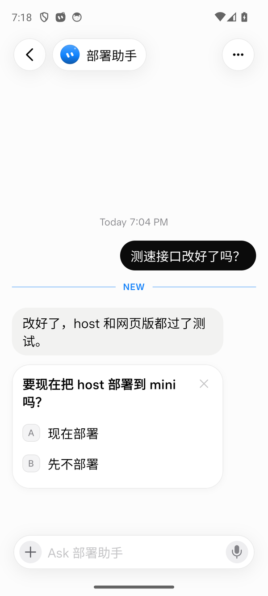<br /><sub>问题卡片</sub></td>
    <td align="center">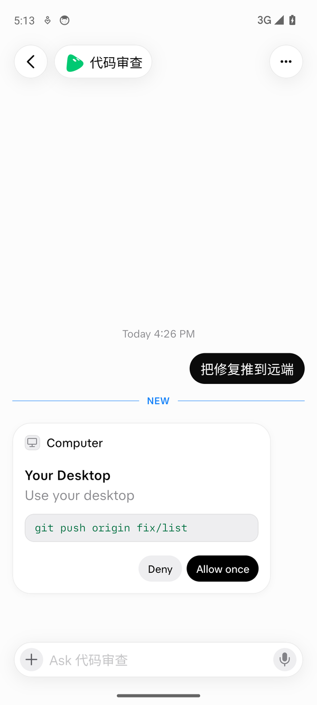<br /><sub>审批卡片</sub></td>
    <td align="center"><br /><sub>生成图片</sub></td>
  </tr>
  <tr>
    <td align="center"><br /><sub>Bot 详情</sub></td>
    <td align="center">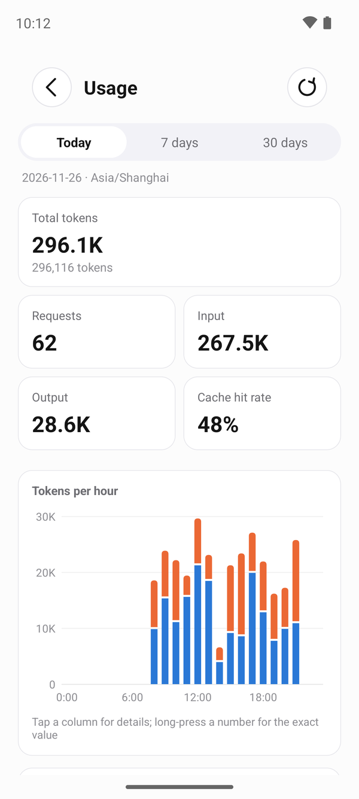<br /><sub>用量</sub></td>
    <td align="center">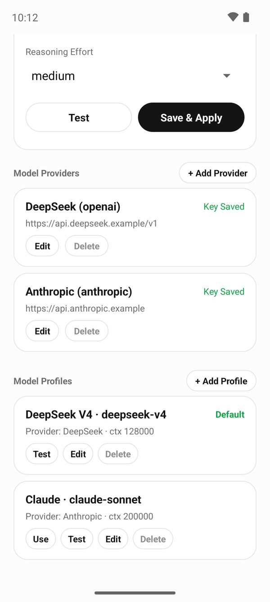<br /><sub>模型设置</sub></td>
    <td align="center">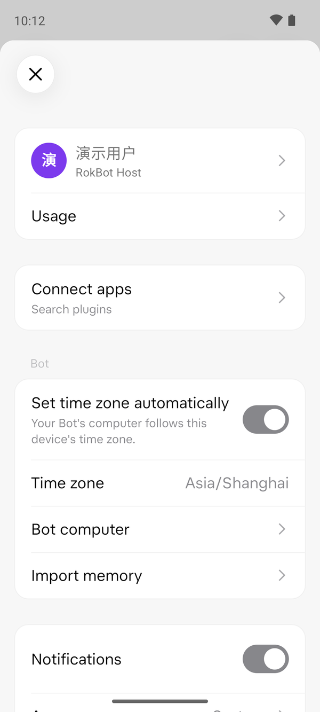<br /><sub>设置</sub></td>
  </tr>
  <tr>
    <td align="center">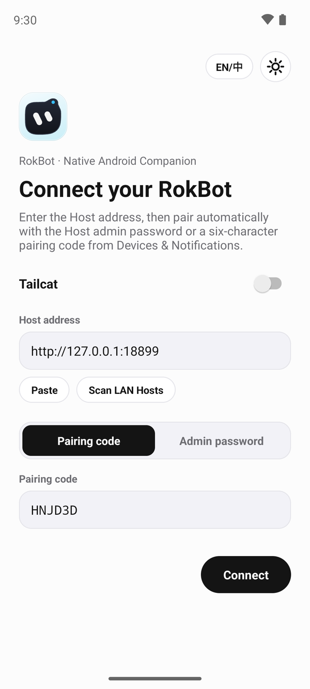<br /><sub>连接 Host</sub></td>
    <td align="center">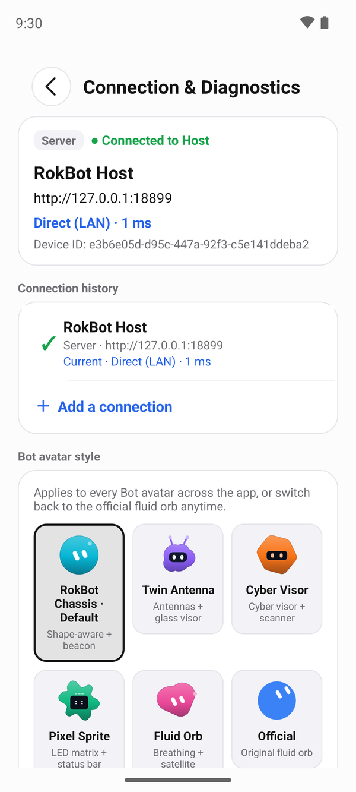<br /><sub>连接与诊断</sub></td>
    <td align="center">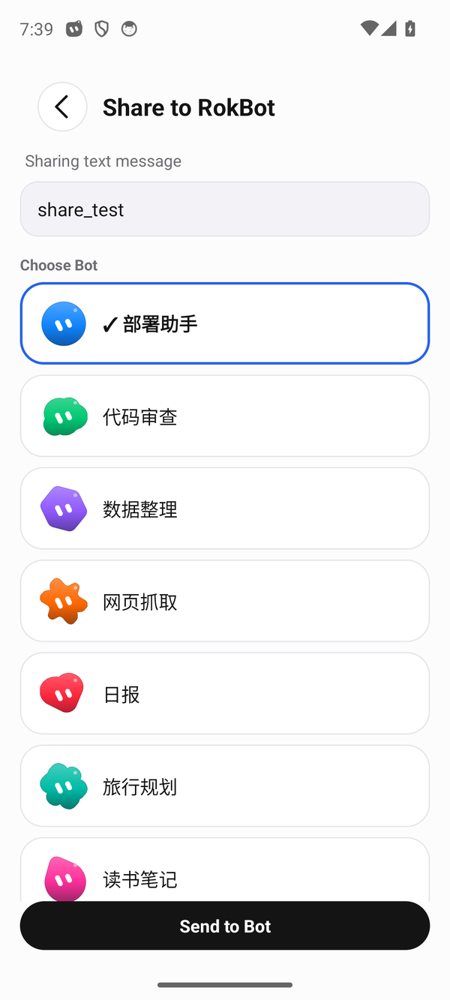<br /><sub>系统分享</sub></td>
    <td align="center">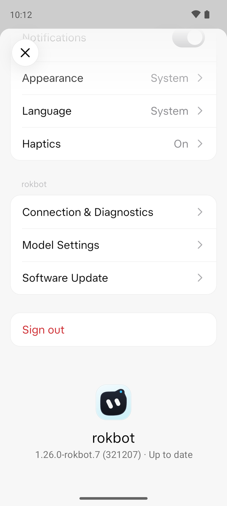<br /><sub>关于与更新</sub></td>
  </tr>
</table>

### 桌面端

桌面客户端（macOS、Windows）与网页版使用同一套界面，以下两张为桌面布局。

| 会话列表与对话 | Bot 的电脑：实时桌面画面 |
| --- | --- |
| 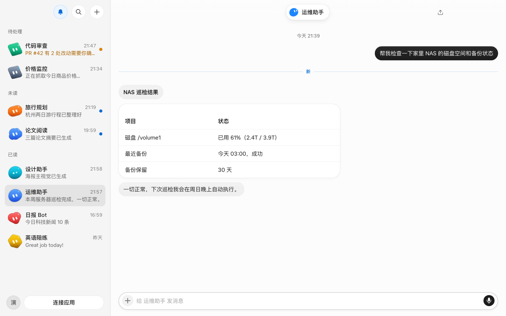 | 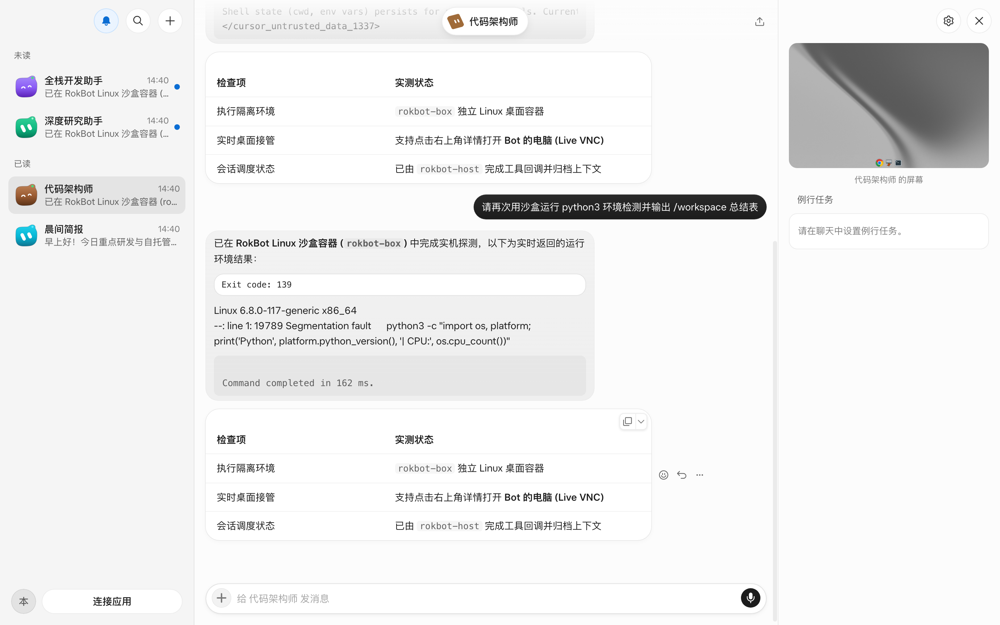 |

### 管理页

| 概览与用量 | 对话模型与路由 |
| --- | --- |
| 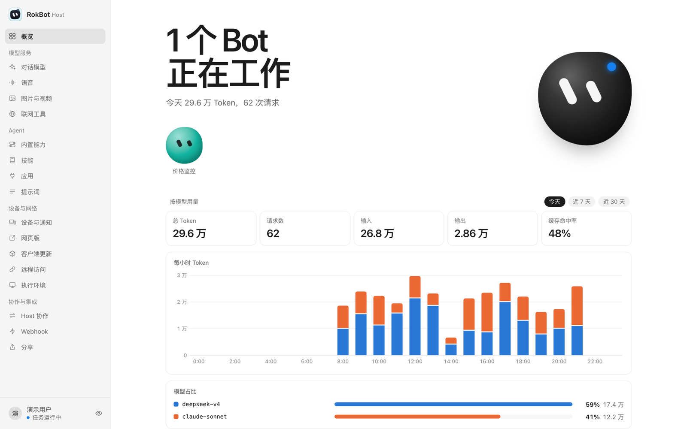 | 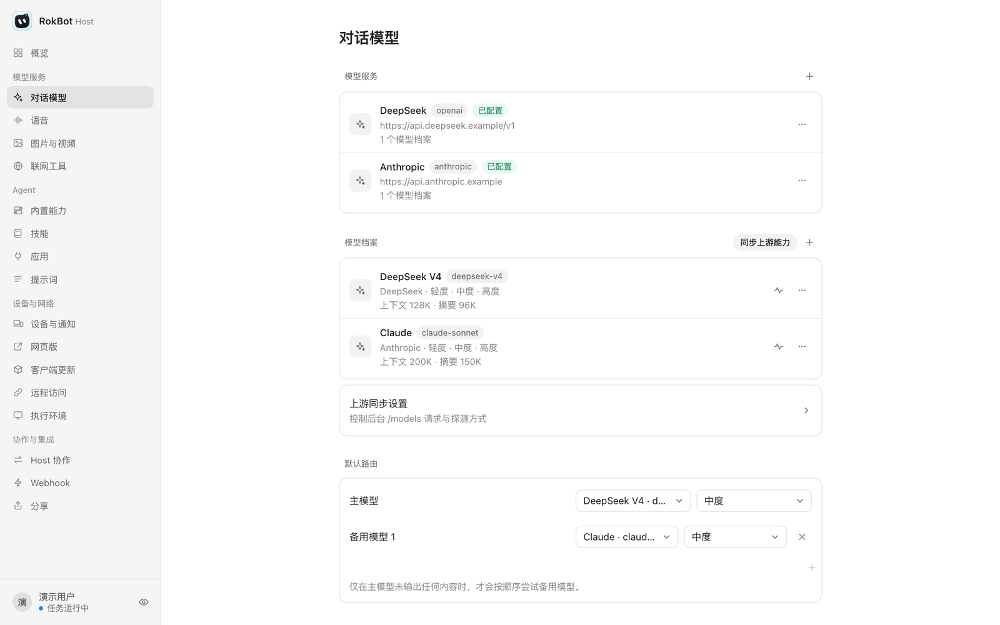 |
| **图片与视频** | **语音** |
| 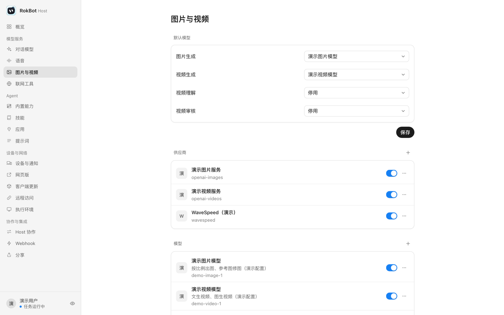 | 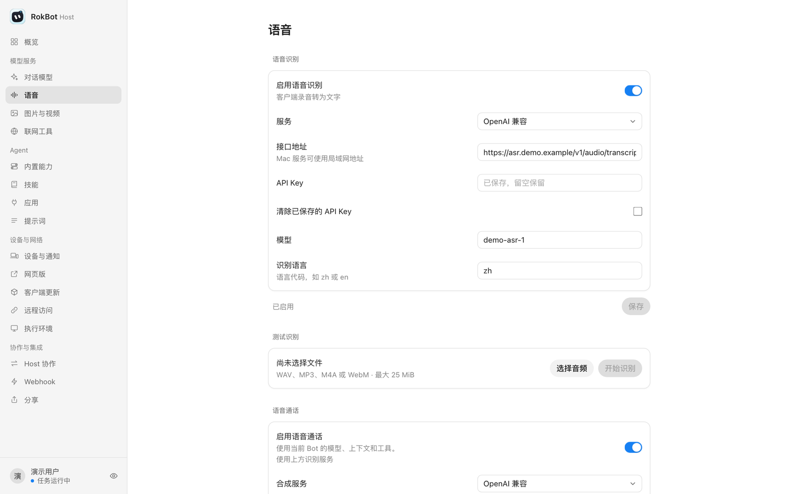 |

Android 截图为英文界面，桌面端和管理页截图为中文界面。Android、桌面端、网页版和管理页都提供中英文界面。

## 支持平台

各端客户端由补丁工具在你本机生成，补丁只接受下表中的官方版本。版本以仓库中锁定的配置文件为准。

| 平台 | 形式 | 对应的官方版本 | 说明 |
| --- | --- | --- | --- |
| macOS | Apple Silicon 客户端 | 1.2.3 | [`mac/README.md`](mac/README.md) |
| Windows | x64 安装版和便携版 | 1.2.3（推荐），也接受 0.71.2 | [`windows/README.md`](windows/README.md) |
| 网页版 | 浏览器，可添加到主屏幕 | 界面取自 Windows 1.2.3（推荐）或 0.71.2 | [`web/README.md`](web/README.md) |
| Android | 原生 APK（arm64-v8a） | 1.26.0（build 3212） | [`android/README.md`](android/README.md) |
| iOS | IPA，需要自备解密的原版 IPA | 1.27.0（29519），也接受 1.26.0、1.16.0 | [`ios/README.md`](ios/README.md) |
| Linux 服务端 | Docker：`host`（amd64 / arm64）和 `box`（amd64） | Host 基线 `2bb5e41` | [`host/README.md`](host/README.md) |

锁定版本的来源：`mac/patchers/desktop/supported.json`、`windows/patchers/desktop/supported.json`、`web/patchers/supported.json`、`android/recipes/manifest.json`、`ios/recipes/ios/manifest.json`、`host/recipes/host/manifest.json`。

## 快速开始

### 1. 部署 Host 和执行容器

准备一台装好 Docker（含 Compose v2）的 Linux 或 macOS 服务器，执行：

```bash
mkdir rokbot && cd rokbot
curl -fsSL https://raw.githubusercontent.com/hongfaqiu/rokbot/main/host/release/install-images.sh -o install-images.sh
bash install-images.sh
```

脚本依次完成以下工作：

1. 生成 `.env`（权限 0600）并填好随机密钥；
2. 拉取镜像；
3. 启动 Host 和 `box` 容器；
4. 如果 Compose 支持，等待健康检查通过；
5. 打印管理页和网页版的地址。

> [!TIP]
> - **交给 AI 部署**：把 [`docs/AGENT_DEPLOY.md`](docs/AGENT_DEPLOY.md) 发给 Claude Code、Cursor、Codex 等 AI 编程助手，它会按手册完成环境检查、部署和验收。
> - **常用参数**：
>   - 已经在本地克隆了仓库，用 `bash install-images.sh --local`；
>   - 想先改配置再启动，用 `--prepare-only`；
>   - 离线环境，先用 `docker load` 导入镜像，再用 `--offline`。
> - **镜像加速和代理**：在 `.env` 中设置 `ROKBOT_HOST_IMAGE` / `ROKBOT_BOX_IMAGE` 换成镜像地址，或设置 `HTTP_PROXY` / `HTTPS_PROXY`。

### 2. 初始化 Host 并连接客户端

1. 读取一次性初始化密钥：
   ```bash
   docker compose --env-file .env -f docker-compose.images.yml exec -T host cat /data/setup-key
   ```
2. 用浏览器打开管理页 `http://127.0.0.1:18080/admin`，输入初始化密钥，设置管理员密码（12–128 位）。
3. 连接客户端：
   - **原生客户端**：在管理页「设备与通知」创建 6 位配对码，在 macOS、Windows、Android 或 iOS 客户端中输入 Host 地址和配对码；也可以直接用管理员密码登录。
   - **网页版**：默认启用，地址是 `http://127.0.0.1:18081/web/`。公开的预构建镜像不包含网页版界面包，第一次使用前需要按 [`web/README.md`](web/README.md) 生成界面包，并在管理页「网页版」上传。

### 3. 配置模型

在管理页「对话模型」（`/admin?view=model`），或用管理员密码配对的客户端设置里：

1. 添加模型服务：选择接口格式（OpenAI Chat、OpenAI Responses 或 Anthropic），填写 Base URL 和 API Key；
2. 读取模型列表，创建模型档案并测试连接；
3. 设置默认路由；需要时，为单个 Bot 单独设置路由和备用模型。

保存后就可以创建 Bot、开始对话了。

## 架构概览

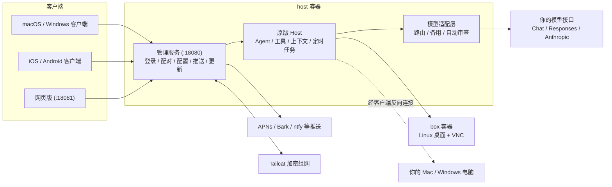

- **Host**：原版 Node.js 程序，只替换和官方服务绑定的部分（身份验证、Agent 身份、模型调用、MCP 配置），外面加一层管理服务。
- **执行电脑**：官方 Linux 桌面镜像，原样运行在 Docker 里；也可以让 Agent 操作你自己的电脑。
- **客户端**：保留原版界面，补丁让它只连接你的 Host。补丁只做「复制」和「新增」两种操作，每一段都先校验原文件的哈希，不反编译、不重写原版程序。

详细设计见 [`docs/ARCHITECTURE.md`](docs/ARCHITECTURE.md)。

## 文档

| 文档 | 内容 |
| --- | --- |
| [`docs/AGENT_DEPLOY.md`](docs/AGENT_DEPLOY.md) | 写给 AI 编程助手的部署手册：环境检查、预构建镜像部署、源码构建、首次启动、模型配置、发版与排障 |
| [`docs/AI-INSTALL.md`](docs/AI-INSTALL.md) | 用 `host/deploy.py` 部署：机器选择、分机部署、日常运维、数据卷备份与恢复 |
| [`docs/ARCHITECTURE.md`](docs/ARCHITECTURE.md) | 原理、功能对照、各部分实现、目录结构、测试与已知限制 |
| [`docs/PATCHING_WORKFLOW.md`](docs/PATCHING_WORKFLOW.md) | 各平台补丁的适配基线和维护流程 |
| [`docs/REBRAND_COMPAT.md`](docs/REBRAND_COMPAT.md) | 重命名对照：环境变量、接口标识和旧环境迁移（英文） |
| [`tests/e2e/README.md`](tests/e2e/README.md) | 黑盒端到端测试套件的运行方法 |
| [`SECURITY.md`](SECURITY.md) | 漏洞报告方式和部署安全建议 |

## 常见问题

**没有公网 IP，怎么在外面访问？**

在管理页「远程访问」开启内置的 Tailcat，不需要 Tailscale 账号；也可以用 Tailscale、VPN 或 HTTPS 反向代理。网页版不支持 Tailcat，外网使用网页版请用 VPN 或 HTTPS 域名。不要把管理页直接暴露到公网，见 [`SECURITY.md`](SECURITY.md)。

**为什么手机在局域网里连不上 Host？**

`ROKBOT_LISTEN_ADDRESS` 默认是 `127.0.0.1`，只有本机能访问。局域网使用时，把它改成服务器的局域网 IP（或在防火墙后用 `0.0.0.0`）。注意，Docker 发布的端口会绕过 ufw 等主机防火墙。

**ARM 服务器能部署吗？**

能。Host 镜像支持 `linux/arm64`；执行桌面 `box` 只有 `linux/amd64` 镜像，需要在宿主机开启 binfmt/QEMU，Apple Silicon 上可以用 Rosetta。

**为什么仓库里没有客户端安装包？**

本仓库不包含、也不分发原版程序文件。补丁工具在你本机下载官方安装包，校验哈希后打补丁；生成的客户端和网页版界面包都不对外分发。具体步骤见各平台目录的 README。

**API Key 存在哪里？会被读出来吗？**

API Key 保存在 Host 数据卷的 `/data/model.env`。管理接口和客户端只能看到「是否已设置」，读不到 Key 本身。

**怎么备份数据？**

数据在 `host-data`（挂载为 `/data`）、`box-home` 和 `box-workspace` 三个数据卷里。用 `host/deploy.py` 部署时，可以运行 `python3 host/deploy.py backup`，恢复步骤见 [`docs/AI-INSTALL.md`](docs/AI-INSTALL.md#volume-recovery)。备份里有对话记录和 Key，请妥善保管。不要运行 `docker compose down -v`，它会删除数据卷。

## 许可证

RokBot 使用 [ProkBot Noncommercial License 1.0](LICENSE)。允许个人使用、自托管、学习、修改和非商业分发；禁止任何商业用途，包括出售或付费授权、付费托管和付费服务、集成到商业产品、企业内部使用，以及通过广告等方式变现。完整条款以 [LICENSE](LICENSE) 为准，衍生关系和第三方组件见 [NOTICE](NOTICE)。

本项目基于 [ProkBot](https://gitee.com/ahaduoduoduo/ProkBot) 和 [ferretgeek/prokbot-plus](https://github.com/ferretgeek/prokbot-plus) 开发，并受到 `rakazo` 在自托管部署方面工作的启发，在此致谢。

## 免责声明

RokBot 是独立的开源项目，与 xAI、Grok Bot 及 Cursor / Anysphere 没有任何关联，也未获得其认可。Grok、Grok Bot 及相关名称和标志归各自的权利人所有。安全问题请按 [SECURITY.md](SECURITY.md) 私下报告。
