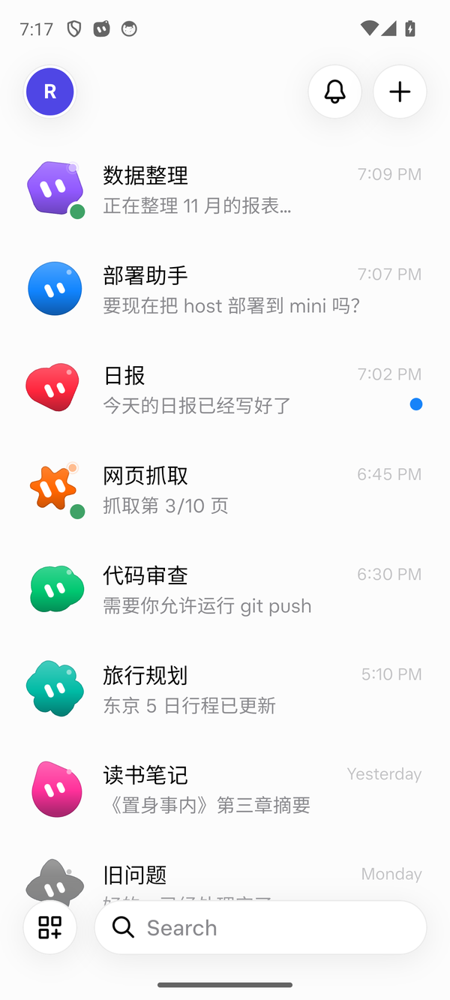
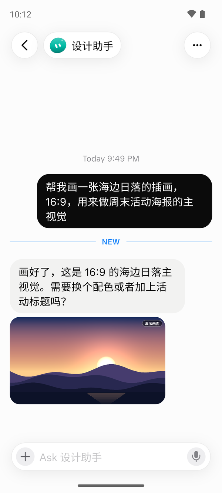
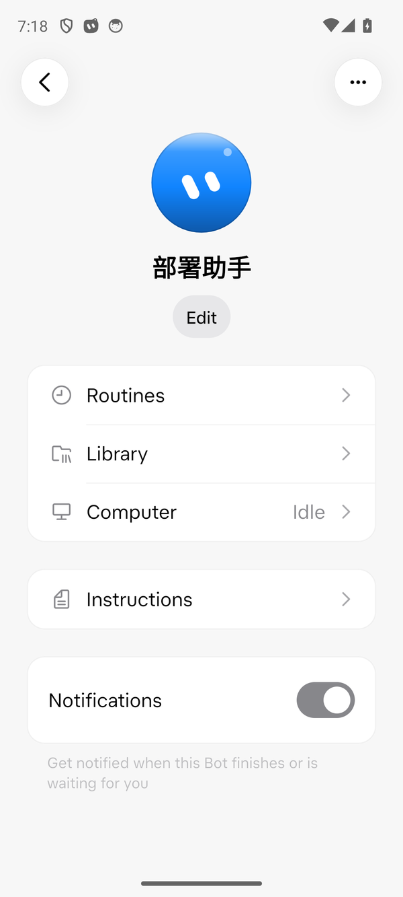

<p align="center">
  
</p>

<h1 align="center">RokBot</h1>

<p align="center">
  部署在你自己服务器上的私有 AI 助手：自选模型，数据留在本地，全平台原生客户端与网页版自由接力。
</p>

<p align="center">
  <a href="LICENSE"></a>
  <a href="docs/clients.md"></a>
  <a href="#快速开始"></a>
</p>

<p align="center">
  <a href="docs/media/rokbot-promo.mp4">
    
  </a>
  <br />
  <sub><a href="docs/media/rokbot-promo.mp4">观看完整宣传片（80 秒，带配音）</a></sub>
</p>

<!-- 用户可在 GitHub 网页编辑器中把 mp4 拖入此处，生成 user-attachments 链接后即可内嵌播放 -->

<div align="center">

<table>
  <tr>
    <td align="center"><br /><sub>Bot 列表</sub></td>
    <td align="center"><br /><sub>聊天与生图</sub></td>
    <td align="center"><br /><sub>Bot 的电脑与任务</sub></td>
    <td align="center"><br /><sub>审批卡片</sub></td>
  </tr>
</table>

<sub>更多 Android、桌面端与管理页截图见 <a href="docs/screenshots.md">界面截图</a></sub>

</div>

<p align="center">
  <strong>简体中文</strong> ·
  <a href="README.en.md">English</a> ·
  <a href="#与上游的区别">与上游对比</a> ·
  <a href="#为什么选择-rokbot">核心优势</a> ·
  <a href="#最新功能">最新功能</a> ·
  <a href="#快速开始">快速开始</a> ·
  <a href="#完整文档">完整文档</a>
</p>

## 与上游的区别

RokBot 是在官方 Grok Bot 基础上打造的个人自托管重制版，衍生自上游开源项目 [ProkBot](https://gitee.com/ahaduoduoduo/ProkBot) 与 [ferretgeek/prokbot-plus](https://github.com/ferretgeek/prokbot-plus)（详见 [NOTICE](NOTICE)）。

| 维度 | 官方 Grok Bot | ProkBot | prokbot-plus | RokBot |
| --- | --- | --- | --- | --- |
| 部署与数据归属 | 官方云端托管，需云端账号 | 自托管 Docker，数据留本地 | 自托管 Docker，支持 ARM64 与备份恢复 | 自托管 Docker + GHCR 预构建镜像一键部署，支持离线与源码构建 |
| 模型接入与路由 | 仅限官方模型 | 自选模型（OpenAI Chat 为主） | OpenAI Chat / Responses / Anthropic，单 Bot 路由与备用 | 新增 6 场景独立模型路由 + Android 单 Bot 详情页选模型，每路最多 8 个备用 |
| Android 客户端 | 官方原生客户端（连官方云） | 旧版 WebView 套壳 | 旧版 WebView 套壳 | 全新原生 React Native + Hermes 补丁（16KB 对齐、6 个原生模态页、系统分享） |
| 桌面端与网页版 | 官方桌面端（无自托管网页版） | macOS + iOS | 新增 Windows（1.1.0/0.71.2）与网页版 | 桌面端与网页版升级至 1.3.0 基线，新增 Linux x64/arm64 桌面端，网页版彻底解耦 |
| 近期交互增强 | 官方云端策略 | 基础对话与云电脑 | 网页端、应用目录、Webhook、用量统计 | 输入框快捷建议、多选批量下载图片（桌面/网页/Android 相册）、Android 原生建群 |
| 隐私与遥测 | 官方云端账号与遥测 | 本地配对，关闭遥测 | 本地配对，关闭遥测 | 全端关闭遥测、API Key 只写不读，内置 Tailcat 零账号穿透与多端增量更新 |

## 为什么选择 RokBot

- **完全自托管，数据留在自己机器上**：Agent 服务端（Host）和 Linux 执行桌面（`box`）以 Docker 运行在自己的服务器上，对话、文件、配置和 API Key 全部保存在本地数据卷中。API Key 只写不读，全端遥测与错误上报已关闭。
- **模型自由选择，按场景精细路由**：兼容 OpenAI Chat Completions、OpenAI Responses 和 Anthropic Messages 三种接口格式。支持默认路由、单个 Bot 专属路由以及 6 个独立场景模型配置，每条路由最多 8 个自动故障备用，输出中途绝不误切。
- **全平台客户端覆盖**：支持 macOS、Windows、Linux 原生桌面端、原生 Android APK、iOS IPA 及独立网页版。所有客户端连接同一台 Host，电脑上布置的任务可在手机或浏览器上无缝接力。
- **自带云电脑，也能安全操作本机**：内置带实时 VNC 接管的 Linux 桌面容器，也可替换为远程 Linux 执行节点；通过客户端反向连接，Bot 可在无需开放端口的前提下操作你的 Mac（命令与图形界面）或 Windows（本机命令）。
- **无账号配对与免公网 IP 访问**：无需注册云端账号，通过 6 位一次性配对码或管理员密码接入；局域网支持 IP 直连与 Android 自动扫描，外网可使用内置 Tailcat 加密组网（无需 Tailscale 账号）、Tailscale 或 HTTPS 反向代理。
- **自动化、多媒体与安全护栏齐全**：内置 cron 定时任务、HMAC-SHA256 签名 Webhook、图片/视频生成与语音通话、按模型统计的 Token 用量面板，以及敏感操作自动审查与原生审批卡片。

完整功能介绍见 [docs/features.md](docs/features.md)，系统架构见 [docs/architecture-overview.md](docs/architecture-overview.md)。

## 最新功能

以下要点摘自最近发版说明（详见 [2026-11-27 更新说明](docs/releases/2026-11-27.md)）：

- **桌面端与网页版升级至 1.3.0**：macOS、Windows 桌面端与网页版默认升级至官方 1.3.0 基线，保留全部 RokBot 自托管能力，同时兼容 `1.2.3` / `0.71.2` 回退构建。
- **新增 Linux 桌面客户端**：支持 Linux x64 (`amd64`) 与 arm64 (`aarch64`)，支持在 Linux 或 macOS 上跨平台一次产出 `.deb`、`.tar.gz` 与便携目录，内置 Tailcat 并支持增量更新。
- **按场景分配模型**：可在管理页或 Android 模型设置页为输入框建议、上下文压缩、记忆提取、自动审核、子 Agent 执行、定时任务 6 个场景分别指定模型档案与思考强度，留空自动沿用默认路由。
- **输入框快捷建议**：网页版与 Android 对话输入框上方提供上下文相关快捷建议，点击即填；支持单独配置轻量模型，未配置或失败时自动回退中英文预置建议。
- **多选批量下载图片**：桌面端支持一键保存到文件夹或打包 ZIP，网页版自动打包 ZIP，Android 原生图片查看器支持多选批量保存至系统相册（`Pictures/RokBot`）。
- **Android 单 Bot 指定模型与原生建群**：可在单个 Bot 详情页直接指定专属模型；点击会话列表右上角「+」弹出原生底部菜单，一键新建 Bot 或拉多个 Bot 建群协作。

## 快速开始

准备一台装有 Docker（含 Compose v2）的 Linux 或 macOS 服务器，3 步即可跑通：

1. **登录 GHCR、克隆仓库并启动服务**（本仓库与预构建镜像需访问权限）：

   ```bash
   echo "$GHCR_TOKEN" | docker login ghcr.io -u <GitHub 用户名> --password-stdin
   gh repo clone hongfaqiu/rokbot rokbot-src
   mkdir rokbot && cd rokbot
   bash ../rokbot-src/host/release/install-images.sh --local
   ```

2. **初始化管理页并配置模型**：

   ```bash
   docker compose --env-file .env -f docker-compose.images.yml exec -T host cat /data/setup-key
   ```

   打开 `http://127.0.0.1:18080/admin`，输入初始化密钥并设置管理员密码，随后在「对话模型」添加模型服务、创建档案并设为默认路由。

3. **获取并连接客户端**：本仓库不直接分发安装包，按 [客户端构建与获取指南](docs/clients.md) 自行打补丁或从 Host 获取客户端，在管理页生成 6 位配对码即可接入。

详细参数、离线安装、源码构建与 AI 助手自动部署见：[部署指南](docs/deployment.md) · [AI 助手部署手册](docs/AGENT_DEPLOY.md) · [高级运维与备份](docs/AI-INSTALL.md)。

## 完整文档

| 文档 | 内容 |
| --- | --- |
| [docs/features.md](docs/features.md) | 全部核心功能说明（云电脑、模型路由、多媒体、语音、自动化、网络与隐私） |
| [docs/screenshots.md](docs/screenshots.md) | Android、桌面端与管理页完整界面截图 |
| [docs/deployment.md](docs/deployment.md) | 详细部署步骤、常用脚本参数、初始化与模型配置 |
| [docs/clients.md](docs/clients.md) | 支持平台版本表、六端客户端构建命令与 Host 增量分发 |
| [docs/architecture-overview.md](docs/architecture-overview.md) | 架构概览与组件交互图 |
| [docs/faq.md](docs/faq.md) | 常见问题解答与分发合规说明 |
| [docs/releases/2026-11-27.md](docs/releases/2026-11-27.md) | 2026-11-27 版本更新说明 |
| [docs/AGENT_DEPLOY.md](docs/AGENT_DEPLOY.md) | 写给 AI 编程助手的部署手册（检查、部署、发版与排障） |
| [docs/AI-INSTALL.md](docs/AI-INSTALL.md) | 使用 `host/deploy.py` 部署、分机部署、日常运维与数据卷备份恢复 |
| [docs/ARCHITECTURE.md](docs/ARCHITECTURE.md) | 完整技术架构、功能对照、模块实现与目录结构 |
| [docs/PATCHING_WORKFLOW.md](docs/PATCHING_WORKFLOW.md) | 各平台补丁基线与维护流程 |
| [docs/REBRAND_COMPAT.md](docs/REBRAND_COMPAT.md) | 重命名对照：环境变量、接口标识与旧环境迁移（英文） |
| [tests/e2e/README.md](tests/e2e/README.md) | 黑盒端到端测试套件运行方法 |
| [SECURITY.md](SECURITY.md) | 漏洞报告方式与部署安全建议 |

## 许可证与致谢

RokBot 使用 [ProkBot Noncommercial License 1.0](LICENSE)（允许个人使用、自托管、学习、修改与非商业分发，禁止任何商业用途；衍生关系与第三方声明见 [NOTICE](NOTICE)，合规说明见 [docs/faq.md](docs/faq.md#分发与合规说明)）。本项目基于 [ProkBot](https://gitee.com/ahaduoduoduo/ProkBot) 和 [ferretgeek/prokbot-plus](https://github.com/ferretgeek/prokbot-plus) 开发，并受到 `rakazo` 在自托管部署方面工作的启发，在此致谢；友情链接：[LINUX DO](https://linux.do)。

RokBot 是独立的开源项目，与 xAI、官方 Grok Bot 及 Cursor / Anysphere 没有任何关联，也未获得其认可；相关名称和标志归各自权利人所有。安全问题请按 [SECURITY.md](SECURITY.md) 私下报告。
