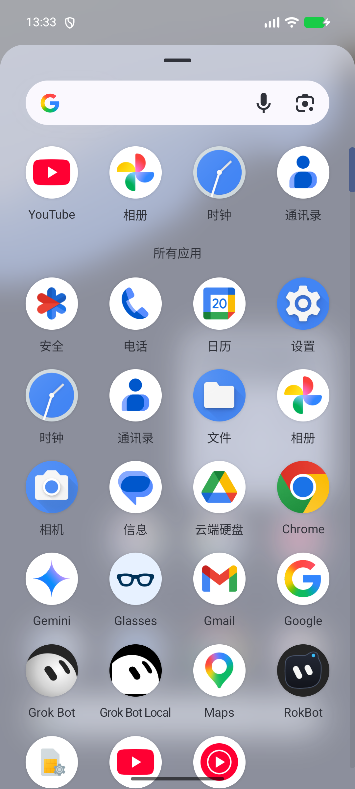
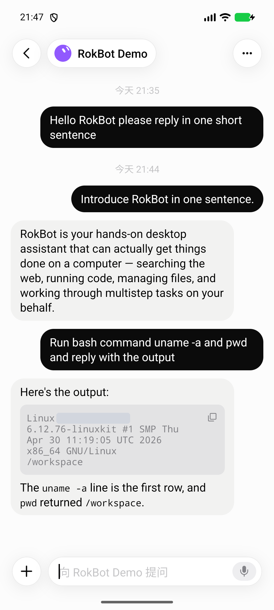
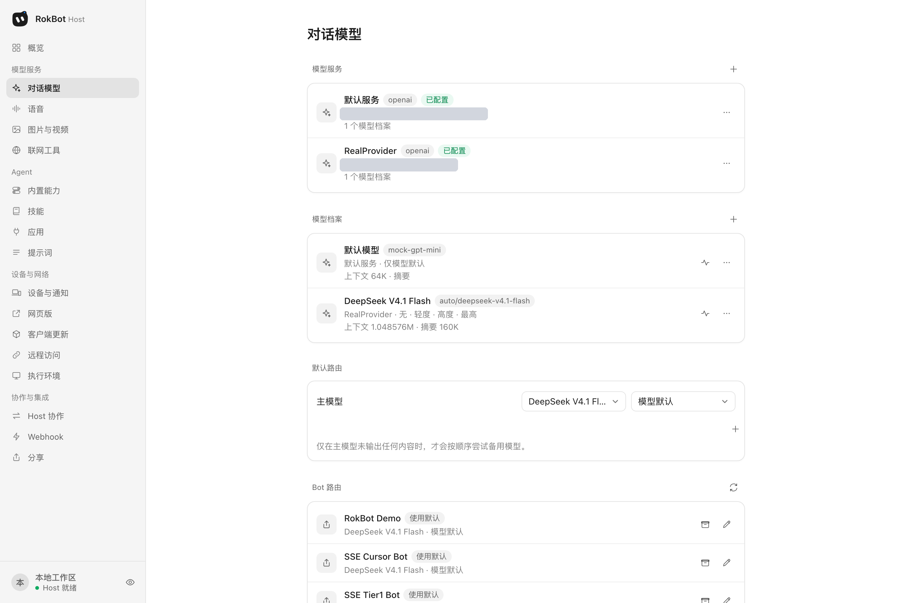

# RokBot

**在自己的服务器上自托管运行 RokBot，接入你自己的模型，并坚持全端官方原生客户端补丁路线。**

**简体中文** · [English](README.en.md) · [AI Agent 部署引导](docs/AGENT_DEPLOY.md) · [补丁改造流程](docs/PATCHING_WORKFLOW.md) · [兼容与重命名说明](docs/REBRAND_COMPAT.md)

<p align="center"></p>

---

## 简介

RokBot 是一套面向自托管场景的 AI 助手服务端与全端官方原生客户端补丁工程：

- **全端原生路线（舍弃套壳）**：Android 端直接对官方原生 React Native + Hermes 安装包（`.xapk` / `.apks` / `.apk`）执行补丁，100% 保留原版界面与交互；macOS / Windows / iOS / 网页版同样基于官方安装包补丁生成。
- **自托管 Host 增强**：基于官方 Host `2bb5e41`，支持 Anthropic Messages / OpenAI Responses / OpenAI Chat 多接口、按 Bot 独立模型路由、可靠上下文压缩、管理员密码配对、多机本地执行与默认机器固定路由（`ROKBOT_DEFAULT_MACHINE_ID`）。
- **一键部署 + 应用内配置 + 自建更新源**：预构建镜像一键安装；在任意客户端里直接配置模型；四端客户端的签名增量更新由你自己的 Host 下发。
- **零官方闭源分发**：本仓库不含任何官方程序包、成品 APK/IPA 或密钥；所有客户端均由用户在本地基于自行校验的官方安装包生成。

---

## 与上游的详细对比

上游指 [ProkBot](https://gitee.com/ahaduoduoduo/ProkBot)（基线 `3e9fe8c`）与 [ferretgeek/prokbot-plus](https://github.com/ferretgeek/prokbot-plus)（参考至 `1.5.1`）。

| 方面 | 上游 | RokBot |
| --- | --- | --- |
| 品牌 | `grokbot` / ProkBot 命名，沿用官方图标 | 全面更名为 `rokbot`：`ROKBOT_*` 环境变量、`x-rokbot-*` 请求头、`rokbot_*` Cookie、`rokbot-local://` 链接、`RBDELTA1` / `RBD1` 增量格式、`ghcr.io/hongfaqiu/rokbot/*` 镜像；旧名仅作迁移兼容，见 [REBRAND_COMPAT.md](docs/REBRAND_COMPAT.md) |
| Logo | 官方 Grok Bot 图标 | 全新**变形 RokBot Logo**（[`assets/logo/`](assets/logo/)），统一生成 PNG / `.ico` / `.icns` / Android 自适应 `mipmap-*` / iOS `AppIcon` / Host 管理后台与网页图标 |
| Host 基线 | Host `d0a4baa` / Box `9d2ac1b` | 升级到官方 **Host `2bb5e41` + `sand-box-2bb5e41`**（`officekit-ts`、多机本地执行、Local CUA、新扩展体系），全部字节补丁重新移植并通过测试；修复 `starting extension mcp` 阻塞模型热重载的问题 |
| 多机执行路由 | 多台电脑在线时隐式执行可能随机落到任意一台 | **ExternalShell 路由**：隐式执行确定性地落到 `ROKBOT_DEFAULT_MACHINE_ID`；未配置且多机在线时明确报错，绝不静默随机落点 |
| 设备去重 | 重新配对同一台设备会在设备列表里留下重复条目 | 客户端上报稳定的 `clientDeviceId`（Android / iOS / 桌面 / 网页），重新配对时替换旧条目而不是新增 |
| 模型配置 | 只能在 Host 管理后台或 `.env` 中修改 | **全部客户端应用内配置**：`GET/PUT /local/model`、`/local/model/catalog`（拉取模型列表）、`/local/model/test`（真实测试请求），修改后 Host 自动热重载；首次连接 `needsModel` 时客户端主动引导 |
| 客户端更新 | 手动重新下载安装 | **四端签名增量自动更新**，由自建 Host 下发：Android `RBDELTA1` 增量 + 证书指纹校验；macOS / Windows ECDSA P-256 签名清单 + `RBD1` ASAR 增量；iOS 提供 `itms-services` / AltStore / SideStore / IPA 分享安装 |
| 部署方式 | 本地拉取官方 Host 包后自行构建镜像 | 保留离线构建，同时新增参考 `rakazo` 的**预构建镜像一键部署**：[`install-images.sh`](host/release/install-images.sh) + [`docker-compose.images.yml`](host/release/docker-compose.images.yml)，自动生成密钥、同步代理、等待健康检查并打印上手步骤 |
| 桌面端 / 网页版 | Windows `1.1.0`、macOS `0.71.2`、网页界面取自 `1.1.0` | macOS / Windows / 网页版升级到官方 **`1.2.3`**，带 RokBot 图标、应用内模型配置与自动更新 |
| Android | WebView 套壳 Windows 界面 | 官方原生 RN `1.16.0` 补丁：Pairip 去校验、Hermes 字节码补丁、Companion DEX、16KB 对齐 Tailcat、原生模型配置页与更新页 |
| 测试 | 各模块单元测试 | 新增 [`tests/e2e/`](tests/e2e/) 黑盒端到端测试套件（Tier 1–4 共 199 项 + Tier 5 对抗性加固），并在 Android 模拟器 + 本地 Host 上做过真实联调 |

---

## 目录结构

| 目录 | 说明 | 当前适配基线 |
| --- | --- | --- |
| [`host/`](host/) | 自托管 Host 运行时、管理后台、更新服务、Docker 构建、一键部署与字节差分补丁 | Host `2bb5e41` / Box `sand-box-2bb5e41` |
| [`android/`](android/) | **官方原生 React Native Android 补丁器**（Pairip 去校验、Hermes 字节码补丁、Companion DEX、16KB 对齐 Tailcat `.so`、原生模态页） | 官方 Android `1.16.0`（build `1075`） |
| [`windows/`](windows/) | Windows x64 客户端补丁与安装器 | 官方 Windows `1.2.3` |
| [`mac/`](mac/) | macOS Apple Silicon 客户端补丁 | 官方 macOS `1.2.3` |
| [`ios/`](ios/) | iOS arm64 砸壳 IPA 注入补丁（原生 dylib 注入） | 官方 iOS `1.16.0`（build `23152`） |
| [`web/`](web/) | 浏览器网页版客户端打包与上传工具 | 界面取自 Windows `1.2.3` |
| [`assets/logo/`](assets/logo/) | 变形 RokBot Logo 母版 SVG 与各平台图标 | — |
| [`tests/e2e/`](tests/e2e/) | 黑盒端到端测试套件 | — |
| [`docs/`](docs/) | 部署手册、架构文档、[品牌重命名兼容说明](docs/REBRAND_COMPAT.md)与截图 | — |

---

## 新手一键部署 Host

只需要一台装好 Docker（含 Compose v2）的 Linux / macOS 机器，不需要克隆仓库、不需要构建镜像。

```bash
mkdir rokbot && cd rokbot
curl -fsSL https://raw.githubusercontent.com/hongfaqiu/rokbot/main/host/release/install-images.sh -o install-images.sh
bash install-images.sh
```

脚本会自动完成：下载 `docker-compose.images.yml` 与 `.env.images.example` → 生成 `.env`（权限 `0600`，自动填充随机密钥）→ 拉取镜像 → 启动 → 等待健康检查 → 打印访问地址与上手步骤。

> [!TIP]
> - 仓库为私有或已克隆到本地时，进入 `host/release/` 执行 `bash install-images.sh --local`，直接使用本地文件。
> - 只想先生成配置再修改：`bash install-images.sh --prepare-only`，编辑 `.env` 后再执行一次 `bash install-images.sh`。
> - 内网 / 无法拉取镜像：先把镜像导入本机 Docker，再执行 `bash install-images.sh --offline`。
> - 需要代理或镜像加速：在 `.env` 里填 `HTTP_PROXY` / `HTTPS_PROXY`，或把 `ROKBOT_HOST_IMAGE` / `ROKBOT_BOX_IMAGE` 改成你的镜像仓库地址。

首次上手（脚本结束时也会打印）：

1. 取出一次性初始化密钥：`docker compose --env-file .env -f docker-compose.images.yml exec -T host cat /data/setup-key`
2. 打开 `http://127.0.0.1:18080/admin`，输入初始化密钥并设置管理员密码。
3. 在「设备」页生成 6 位配对码，在客户端里填写 Host 地址 + 配对码（或直接用管理员密码登录）。
4. 在客户端里配置模型（见下一节），或在管理后台「模型」页配置。
5. 需要局域网 / 公网访问时，在 `.env` 中设置 `ROKBOT_LISTEN_ADDRESS=0.0.0.0` 与 `ROKBOT_PUBLIC_URL`，建议放在 HTTPS 反向代理之后。

常用 `.env` 选项：

| 变量 | 默认值 | 说明 |
| --- | --- | --- |
| `ROKBOT_PUBLIC_PORT` | `18080` | 对外端口 |
| `ROKBOT_LISTEN_ADDRESS` | `127.0.0.1` | 监听地址，局域网访问改为 `0.0.0.0` |
| `ROKBOT_PUBLIC_URL` | 空 | 对外 HTTPS 地址（iOS OTA 安装必须） |
| `ROKBOT_ALLOW_DEVICE_MODEL_CONFIG` | `1` | 是否允许客户端应用内修改模型 |
| `ROKBOT_DEFAULT_MACHINE_ID` | 空 | 多台电脑接入时的默认执行机器 |
| `ROKBOT_UPDATE_DIR` | `/data/updates` | 四端更新包存放目录 |

面向 AI Agent（Claude Code / Cursor / Codex / Antigravity 等）的自动化部署、健康校验、模型配置与四端更新发布指令见 [`docs/AGENT_DEPLOY.md`](docs/AGENT_DEPLOY.md)；离线自行构建镜像、数据备份、拆分执行电脑等进阶用法见 [`docs/AI-INSTALL.md`](docs/AI-INSTALL.md) 与 [`host/README.md`](host/README.md)。

---

## 生成客户端

| 平台 | 命令 | 文档 |
| --- | --- | --- |
| Android | `node android/release/patch-android.mjs --input-apk /path/to/grok-bot-1.16.0.xapk --output-apk android/output/rokbot-android-patched.apk --force` | [`android/README.md`](android/README.md) |
| iOS | `python3 ios/release/patch-ios.py --input /path/to/decrypted.ipa ...`（需自备砸壳 IPA 与签名） | [`ios/README.md`](ios/README.md) |
| macOS / Windows | 见各自目录，工具会自动下载并校验官方 `1.2.3` 安装包 | [`mac/README.md`](mac/README.md) · [`windows/README.md`](windows/README.md) |
| 网页版 | 生成 `web/output/RokBotLocal-web-1.2.3.zip` 后在管理后台上传 | [`web/README.md`](web/README.md) |

所有命令只需 Node.js `>= 20`（iOS 另需 Python 3 与签名工具）。

---

## 应用内模型配置

Host 首次启动时还没有模型，客户端连接后会通过 `GET /local/status` 得到 `needsModel: true`，并弹出引导提示。

1. **打开模型配置**：Android 在连接页点「模型配置」（`ModelsActivity`）；iOS 在已连接页点「模型配置」（`RBModels`）；macOS / Windows / 网页版在设置或顶部引导横幅中打开。
2. **添加模型服务**：选择接口类型（`openai` Chat、`openai-responses`、`anthropic`），填写 Base URL 与 API Key。API Key 只写不读：保存后客户端只能看到「已设置」，留空保存会保留原有 Key。
3. **拉取模型列表**：点「获取模型」调用 `POST /local/model/catalog`，从上游 `/models` 拉取可用模型，并可设置推理强度与上下文窗口。
4. **测试**：点「测试」调用 `POST /local/model/test`，Host 用该配置发送一次真实请求（`Reply with OK.`）并返回延迟。
5. **保存并切换**：保存后 Host 写入 `/data/model.env` 并自动热重载运行时，返回 `reload.status: "applied"` 后即可直接开始对话；可随时切换默认模型。

权限：默认只有用**管理员密码**配对的设备才能修改模型；用配对码登录的设备可在保存时输入管理员密码临时提权。运维可通过 `ROKBOT_ALLOW_DEVICE_MODEL_CONFIG=0` 完全关闭应用内配置。

---

## 四端增量更新

更新包由管理员自己生成、签名并上传到自己的 Host，客户端只信任自己 Host 下发的、签名校验通过的包。

**管理员发布流程（管理后台 → 客户端更新）**

1. 用本仓库的补丁工具生成新版客户端（Android 请固定使用同一个签名密钥 `--keystore`，否则无法覆盖安装）。
2. 打开 `/admin?view=updates`，选择平台（Android / iOS / macOS / Windows）与发布通道，上传已签名的 `.apk` / `.ipa` / `.dmg` / `.zip` / `.exe`；桌面端可额外上传 `app.asar`。
3. 填写版本号与数字版本号（Android `versionCode` / iOS build），Android 证书 SHA-256 会从 APK 自动提取。
4. 在「生成增量补丁」中选择一个旧版本，Host 会自动生成增量包（Android `RBDELTA1`、桌面 `RBD1`）。
5. 填写更新说明并发布。桌面端清单由 Host 的 ECDSA P-256 私钥签名，公钥在同一页面展示，并内置到客户端中。

**客户端行为**

| 平台 | 检查入口 | 更新方式 |
| --- | --- | --- |
| Android | 连接页 / 个人资料页「检查更新」 | 拉取 `/local/updates/android.json`，优先下载 `RBDELTA1` 增量并在本地还原完整 APK，校验 SHA-256、包名与签名证书指纹后调起系统安装器 |
| macOS / Windows | 启动时自动检查（空闲自动更新）或设置中手动检查 | 校验 ECDSA P-256 签名清单，优先应用 `RBD1` ASAR 增量，失败回退完整安装包 |
| iOS | 已连接页「检查更新」（每 6 小时节流） | iOS 沙盒不允许自我替换，提供 `itms-services://` OTA（需 HTTPS `ROKBOT_PUBLIC_URL`）、AltStore / SideStore 源、下载 IPA 后分享给 TrollStore / Sideloadly 三种方式 |

---

## 自托管适配与各端补丁改造流程

各端（Host `2bb5e41` 字节差分、Android `1.16.0` Split XAPK 合并 / Pairip 去校验 / Hermes 字节码补丁 / Companion DEX 注入与签名、macOS & Windows `1.2.3` Electron ASAR 配方、Web `1.2.3` 渲染层提取、iOS `1.16.0` `RokBotLocal.dylib` 注入及未来官方版本跟进方法）的完整技术细节已独立记录在 **[`docs/PATCHING_WORKFLOW.md`](docs/PATCHING_WORKFLOW.md)**。

---

## 截图

以下截图均来自 Android 模拟器（`1.16.0` 原生补丁 APK）+ 本地自托管 Host（`2bb5e41` + `sand-box-2bb5e41`）的真实联调，账号、地址、配对码、容器标识与密钥等隐私信息已打码：

| Android 桌面图标 | Android 配对连接 | Android 应用内模型配置 | Android 真实对话与沙盒执行 |
| --- | --- | --- | --- |
|  |  |  |  |

| Host 管理后台概览 | Host 模型路由配置 | Host 四端增量更新管理 |
| --- | --- | --- |
|  |  |  |

---

## 实机联调与验证摘要

| 检查项 | 结果 | 说明 |
| --- | --- | --- |
| 离线黑盒 E2E（`--tier all --repo-check`） | **PASS（199 / 199）** | Tier 1–4 全部通过，0 失败、0 跳过 |
| 在线 Host E2E（`--tier all --mode live --repo-check`） | **PASS（151 / 199，0 失败）** | 48 项隔离 Harness/未挂载功能按设计跳过（含需破坏性改写 `/data/model.env`、未上传 Web 包、未接入外部桌面节点） |
| Android 真流式对话（真实模型） | **PASS** | Android 模拟器连接本地测试 Host，通过 `POST /local/model/test`（`962–1205 ms`）及真实对话流式回复 |
| `sand-box-2bb5e41` 沙盒工具执行 | **PASS** | Android 端发起 `uname -a && pwd`，`sand-box-2bb5e41` 执行并返回容器内核与 `/workspace` |
| Host → Android `RBDELTA1` 增量更新 | **PASS** | 上传并发布 `1.16.0 -> 1.16.1`，生成 `RBDELTA1`（258 B vs 全量 3376 B），本地还原 SHA-256 一致，Android `UpdateManager` 识别新版本并验证包名/证书指纹守卫 |
| 资料库文件 CRUD 与附件安全头 | **PASS** | `/local/files` 增删查下载、`Content-Security-Policy: default-src 'none'; sandbox`、`>20 MiB` 返回 `413` 均通过 |
| Connectors 内置应用发现 | **PASS** | `/local/connectors` 与 `/admin/api/connectors` 返回内置 `app-builder`（3 个工具） |
| ExternalShell 多机路由（`ROKBOT_DEFAULT_MACHINE_ID`） | **Harness PASS / Live NOT_TESTABLE** | Harness 验证确定性路由与 `409` 保护；当前测试栈未挂载多台真实桌面 ExternalShell 节点 |
| 语音（ASR/TTS）与离线推送（APNs/FCM） | **NOT_TESTABLE（未配置上游凭证）** | `/local/voice/status` 与 `/admin/api/push` 接口就绪（当前测试栈未启用外部 Fish/APNs/FCM 凭证） |

---

## 测试

```bash
# 黑盒端到端测试套件（自带模拟 Host + 仓库静态检查）
node tests/e2e/runner.mjs --tier all --repo-check

# 针对真实运行中的 Host
ROKBOT_E2E_HOST_URL=http://127.0.0.1:18080 ROKBOT_E2E_ADMIN_PASSWORD=<管理员密码> \
  node tests/e2e/runner.mjs --tier all --mode live --repo-check
```

各模块单元测试见对应目录的 README。

---

## 参考与致谢

本项目在架构设计、字节补丁机制与多端适配思路上参考了以下两个优秀开源上游仓库：

1. **[ProkBot](https://gitee.com/ahaduoduoduo/ProkBot)**（基线 `3e9fe8c`）—— 开创性地将官方 Host 容器化并打通客户端补丁链路；
2. **[ferretgeek/prokbot-plus](https://github.com/ferretgeek/prokbot-plus)**（参考至 `1.5.1`）—— 扩展了多模型协议、按 Bot 模型路由、可靠压缩、Windows/Web 客户端及部署运维工具。

一键部署脚本的交互方式参考了 `rakazo`。RokBot 在上述工作基础上以全新仓库重新组织，聚焦**原生官方客户端补丁**与**新一代 Host 基线演进**。

---

## 许可与声明

- 沿用 [ProkBot Noncommercial License 1.0](LICENSE)：允许个人使用、学习、修改与非商业分发，禁止任何形式的商业用途（包括收费部署、付费服务与企业内部使用）。详见 [NOTICE](NOTICE)。
- 本项目与 xAI、Grok Bot 及 Cursor/Anysphere 均无任何关联。安全问题请参阅 [SECURITY.md](SECURITY.md)。
