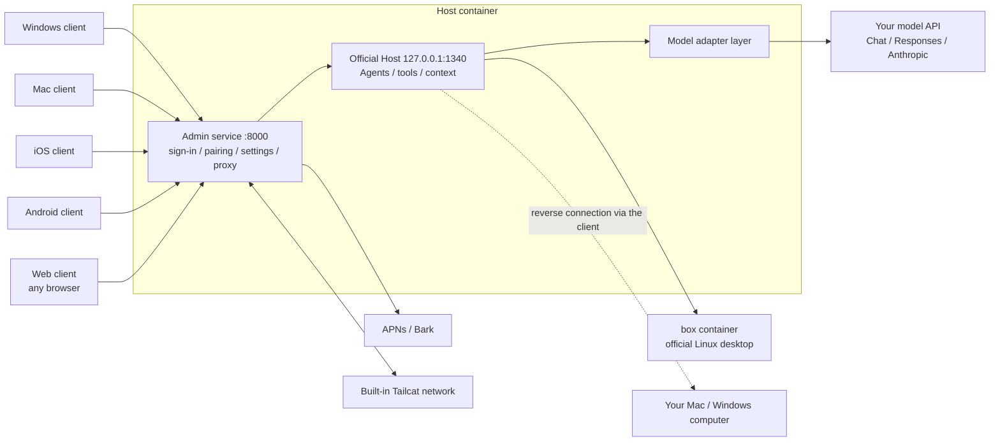

# Technical documentation

[简体中文](ARCHITECTURE.md) · [Deployment guide](AI-INSTALL.en.md) · [Rebranding & Compatibility](REBRAND_COMPAT.md)

How RokBot works, how each part is implemented, the layout, tests and maintenance, and known limitations.

## How it works

The official Grok Bot server side runs in the official cloud, in two parts: the Host handles chats, schedules Agents and stores records; the cloud computer is a Linux desktop where the Agent actually works. This project moves both onto your own machines and uses the official programs as directly as possible:

- **Host**: the official Node.js program, with only the parts tied to official services replaced, wrapped in an admin service;
- **Execution computer**: the official Linux desktop image, run unchanged in Docker. Agents can also operate your own computer;
- **Clients**: the official interface, unchanged; the patch makes them connect only to your Host.



The patch tools copy bytes from the official files you provide (or that they download), add this project's changes and produce new clients or images. A patch has only two kinds of operation, copy and add, and checks the hash of every source section. Nothing is decompiled or rewritten.

## Feature comparison

🟢 Official, kept　🔁 Replaced with your own service　⛔ Turned off

| Feature | How it works here | What you need |
| --- | --- | --- |
| 🔁 Sign-in | No account. The admin page creates a 6-character pairing code; a client enters the Host address and the code | — |
| 🔁 Host and execution computer | The Host is built for the server's architecture; the execution desktop stays official | amd64 / arm64 Linux; the amd64 desktop can run on its own machine |
| 🔁 Chat models | Several model services and profiles in three API formats; the default route or a per-Bot route sets the model, reasoning effort and fallback order | Model API address and key |
| 🟢 Computer and browser use, memory, context compaction, scheduled tasks, approvals, human takeover | Official behavior, using your model and local timers | A model with image input to operate computers |
| 🔁 Automatic review | Your model decides whether an action may run; you can write the rules | — |
| 🔁 Teach a task | Official recording; your model turns it into a skill | A model with image input |
| 🔁 Operate your computer | Through your Host; your computer opens no ports. Mac: commands and GUI control; Windows: local commands | Mac or Windows client |
| 🔁 Bot library, user profile, skills | Stored on the Host; skills have versions, diffs and restore | — |
| 🔁 Connected apps | The Host's own app catalog: code apps, remote MCP or skills only, with OAuth or API keys; Bots can write apps too | The app's own credentials |
| 🔁 Complex coding | Handed to Codex on a connected Mac or Windows PC, using that computer's Codex login and model | Codex CLI installed and signed in |
| 🔁 Sharing Bots and skills, multi-Bot collaboration | Publish to your own Host or export a ZIP; hand tasks to Bots on other Hosts | Another Host |
| 🔁 Voice input, live calls | Fish Audio, OpenAI-compatible transcription or a local model on Mac; calls use your recognition and speech services (experimental) | Voice services |
| 🔁 Image and video generation | OpenAI-compatible image APIs (aspect ratios, edits with reference images), WaveSpeed and more | Provider key |
| 🔁 Web search | Built-in web tools of Claude or OpenAI Responses models, or DeepSeek or an HTTP JSON search service | Optional |
| 🔁 Phone notifications | iOS: APNs or Bark; the Android app keeps its own connection; the web client uses browser notifications while open | For iOS, Bark or an Apple developer account with a .p8 key |
| 🔁 Access from outside | IP address, Tailscale, an HTTPS reverse proxy or the built-in Tailcat | A domain, depending on the method |
| ⛔ Telemetry, crash reports, automatic updates | Off; the patches are pinned to supported versions | — |

Official features not provided: virtual cards, external message drafts, product feedback and passkey forwarding.

Self-hosted enhancements (inherited from upstream self-hosted versions and evolved in RokBot; see [REBRAND_COMPAT.md](REBRAND_COMPAT.md#historical-attribution)): apps (one JSON file; see [app development](#app-development)), webhooks that start tasks, usage statistics, prompt management (with restore), per-model context settings, an admin web page (Chinese and English, light and dark, phone screens), a [split deployment](AI-INSTALL.en.md#split-host) and [volume backup and recovery](AI-INSTALL.en.md#volume-recovery).

## How each part is implemented

### Host and admin service

Only four parts of the official Host are replaced, the ones tied to official services: authentication, Agent identity, model calls and MCP configuration. Official scheduled tasks are triggered by the official backend, so local timers are added. The admin service in front handles administrator sign-in, device pairing, settings and push, and forwards client requests to the official Host.

- **`host` container**: the admin service listens on 8000, published on the host at `${ROKBOT_LISTEN_ADDRESS:-127.0.0.1}:${ROKBOT_PUBLIC_PORT:-18080}`; the official Host listens only on `127.0.0.1:1340` inside the container.
- **`box` container**: the official Linux desktop; its VNC port is visible only on the container network.

| Data | Contents |
| --- | --- |
| Volume `host-data` (`/data`) | Administrator (`auth.json`), devices, Bots, chats, usage and settings. Model keys in `model.env`, web tools in `web-services.json`, images in `media.json` |
| `/data/setup-key` | Setup code, deleted after setup |
| Volumes `box-home`, `box-workspace` | The execution computer's home directory and workspace |

`ROKBOT_PUBLIC_URL` in `.env` is the public address. Pairing checks that the client uses the same address, and the admin API checks `Origin` against it. It must be a whole domain or IP, without a path. `TZ` affects scheduled tasks and usage statistics.

Admin API: the administrator password (12–128 characters) is stored with scrypt, and sign-in creates a cookie session. Non-GET requests need `x-rokbot-csrf: 1`, and an `Origin`, if present, must match the public address. Sign-in, setup and model tests are limited to 5 per minute per IP. Pairing codes have 6 digits, last 5 minutes and work once; each paired device gets its own token, which the admin page can revoke. `host/tools/host-admin.mjs` does setup, model configuration and tests, pairing codes and status from the command line.

### Model adapter layer

The official Host sends model requests to an official classifier. This project takes over before the request leaves the Host: it converts the official Harness messages into one of three APIs and converts the streamed reply back. Tool calls, sub-Agents and context management are still the official logic.

| File | Role |
| --- | --- |
| `host/runtime/model-session.mjs` | Entry point; dispatches on `apiFormat` (`openai` / `openai-responses` / `anthropic`) and handles fallback |
| `host/runtime/model-routing.mjs` | Validates services, profiles and routes; resolves the default or per-Bot route and its fallback chain |
| `host/runtime/openai-chat.mjs` | Chat Completions (`/chat/completions`). Either `[DONE]` or `finish_reason` ends the stream; tool calls that arrive with `stop` still run; empty arguments count as `{}` only for tools without required parameters |
| `host/runtime/openai-responses.mjs` | Responses (`/responses`), stateless |
| `host/runtime/anthropic-messages.mjs` | Messages; the address may be the root or `/v1` |
| `host/runtime/model-common.mjs` | SSE parsing, error normalization, image and file conversion, reasoning source tags, optional-parameter fallback |
| `host/runtime/model-policy.mjs` | Reasoning effort levels and the per-model reference table |
| `host/server/models.mjs` | Saves settings, lists models, tests connections (on the same code path as real chats) |

| Capability | OpenAI Chat | OpenAI Responses | Anthropic Messages |
| --- | --- | --- | --- |
| Reasoning effort | `reasoning_effort`; DeepSeek also gets a `thinking` switch | `reasoning.effort`, with reasoning summaries and encrypted reasoning | Adaptive thinking with `output_config.effort` from Claude 4.6; thinking budgets for older models |
| Multi-turn reasoning | Sends back `reasoning_content` from the same model | `store: false`, sends back encrypted reasoning | Sends back signed thinking blocks |
| Images and files | Images, PDF, text files | Images in tool results, PDF | Images in tool results, PDF and text documents |

- **Reasoning effort**: `none`, `minimal`, `low`, `medium`, `high`, `xhigh`, `max`, and `default` (not sent). Levels come from the API's `/models` response when available, otherwise from a built-in reference table.
- **Per-Bot routes**: a service holds the format, address and key; a profile binds a service, model ID, reasoning effort and context policy. A Bot can have a main profile and up to 8 fallbacks, without Jev; sub-Agents inherit their parent Bot's route. Keys are written only to the private `model.env`.
- **Fallback**: while the main model has produced no text or tool call yet, 402, 408, 429, 5xx, network errors and upstream I/O idle timeouts (300 seconds by default) move to the next fallback. The Harness has its own 150-second first-token timeout, which usually ends the turn first. 400s, authentication errors and caller cancellations do not trigger a fallback. Fallbacks that share a key are skipped only when the key's quota is clearly used up. Once text or a tool call has gone out, the model never changes, so nothing is shown or run twice.
- **Reasoning source tags**: reasoning from one format or provider cannot be read by another. Each reasoning part records its format and service ID in `providerOptions.rokbot` and is replayed only to a matching model.
- **Context size**: filled in automatically only when the provider's catalog reports it; unknown models get `0`, never a guess. A manual non-zero size and summary threshold turn on automatic summaries.
- **Optional-parameter fallback**: when a provider rejects an optional parameter with 400 (such as `reasoning.summary` or `max_tokens`), it is removed, the request is retried once and the choice is kept for the session; the log shows `[model] … retrying without …`.
- **Known gateway issue**: some aggregating gateways that forward Claude in Responses format return `native_thinking_replay_mismatch` whenever tools are present. Use the Anthropic format for Claude.

All three APIs release tool calls only after a complete end-of-stream marker. An early EOF, broken encoding or cancellation counts as a failure.

### Automatic review

Before a risky action, the official Host asks an official classifier. Here your configured model decides, with the official classifier prompt and result format (`host/runtime/host-auto-review.mjs`). If the model does not answer in the expected form, it retries once and only then refuses; every failure logs `Local auto-review failed: <reason>`.

### Web access and image generation

The official `WebSearch`, `WebFetch` and `GenerateImage` tools are served by the Host and appear only when a provider is configured.

| File | Role |
| --- | --- |
| `host/runtime/web-services.mjs` | Web adapters: `anthropic-tools` (the model's own `web_search` / `web_fetch`), `responses-search` (search only), `deepseek-tools`, `http-json` |
| `host/server/media-providers.mjs` | Image adapters: `openai-images`, `wavespeed`, `http-json` |
| `host/runtime/media-services.mjs` | Job records, saving results, preventing duplicate submissions |

Fixes in this project:

- Claude with thinking enabled refuses forced tool calls. After such a 400, `anthropic-tools` switches to automatic tool choice and remembers that for the model;
- when one of several parallel searches returns `max_uses_exceeded`, any successful search is used;
- the official tool passes `aspect_ratio`, but OpenAI image APIs accept only `size`: the Host picks the closest ratio from the model's `size` list, or from `1024x1024`, `1536x1024` and `1024x1536` when there is no list;
- with reference images, the request becomes a multipart call to `/images/edits`.

An image model can declare its parameters in `models[].inputSchema` of `PUT /admin/api/media`: only models with an `images` property accept reference images, and the `size` list should include both landscape and portrait sizes. Web and image provider addresses always end in `/v1`, including `anthropic-tools`.

### Delivery order of multiple messages

The official prompt asks Bots to split replies into 2–4 `SendToUser` messages. This project's model layer hands tool calls to the Harness only after the whole reply has arrived (so a retry never runs a tool twice), and the reliability layer writes each tool's intent to disk before running it, so messages started together went out in whichever order their writes finished. `host/runtime/reliability/tool-order.mjs` makes each `SendToUser` / `SendToAgent` wait for the previous one in written order, waiting at most 15 seconds; other tools still run in parallel. When concurrent replies reuse a call ID, that message is left unordered instead of failing the chat.

When the model asks, under a new call ID, to resend the exact text of a message that was just delivered successfully, the adapter ends the turn with a non-retryable error instead of sending it twice.

### Execution computer

The official Linux desktop image is used directly; the Host operates it over an authenticated connection, on the same machine or another one. When Agents operate your computer, the client connects out to the Host, so your computer opens no ports.

<a id="mac-client"></a><a id="windows-client"></a><a id="windows-client-new-in-this-version"></a>
### Desktop clients (Mac and Windows)

The official desktop client is an Electron app. The official interface is kept; the main process that handles connections and system features is rewritten (`mac/clients/desktop/`, shared by Mac and Windows) so the app connects only to your Host. Platform differences live in `platform.mjs`. Complex coding goes to Codex on the same computer.

- **Mac**: ad-hoc signed by default. For Agents to control the GUI, sign with your own certificate (`--identity auto`) and grant Accessibility and Screen Recording. Output goes to a `.noindex` folder so Spotlight does not index a duplicate app.
- **Windows**: `windows/patchers/desktop/patch.mjs` uses the 1.1.0 installer by default; `--version 0.71.2` uses the fallback; `--source` takes an installer, an `app-64.7z` or an installed folder (versions are recognized by size and SHA-256). It extracts `app-64.7z` from the NSIS installer, unpacks it with the Windows `tar.exe` (7-Zip on Windows 10), checks `app.asar` and replays the recipe; `--verify-only` stops there. A build swaps in the shared main process, repacks the ASAR and outputs a portable folder, a portable ZIP, an installer and `*.patch.json`. The modified `Grok Bot.exe` no longer carries the official signature.
- **Windows runtime**: closing the window leaves the app in the tray; notifications use a Start menu shortcut with an AppUserModelID; local commands run in PowerShell with UTF-8 output (starting from Git Bash changes `cmd /c` arguments, so start it from the Start menu); delegation uses the local `codex.exe` and ends with `taskkill /T`. Windows has no equivalent of the Mac mouse and keyboard component.
- **1.1.0 interfaces**: the preload declares methods on three edges, `desktop-mount`, `main` and `spotlight`, and `local-services.mjs` registers handlers per edge. Global search is forwarded by `gateway.mjs` to the Host's `searchAgents` / `searchMedia`. Dictation collects 16 kHz PCM into a WAV for the Host's `/local/audio/transcriptions`.
- **Recipes**: the 1.1.0 recipe is generated by `windows/tools/desktop-recipes/build.mjs`. Each change in `spec.mjs` is anchored on text that occurs once in the original file; this project's added code is in `extensions/`. `--check` regenerates the recipe from the official installer and compares it byte for byte. The 0.71.2 recipe is generated by `windows/tools/port-desktop-recipes.mjs` from the Mac recipe of the same version and is used by the Windows fallback. `mac/clients/desktop/*-settings-extension.js` is the source of the code the 0.71.2 recipe adds to the settings page.
- **Installer**: `windows/installer/` uses the Go standard library to join `stub.exe`, the portable ZIP and a 32-byte trailer into a per-user installer. Target install folder: `%LOCALAPPDATA%\Programs\RokBot Local`, supporting `/S` and `/D=folder`. Rebuild the stub in `windows/installer/` with `go build -trimpath -ldflags="-H=windowsgui -s -w" -o ../dist/installer/rokbot-setup-stub.exe .`, and Tailcat with `python host/network/build-tailcat.py --target windows-amd64 --output windows/dist/network`.

<a id="desktop-protocol"></a>
**Shared protocol**:

- `gateway.mjs` answers a single v3 `ready` per port and closes the port on a version mismatch; request IDs are unique per port, and a cancellation affects only its own request.
- `connection.mjs` stores device credentials encrypted and retries only the original Host address or Tailcat tunnel; a new address needs new pairing. Requests do not follow redirects.
- `streams.mjs` reports online only after `/events` returns 200 with `text/event-stream`, and reconnects with `Last-Event-ID`. When a normal request gets 401, it checks `/connect/status` first and asks for new pairing only if that returns 401 too; older Hosts without that endpoint get the original pairing prompt.
- `client-persistence.mjs` keeps the old settings when a write fails; a damaged file is renamed to `local-client-persistence.json.damaged-<time>` and the app continues with empty data.

<a id="android-client"></a>
### Android client

RokBot drops the legacy "Windows UI inside an Android WebView" wrapper and directly patches the official native React Native + Hermes Android package (`.xapk` / `.apks` / `.apk`, targeting official `ai.x.grok.bot` / `co.anysphere.sand` `1.26.0` build `3212`), preserving the authentic mobile UI, voice call screen, connector marketplace, and settings.

- **Split XAPK merging & resource rebuild** (`android/patchers/xapk.mjs`, `arsc.mjs`): pure Node.js extraction of split APKs/XAPK/APKS, removing `libpairipcore.so` and merging base, `arm64-v8a` native libraries, and density/locale `resources.arsc` + asset splits into one universal APK.
- **Pairip anti-tamper neutralization** (`android/patchers/pairip-dex.mjs`, `pairip-elf.mjs`, `PairipVmBridge`): neutralizes Google Play Pairip signature/license checks at both DEX and ELF levels, removes `DT_NEEDED libpairipcore.so` and encrypted `.data` trampolines, and delegates runtime initialization via `AppComponentFactory`.
- **Hermes bytecode & Companion DEX injection** (`android/patchers/hermes.mjs`, `dex.mjs`, `android/companion/`): verifies HBC fingerprints against `android/recipes/manifest.json`, applies `recipes/*.gbp.gz` bytepatches, and injects the compiled `android/bin/classes2.dex` (`bash android/companion/build.sh`).
- **Native companion runtime & 6 iOS-parity modals** (`android/companion/`):
  - **Network interception & voice**: `R8OkHttpHook` / `R8OkHttpInterceptor` / `LegacyOkHttpHook` / `NetworkInterceptor` block upstream telemetry and route API/WebSocket calls, `/aiserver.v1.GrokBotService/*`, `/aiserver.v1.AiService/TranscribeAudio`, etc., to the self-hosted Host; `VoiceManager` provides 24 kHz PCM capture with hardware AEC/NS.
  - **6 native modal screens**: `PairingActivity` (6-char pairing code, admin password, mDNS LAN discovery, and Tailcat tunnel), `ProfileActivity`, `PushSettingsActivity`, `LibraryActivity`, `ComputersActivity` / `ComputerViewerActivity` (noVNC), and `UsageActivity`.
  - **Tailcat, sharing & notifications**: embeds 16KB-page-aligned `android/bin/jniLibs/arm64-v8a/libgroktailcat*.so` (`TailcatBridge`); `NotificationService` maintains an SSE `/notifications/events` stream; `ShareTargetActivity` handles system share intents; external `rokbot-local://agent/<id>` links normalize at the native boundary to the internal Hermes deep link URI (see [REBRAND_COMPAT.md](REBRAND_COMPAT.md#category-b-mobile)).
  - **Credentials & signing**: device tokens and Tailcat node keys are encrypted with Android Keystore (`AES/GCM/NoPadding`). `android/release/patch-android.mjs` performs 16KB zipalign and APK v2/v3 signing (`android/patchers/signing.mjs`, target keystore `~/.rokbot-local/android-signing.json`; `android/bin/rokbot-native-base.apk` is solely an offline patcher test fixture).

<a id="web-client"></a>
### Web client

The web client runs the official desktop renderer and a self-contained browser bridge in any modern browser, completely decoupled from `android/`. What the desktop main process does (API forwarding, device credential storage, noVNC bridge injection) is handled by the Host and `web/client/`. See [`web/README.en.md`](../web/README.en.md) for usage.

**The bundle** (`web/patchers/patch.mjs`) extracts the renderer from a user-supplied official Windows installer via `windows/patchers/desktop/original.mjs` (`web/patchers/supported.json` defaults to `1.1.0`, falling back to `0.71.2`), applies `web/patchers/renderer-patches.mjs`, and prepends `boot-data.js`, `compat.js`, `bridge.js`, `gateway.js`, `services.js`, `layout.js`, `web-shell.js`, styles, and a web app manifest before the official scripts (with `'self'` in CSP `frame-src` and `wss:` in `connect-src`). The first entry of the output ZIP, `web-bundle.json` (`rokbot-web-bundle/v1`), lists the size and SHA-256 of every other file. The bundle contains the official interface: it goes only to the user's own Host, never into the repository or a release. `--upload` uses `upload.mjs` to sign in to the admin API, upload, enable and sign out.

**Host side** (`host/server/web-client.mjs`):

- **Install**: checks paths, sizes and digests against the manifest, limits file count and size, unpacks next to the current bundle and swaps it in whole; any failure leaves the old bundle untouched.
- **Sign-in**: `/web/login` is the Host's own page (`public/web-login.*`). `/web/api/pair` creates a `platform: web` device from a pairing code and puts its token in the `rokbot_web` cookie (HttpOnly, SameSite=Strict, Secure over https). Interface files are served only to signed-in browsers.
- **Device API**: requests with the cookie must also carry `x-rokbot-web: 1` and a same-origin Origin. Other sites need a CORS preflight to send that header, which the Host never allows: a second line of defense besides SameSite. `web` devices have no desktop execution rights; revoking one also revokes its computer-view tickets, push registrations and open connections.
- **Computer view**: the iframe loads the Host's `/vnc/desktop/` and `/vnc/fork/` directly, and the Host inserts the bridge script (`vnc-bridge.js`) from the bundle into the noVNC page.

**Browser layer** (`web/client/`):

- `boot-data.js` prepares the language, theme, settings and `?agent=` deep link (removed from the address bar once read). iPhone and iPad disable zoom so tapping a field does not zoom the page; Android uses `interactive-widget=resizes-content`.
- `bridge.js`, `gateway.js`, `services.js`, `webview.js`, `layout.js`, `android.css`, and `anchor-fallback.js` emulate Electron's `ipcRenderer`/`contextBridge`/`process` and `<webview>` in the browser and provide responsive phone layouts on narrow viewports.
- `native.js` implements the native bridge API in the browser: settings in localStorage, downloads through Blob links, external links in new tabs, and a 401 returns to the sign-in page. It connects only to the Host that served the page.
- `web-shell.js` gives the browser's back button and back gesture to the bridge first, one level at a time; uses `visualViewport` so the keyboard does not cover the input; and while the page is open, subscribes to notification events and shows browser notifications for Bots you are not viewing, deduplicated by ID.
- `web.css`: no page scrolling, and safe areas when opened from the home screen.

`compat.js` polyfills missing browser APIs and falls back to `content-box` when Safari lacks `device-pixel-content-box` so chats do not go blank; `bridge.js` focuses a deep-linked or notified Bot only after the interface lists it. A LAN http address is not a secure context, so the microphone, voice input and notifications work only over https or on `localhost`.

<a id="ios-client"></a>
### iOS client

The official iOS client is a React Native app. An injected dynamic library (Objective-C, source in `ios/clients/ios/`, built with `build.py`) redirects requests meant for official servers to your Host, and a few fixed changes are made to the Hermes bytecode. The widget, share and notification extensions are kept with their own bundle IDs. The patch outputs an unsigned IPA; you sign the app and all three extensions yourself (see [`ios/README.en.md`](../ios/README.en.md)). The bytecode patches (`ios/recipes/ios/*.hbc.gbp.gz`) were generated by the upstream author; the process that produced them is not in the upstream repository.

<a id="voice"></a>
### Voice, push and access from outside

- **Live calls**: the official call interface is kept, and each exchange becomes three steps: recognition turns speech into text, the current Bot answers with its own model, and speech synthesis reads it out.
- **Push**: the Host can send to APNs directly (with an Apple developer account that has push rights and a .p8 key); otherwise it uses Bark.
- **Access from outside**: LAN, VPN, an HTTPS reverse proxy or the built-in Tailcat. Tailcat is based on Tailscale's open-source networking component and is built into the clients, the Host and the execution computer; copy a link or scan a code to connect, without a Tailscale account.

<a id="app-development"></a>
### Skills, apps, sharing and collaboration

The official skill catalog, app marketplace, Bot publishing and multi-Agent collaboration depend on official platforms. Each has a counterpart on the Host that keeps the official interface, with data from your Host. Code apps and webhooks plug into the official tools and automations.

An app is one `rokbot-app` JSON file that declares code, a remote MCP server or skills; import and authorize it on the admin page. Code apps run on the execution computer with that user's file and network access. The full format and OAuth examples are in `host/server/application-guide.md`, the same guide Bots read when they write apps.

## Directory layout and key files

| Path | Contents |
| --- | --- |
| `host/deploy.py` | Deployment entry point: checks, setup, start, update, backup and recovery. Not the same as `host/deploy/` inside the container |
| `host/release/` | `build-docker.py` downloads and verifies the originals and builds `rokbot-host:local`; `patch-host.py` and `bytepatch.py` apply the Host patch; `compose*.yaml`; `backup.py`; `platforms.py` detects architectures |
| `host/recipes/host/` | Input manifest (`manifest.json`) for the official Host, desktop and patches |
| `host/server/` | Admin service: authentication, pairing, push, settings, web client hosting, admin web page (`public/`) |
| `host/runtime/` | Runtime injected into the official Host: model adapters, web and image tools, automatic review, reliability layer (`reliability/`) |
| `host/deploy/` | Process management inside the container and the standalone execution node |
| `host/tools/host-admin.mjs` | Command-line administration |
| `host/network/`, `host/bin/` | Tailcat source and build script; prebuilt Linux binaries |
| `host/bench/` | Whole-machine capacity measurement (see `host/README.en.md`) |
| `assets/logo/` | Deformed RokBot SVG (`rokbot-logo.svg`), `generate_icons.py`, `manifest.json`, and generated icon assets |
| `mac/clients/desktop/` | Desktop main process shared by Mac and Windows |
| `mac/patchers/desktop/` | Mac patcher, recipe applier and original downloader (also used by Windows) |
| `windows/patchers/desktop/` | Windows patcher: `patch.mjs`, `original.mjs` (unpacks the official installer; also used by the web client), `inputs.mjs` (inputs per version), `pe.mjs`, `recipes/`; `0.71.2/` is the fallback |
| `windows/tools/` | The 1.1.0 recipe generator `desktop-recipes/`, same-version recipe porting, preload inspection |
| `windows/installer/`, `windows/dist/` | Installer source; prebuilt Tailcat and installer stub |
| `android/release/` | Native Android CLI entry points (`patch-android.mjs`, `patch-android.py`) and incremental delta updater (`delta-update.mjs`) |
| `android/patchers/` | Pure Node.js AXML, ARSC, XAPK/APKS merge, Pairip DEX/ELF neutralization, DEX/JNI, Hermes patcher, and APK v2/v3 signer |
| `android/companion/`, `android/bin/` | Native Java companion (`build.sh` -> `classes2.dex`), 16KB-aligned Tailcat `.so` libs, and `rokbot-native-base.apk` test fixture |
| `android/recipes/`, `android/test-target/` | Official Android `1.26.0` (`3212`) fingerprints & Hermes/Pairip recipes; minimal RN base APK builder |
| `web/client/`, `web/patchers/` | Self-contained web client browser/bridge layer; bundle builder (`patch.mjs`, `output.mjs`, `renderer-patches.mjs`, `supported.json`, `zip.mjs`) and uploader (`upload.mjs`) |
| `ios/` | `release/patch-ios.py` patch entry point; `clients/ios/` injected library source |
| `ci/` | Input checks, shared signing (`release-sign.mjs`), homepage version helpers, official channel snapshots, release packaging and verification tests |
| `*/recipes/`, `*/THIRD_PARTY/` | Patch data; third-party licenses |

## Linux deployment notes

- Both architectures use the same Host patch. An amd64 Host keeps the official image base; ARM64 uses Node 22, pinned ARM native modules (`host/release/arm-runtime/`) and Tailcat built for the architecture. The official desktop is always `linux/amd64`.
- On a single ARM machine a small amd64 probe container runs first, and the large desktop is not downloaded if it fails; with a separate desktop, the ARM Host does not download it at all. The official images are accepted only by pinned digests.
- Code checked out on Windows loses executable bits, so the Dockerfiles run `chmod 755` after copying Tailcat.
- Ports published by Docker bypass ufw. To restrict access, change `ROKBOT_LISTEN_ADDRESS` or restrict at the network edge.
- Backups pause containers, so health checks may fail briefly.

<a id="capacity-evidence"></a>
**Capacity basis**: the homepage minimum (2 cores / 4 GB) and recommendation (4 cores / 8 GB) come from functional tests on fresh 2C4G and 4C8G virtual machines (pairing, attachments, two-turn real chats, cancellation, reading back after a restart) and about a week of real use on the author's production instance (memory peaks of 0.9 GB for the Host and 1.7 GB for the execution desktop, about 13 GB of images). Two timed runs on 2C2G failed. This shows enough for one person or a household; sustained load from several clients is untested. To measure more, compare runs with `host/bench/` on dedicated non-production virtual machines, as described in [`host/README.en.md`](../host/README.en.md#capacity-benchmark).

<a id="testing"></a>
## Tests and maintenance

You need Node.js 22.12+ and Python 3.10+. Run all automated suites before committing:

```sh
node ci/check-inputs.mjs                     # pinned versions, patch manifests and prebuilt digests
node --test ci/*.test.mjs                    # CI helpers and homepage version tests
python3 -I -B -S ci/test_release_packages.py # release packaging specification tests
python3 -I -B -S ci/test_verify_release.py   # release archive nested verification tests
node --test "host/tests/*.test.mjs"          # server
node --test "windows/tests/*.test.mjs"       # Windows client
node --test "mac/tests/*.test.mjs"           # Mac / shared client
node --test android/patchers/patcher.test.mjs android/tests/*.test.mjs
node android/tests/runner.mjs                # Android MockHost protocol tests
node android/adversarial/run-adversarial.mjs # Android adversarial & 16KB tamper tests
node --test "web/tests/*.test.mjs"           # web client
```

- The Host's web client route test needs `npm ci --prefix host/server --omit=dev --ignore-scripts` first; otherwise it is skipped.
- When running the Host tests in Git Bash, `/usr/bin/tar` on the PATH makes two deployment tests fail; put `C:\Windows\System32` first so the Windows `tar.exe` is used.
- Tests that need official originals are skipped by default. Put the originals in the git-ignored `inputs/` and set `ROKBOT_ANDROID_TEST_XAPK` (active, official Android `.xapk`) and `ROKBOT_TEST_HOST_ARCHIVE` (active, Host original matching `host/recipes/host/manifest.json`). Web/Host pinned-original test source overrides follow the `ROKBOT_*` target convention, with transitional legacy env names documented in [REBRAND_COMPAT.md](REBRAND_COMPAT.md#3-migration--compatibility-bridges) until all test suites complete migration.
- Web client browser test: `python web/tests/browser-flows.py <bundle>`, which needs Playwright (`pip install playwright`, `playwright install chromium firefox webkit`) and covers sign-in, chat, images, notifications, back and sign-out at 8 device sizes. After changing `web/`, run it once with a 1.1.0 bundle and once with a 0.71.2 bundle.
- iOS network layer: `python3 ios/tests/ios-network.test.py`, only on a Mac with the Xcode command line tools.
- Android emulator UI test: `ANDROID_SERIAL=emulator-5554 node android/tests/emulator-e2e.mjs`.

Beyond the automated tests, after a change: send real requests in each format with `host-admin.mjs model-set --test-only`, hold a multi-turn chat with tool calls in a client, and have the Bot look up a news item, draw a 16:9 picture and then edit it. Host runtime changes take effect only after the image is rebuilt; verify them only on isolated non-production instances.

<a id="desktop-compatibility"></a><a id="desktop-validation"></a>
### Supporting a new official version

Versions are set by the manifests the build tools read: desktop `*/patchers/desktop/supported.json` and `recipes/manifest.json`, Android `android/recipes/manifest.json`, web client `web/patchers/supported.json`, iOS `ios/recipes/ios/manifest.json`, Host `host/recipes/host/manifest.json`. Never loosen hash checks.

```sh
node ci/official-channels.mjs --online --phase planning     # current versions on the official channels
node ci/desktop-source-audit.mjs <windows|mac> <app.asar> <version> <asar-sha256>
node windows/tools/desktop-recipes/build.mjs --source <installer> --check
node --expose-internals windows/tools/inspect-desktop-preload.mjs <preload.cjs> <preload-sha256>
```

1. Windows & web client: move the current version's inputs and recipe to `windows/patchers/desktop/<version>/` as the fallback, update `windows/patchers/desktop/supported.json`, adjust the anchors in `spec.mjs` for the new original and run `build.mjs`. For the web client, also verify the browser bridge and `web/patchers/renderer-patches.mjs`, then update `web/patchers/supported.json` (moving the old version into `fallback`).
2. Check preload interface changes, the Bot catalog and library, tables, dialogs and input methods, and confirm that wrong inputs are rejected.
3. On a real client, verify pairing, revocation, the Bot list and history, a two-turn chat, cancellation, uploading and reading back an attachment, reconnecting without duplicates, and history after a restart.
4. Official channel observations are kept in `ci/official-snapshot.json`. After updating it, run `node ci/homepage-versions.mjs --write` if homepage version markers are enabled; this does not change the versions the patches accept.

Release packaging and verification rules are defined in `ci/release-packages.py` and `ci/verify-release.py`; the rebranding boundary and upstream-pinned constants are documented in [REBRAND_COMPAT.md](REBRAND_COMPAT.md).

## Where to start for further development

| Need | Where |
| --- | --- |
| Deployment, updates, backups | `host/deploy.py` → `host/release/`; startup inside the container in `host/deploy/supervisor.mjs`. Test fresh installs and updates over old volumes separately |
| A new model API format | Add an adapter in `host/runtime/` shaped like `openai-chat.mjs`, then register it in `model-session.mjs`, `CLASSIFIERS` in `host-auto-review.mjs`, `host/server/models.mjs` and the admin page's `public/model.js` |
| Reasoning effort levels | `host/runtime/model-policy.mjs`; Claude model traits in `anthropic-messages.mjs` |
| The admin page | `host/server/public/`; English strings in `locales-en.js` |
| Desktop clients | `mac/clients/desktop/`, shared by Mac and Windows |
| The Android client | Native companion in `android/companion/` (rebuild `android/bin/classes2.dex` with `bash android/companion/build.sh`); patchers & recipes in `android/patchers/`, `android/recipes/`, `android/release/patch-android.mjs` (building the companion needs JDK 17+ and the Android SDK) |
| The web client | Self-contained browser & bridge layer in `web/client/`, bundle builder & patches in `web/patchers/`, Host side in `host/server/web-client.mjs` |
| Apps (plugins) | See first whether it can be an app or a skill: [app development](#app-development) |

## Known limitations

- Only the pinned versions in the manifests are supported; a new official release needs a new patch. 4-platform Host incremental OTA delivery is staged on the roadmap (signed delta building blocks already exist in `android/release/delta-update.mjs`, `mac/clients/shared/delta.mjs`, and `ci/release-sign.mjs`).
- Windows: Bots cannot control the mouse and keyboard yet; no code signing; x64 only; Tailcat and live voice have not been tested against a real Host.
- Android: native React Native patching preserves the official phone UI and supports Tailcat via `libgroktailcat.so`; background notifications rely on a foreground service, which some vendor systems must allow to run in the background; voice and connector hardening remain under device testing.
- Web client: works with the Bot's computer on the Host only; no Tailcat; over http the microphone, voice input and notifications are unavailable, and there are no notifications once the page is closed; not tested in browsers on real devices.
- The official desktop is amd64 only. A full deployment and its performance with both the Host and an emulated desktop on a single ARM machine are unverified.
- Mac and iOS are upstream patches that this project has not tested on real devices; iOS needs your own decrypted IPA and signing certificate.
