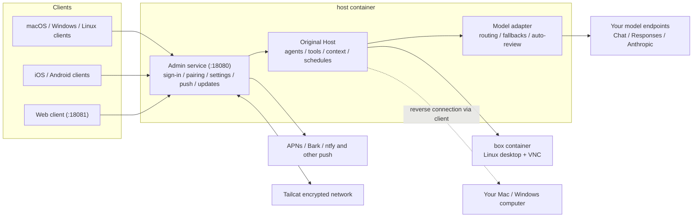

# Architecture Overview

[Back to Home](../README.en.md) · [简体中文](architecture-overview.md) · [Full Technical Architecture](ARCHITECTURE.en.md) · [Patching Workflow](PATCHING_WORKFLOW.en.md)

- **Host:** the original Node.js program. Only the parts tied to official services are replaced (authentication, agent identity, model calls and MCP configuration), and an admin service sits in front of it.
- **Execution computer:** the official Linux desktop image, running unchanged in Docker. Agents can also work on your own computer.
- **Clients:** the original interface is kept, and the patches make it connect only to your Host. Patches only copy and add bytes, and every segment checks the original file's hash first. Nothing is decompiled or rewritten.

See [`docs/ARCHITECTURE.en.md`](ARCHITECTURE.en.md) for the full design, feature comparison and directory layout, and [`docs/PATCHING_WORKFLOW.en.md`](PATCHING_WORKFLOW.en.md) for per-platform patch baselines and maintenance workflows.
