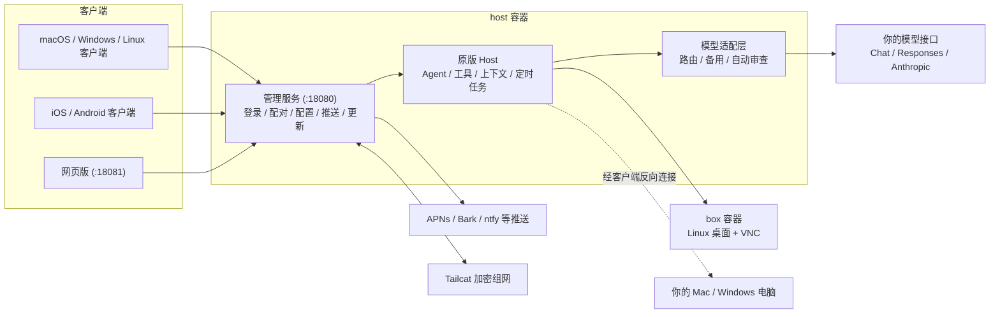

# 架构概览

[返回首页](../README.md) · [English](architecture-overview.en.md) · [完整技术架构](ARCHITECTURE.md) · [补丁维护流程](PATCHING_WORKFLOW.md)

- **Host**：原版 Node.js 程序，只替换和官方服务绑定的部分（身份验证、Agent 身份、模型调用、MCP 配置），外面加一层管理服务。
- **执行电脑**：官方 Linux 桌面镜像，原样运行在 Docker 里；也可以让 Agent 操作你自己的电脑。
- **客户端**：保留原版界面，补丁让它只连接你的 Host。补丁只做「复制」和「新增」两种操作，每一段都先校验原文件的哈希，不反编译、不重写原版程序。

更多实现细节、功能对照与目录结构见 [`docs/ARCHITECTURE.md`](ARCHITECTURE.md)，各平台补丁基线与维护流程见 [`docs/PATCHING_WORKFLOW.md`](PATCHING_WORKFLOW.md)。
