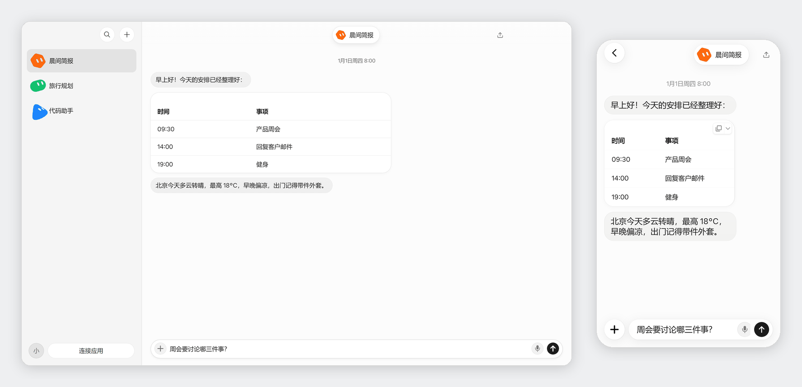

# RokBot 网页版

[English](README.en.md)

在浏览器里使用自己 Host 上的 Bot，电脑、手机、平板都可以，不用安装客户端。电脑和横屏平板是官方桌面版的排版，手机是官方手机版的排版。

界面和 Android 客户端相同，取自你自己下载的官方 Windows 安装包（推荐 1.2.3，用不了再用 0.71.2）。你在电脑上生成「界面包」，上传到自己的 Host；Host 只把它提供给用配对码登录的浏览器。本项目不分发界面包。

<p align="center"></p>

## 使用

需要：

- 已部署并且能打开管理页的 RokBot Host；
- 一台电脑（Windows、macOS 或 Linux），装有 Node.js 22.12+，并有完整的网页版工具包（含 `web/`、`windows/`、`mac/`）或完整的仓库。

### 1. 生成界面包

在仓库根目录执行：

```sh
node web/patchers/patch.mjs
```

工具自动下载并校验官方 `Grok_Bot_1.2.3_Setup.exe`（和 Windows、Android 客户端用的是同一个文件；可通过 `ROKBOT_DESKTOP_DOWNLOAD_BASE` 覆盖下载源），并打包 `assets/logo/rokbot-icon-256.png` 与 `assets/logo/rokbot-icon-512.png` 作为网页版应用图标，生成 `web/output/RokBotLocal-web-1.2.3.zip`。

1.2.3 的界面用不了时，加 `--version 0.71.2` 改用 0.71.2 的界面，或用 `--source` 指定已下载的 0.71.2 安装包，工具按摘要识别版本。

| 选项 | 作用 |
| --- | --- |
| `--source <文件或目录>` | 使用已下载的官方安装包、`app-64.7z` 或已安装的原版目录，按摘要识别是 1.2.3 还是 0.71.2 |
| `--version <1.2.3\|0.71.2>` | 选择界面版本。默认 1.2.3（推荐），用不了再用 0.71.2 |
| `--output <目录>` | 输出目录，默认 `web/output/` |
| `--force` | 覆盖已有的输出 |
| `--upload <Host 地址>` | 生成后直接安装到这台 Host 并启用网页版，见下一步 |
| `--password-file <文件>` | `--upload` 用的管理员密码文件 |
| `--verify-only` | 在临时目录核对原包、执行 Windows recipe、检查网页入口和界面补丁，不生成文件 |

### 2. 上传到 Host

任选一种：

- **管理页**：打开 Host 管理页的「网页版」，点「选择文件并上传」，选刚生成的 ZIP。网页版默认是启用的，上传完成后就能使用；只有管理员关掉过「启用网页版」才保持关闭。
- **命令行**：生成时加 `--upload`，例如 `node web/patchers/patch.mjs --upload https://bot.example.org`。管理员密码从环境变量 `ROKBOT_ADMIN_PASSWORD`、`--password-file` 指定的文件或终端输入读取，不写在命令行里。

Host 会按界面包里的清单逐个核对文件的大小和 SHA-256，核对不通过就不安装，原来的界面包保持不变。

**构建时内置**：在自己的机器上构建 Host 镜像时，可以把界面包直接打进镜像，不用再上传：`python3 host/release/build-docker.py --web-source windows/.cache/Grok_Bot_1.2.3_Setup.exe …`（或 `--web-bundle <已生成的 ZIP>`；`host/deploy.py up/update` 也接受这两个参数）。Host 启动时如果还没有上传过界面包，就安装镜像里的这一份，管理页显示「Host 内置」；换了带新界面包的镜像会自动换成新的。上传的界面包始终优先，删除上传的界面包后改用内置的。这样的镜像含有官方界面，只能自己用，不要推送到公开的镜像仓库；预构建的公开镜像不带界面包。

### 3. 登录

1. 在要使用的设备上用浏览器打开 `Host 地址/web/`，例如 `https://bot.example.org/web/`。管理页「网页版」里有这个地址，可以复制。
2. 在管理页「设备与通知」创建 6 位配对码，输入后登录。每个浏览器都要单独配对；配对码 5 分钟内有效，只能用一次。
3. 在管理页所在的浏览器上，直接点「网页版」页右上角的「在此浏览器打开」，不需要配对码。

登录后浏览器会记住这台设备（Cookie 有效期 400 天），关掉再打开不用重新登录。登录过的浏览器显示在「设备与通知」里，平台显示为「网页版」，可以单独撤销。

### 添加到主屏幕

网页版可以像应用一样从主屏幕打开，全屏显示，没有地址栏：

- **iPhone / iPad**：用 Safari 打开网页版，点「分享」→「添加到主屏幕」；
- **Android**：用 Chrome 打开网页版，点菜单 →「添加到主屏幕」或「安装应用」；
- **电脑**：Chrome 或 Edge 的地址栏右侧有「安装」按钮。

## 功能

- 官方桌面版的完整界面：对话、Bot 管理、技能、市场、资料库、例行任务、设置；中文和英文界面，深色模式跟随系统。
- **自适应排版**：
  - 电脑和横屏平板（宽度 792 像素以上）是官方桌面版的样子，侧栏和对话并排；
  - 竖屏平板和较窄的窗口，侧栏收起，需要时从左侧滑出；
  - 手机（宽度 600 像素以下）照官方手机版排版，和 [Android 客户端](../android/README.md#功能)一样：首页是 Bot 列表，点进去是全屏对话，菜单和对话框从底部弹出；
  - 浏览器的返回键和返回手势逐级返回：先关弹出的面板，再从对话回到 Bot 列表，最后才离开页面；
  - 手机键盘弹出时，输入框跟着上移，不会被挡住；iPhone 的刘海和底部横条留出安全区域。
- **Bot 的电脑**：对话详情里能看到 Bot 电脑的实时画面，打开大画面后可以用鼠标、键盘或触摸直接操作。
- 附件：从设备上选择文件上传（大文件分块），把 Bot 发来的文件下载到设备，全屏看图。
- **会话列表排列**：点会话列表顶部搜索按钮左边的铃铛按钮（手机宽度下是右上角新建按钮左边的铜铃按钮），或在设置 →「通用」→「会话列表」打开「按最后消息时间排列」后，Bot 和群组按最后一条消息的时间倒序，分为「待处理」（等你回答的问题、表单、审批卡片、接管请求，以及正在运行的）、「未读」「已读」三组，分组可折叠；再点一下或关闭开关即恢复默认排列。按钮选中时高亮，和设置里的开关同步。选择保存在这个浏览器里，电脑版同样适用。
- **应用内模型配置**：在网页端设置或引导横幅中直接查看、编辑、探测并测试 Host 模型配置（支持通过管理员密码二次验证提权保存）。
- 通知：网页开着时，没在看的 Bot 有新消息会弹出浏览器通知，点击直接打开对应的 Bot。正在看的 Bot 不重复通知。
- 链接 `Host 地址/web/?agent=<Bot ID>` 可以直接打开某个 Bot 的对话。

## 说明与限制

- **只使用 Host 上的 Bot 电脑**。网页版不能让 Bot 操作你正在用的这台设备，也不能在本机执行命令；需要这些功能请用 Windows 或 Mac 客户端。「教 Bot 做任务」（录制演示）不可用。
- **不支持 Tailcat**。外网使用请用 VPN、内网穿透或 HTTPS 域名。网页版只连接提供这个网页的 Host，要换 Host 就打开那台 Host 的网页版。
- **http 地址能用，但有几项功能需要 https**：浏览器只在 https（或本机 `localhost`）下开放麦克风、语音输入和通知，所以在 http 地址上这几项不可用，Bot 电脑的画面也会显示一行「未加密」的提示（不影响操作）。在公网使用一定要配置 https。
- **网页关掉后收不到通知**。需要后台通知时，用 Android / iOS 客户端，或在管理页配置 Bark 推送。
- 浏览器要求：Chrome、Edge、Firefox、Safari 的较新版本。iPhone 和 iPad 上所有浏览器都使用 Safari 的内核，表现与 Safari 相同。
- 设置和界面状态保存在浏览器本地；换一个浏览器或清除网站数据后，设置会恢复默认（对话和 Bot 都在 Host 上，不受影响）。清除网站数据也会清掉登录状态，需要重新配对。

### 测试情况

每次发布前用 Playwright 在 8 种模拟设备尺寸上跑完整流程（Windows 的 Chromium 和 Firefox、Mac 的 WebKit、Android 手机和平板、iPhone 15、iPhone SE、iPad Pro 横屏），1.2.3 和 0.71.2 两种界面都测。另在真实服务器上验证过上传、局域网 http 登录、真实模型对话和 Bot 电脑的实时画面。没有在真机浏览器上测过，遇到问题欢迎[提交 Issue](https://github.com/hongfaqiu/rokbot/issues)。

## 安全

- 界面包只保存在你的 Host 上。没有登录的访问者只能看到登录页，拿不到界面包里的任何文件。
- 登录凭据是一个 HttpOnly、SameSite=Strict 的 Cookie，网页脚本读不到；https 下还会加 Secure。只有带着这个 Cookie、并且来自同一个网址的请求才能调用 Host。
- 每个浏览器是一台独立的设备，可以在「设备与通知」里撤销。网页版的设备没有桌面执行权限。
- 登录接口有频率限制，配对码 5 分钟过期、只能用一次。

## 更新与删除

- **更新界面**：重新生成界面包并上传，新包整体替换旧包，已经登录的浏览器不用重新配对，刷新页面即可。升级 RokBot 后，用同一版本的工具重新生成界面包。
- **暂停**：在管理页「网页版」关掉「启用网页版」。界面包保留，已登录的浏览器暂时打不开网页版。
- **删除**：点「删除界面包」删除上传的界面包。镜像内置了界面包时改用内置的，否则网页版无法使用。内置的界面包不能删除，不想用时关掉「启用网页版」。已登录的浏览器仍列在「设备与通知」里，可以在那里撤销。

## 常见问题

| 现象 | 处理 |
| --- | --- |
| 打开 `/web/` 显示「网页版还没有启用」 | 在管理页「网页版」上传界面包，并打开「启用网页版」 |
| 上传时提示「界面包格式不受支持」 | 界面包和 Host 不是同一版本的工具生成的。用与 Host 相同版本的工具包重新生成 |
| 生成时提示摘要不匹配 | 只支持未经修改的官方 Windows x64 1.2.3 或 0.71.2 安装包。省略 `--source` 让工具自动下载 |
| 配对码提示无效 | 配对码 5 分钟过期、只能用一次。在「设备与通知」重新创建 |
| 页面突然回到登录页 | 这个浏览器在「设备与通知」里被撤销了，或者清除了网站数据。重新配对即可 |
| 麦克风、语音输入、通知不能用 | 当前是 http 地址。改用 https 地址打开 |
| 改了 Host 的域名或端口 | 登录凭据只对原来的网址有效。在新网址上重新配对 |

## 维护

- `client/` 存放网页版自带的浏览器端代码与桥接脚本（`native.js`、`web-shell.js`、`boot-data.js`、`web.css`、`bridge.js`、`gateway.js`、`services.js` 等）；`patchers/` 负责生成和上传界面包；Host 端是 `host/server/web-client.mjs`。
- 实现原理见[技术文档](../docs/ARCHITECTURE.md#web-client)，测试命令和需要的环境变量见[测试与维护](../docs/ARCHITECTURE.md#testing)。

## 许可与支持

仅限非商业使用，见 [LICENSE](../LICENSE)。项目仓库：<https://github.com/hongfaqiu/rokbot>。本项目多数代码由 AI 辅助编写。生成的界面包含有官方程序的界面，只能装在你自己的 Host 上，不要公开分享。
